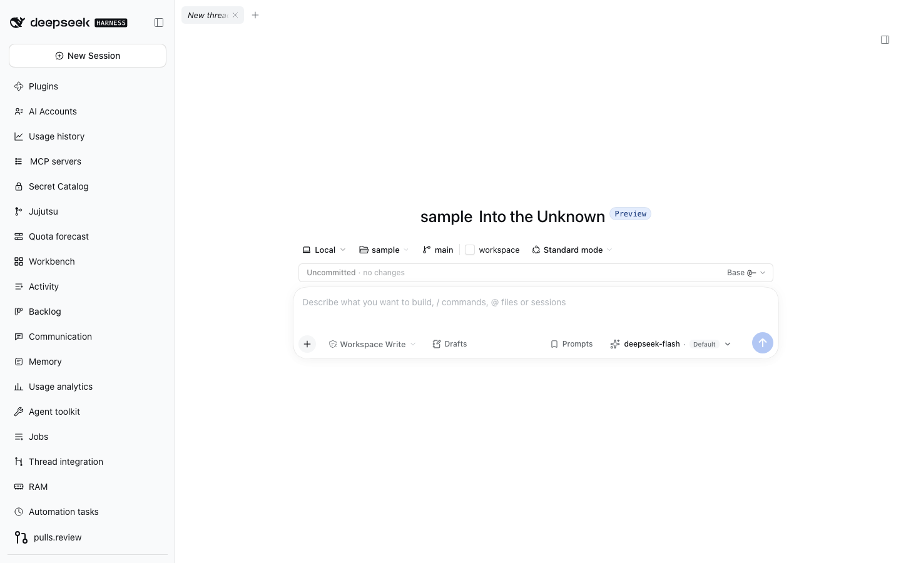
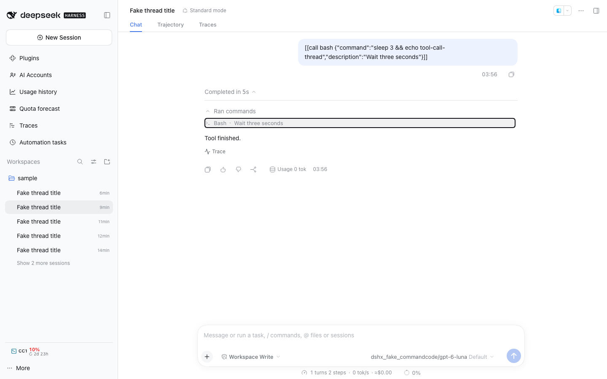
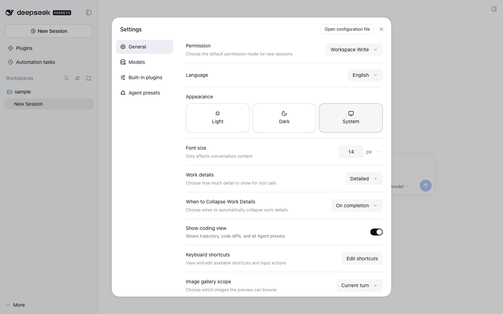

# @dshfiles/chat

Owned fork of DSH's native Chat client plugin. It keeps the native transcript, its Slots, renderers, settings and
scroll behaviour, and mounts only the newest transcript rows plus the ones the reader scrolls up to (see Local delta):
on the live profile a single thread used to mount up to 42k DOM nodes on open.

## Upstream and license

- Upstream: [`deepseek-ai/deepseek-harness`](https://github.com/deepseek-ai/deepseek-harness)
- Package: `@deepseek-ai/dsh-client-ui-chat@0.2.1-rc.2` (MIT, [LICENSE](./LICENSE))
- Pinned revision: tag `dsh-v0.2.1-rc.2`
- Vendored source: [`src/native`](./src/native) is upstream `packages/client/ui-chat/src/client`;
  [`src/chat-settings.ts`](./src/chat-settings.ts), [`src/host.ts`](./src/host.ts) (upstream `src/index.ts`),
  [`src/css-modules.d.ts`](./src/css-modules.d.ts) and [`locale`](./locale) keep the upstream relative layout.

### Why a whole-package fork

The `conversation.chat.flow` Slot's data hooks (`useChat`, `useChatNode`, …) come from the package-private
`nodeSources(binding)` injection of the native registration, and `ChatView`'s scroll hook measures the flow's
rendered rows. A separate Slot occupant cannot rebuild either, so this package replaces the `ui-chat` Loader row:
its `cordis.patch.yml` disables `ui-chat` and inserts `dshfiles-chat`.

### Local delta

Every other vendored file is byte-identical to the pinned revision.

| File                                            | Change                                                                                                                                                                                                                                                                                                                                                                                                                                                           |
| ----------------------------------------------- | ---------------------------------------------------------------------------------------------------------------------------------------------------------------------------------------------------------------------------------------------------------------------------------------------------------------------------------------------------------------------------------------------------------------------------------------------------------------- |
| `src/chat-settings.ts`                          | `CHAT_SETTINGS_NAMESPACE` is `dshfiles-chat`, the replacement row's id; the saved image gallery scope defaults to the current Turn and can include the full thread                                                                                                                                                                                                                                                                                               |
| `src/host.ts`                                   | exposes the gallery scope as a volatile setting that the client can read and update immediately                                                                                                                                                                                                                                                                                                                                                                  |
| `src/native/apply.ts`                           | `apply` takes the dshx client decorator and hands it to the node-renderer registration, so a native node view can sit in this plugin's own client tree; it also wires the live image-gallery scope into Chat and its General settings row                                                                                                                                                                                                                        |
| `src/native/chat/register-node-renderers.ts`    | applies that decorator to the `turn-error` node renderer only: the inline **Resume** button reads the interruption API through the plugin's API context, and the renderer declares the `conversation.chat.turnErrorAction` child seat                                                                                                                                                                                                                            |
| `src/native/chat/MessageItem.tsx`               | `TurnErrorItem` renders the `action` node it is handed, which is where that **Resume** lands, plus the `extraActions` that seat contributes beside it                                                                                                                                                                                                                                                                                                            |
| `src/native/contract/slots.ts`                  | declares `conversation.chat.turnErrorAction` through its own contract module, so a feature plugin can fill it without importing the whole Chat contract; exposes the live gallery-scope hook to Chat views                                                                                                                                                                                                                                                       |
| `src/turn-error-action.ts`                      | new: the published `@dshfiles/chat/turn-error-action` contract — the seat's owner props and its `SlotMap` entry                                                                                                                                                                                                                                                                                                                                                  |
| `src/native/chat/MessageIconActions.tsx`        | `window.setTimeout` → `setTimeout`: this repository type-checks with Node timer types, under which the ref's `ReturnType<typeof setTimeout>` is not a number                                                                                                                                                                                                                                                                                                     |
| `src/native/chat/ChatGroupSeat.tsx`             | a collapsed process group mounts its members the first time its body shows and keeps them; a collapsed historical Turn used to mount every tool row hidden (1k–7k DOM nodes per group on the live profile). Browser find no longer reveals text inside a group never opened                                                                                                                                                                                      |
| `src/native/chat/ChatView.tsx`                  | mounts the rows `useTranscriptWindow` selects; the scroll hook gets the mounted order, first sequence and window-aware `hasMore`/`loadOlder`/`loadThrough`; an `OlderRowsSentinel` mounts older rows near the top; Markdown and tool-row image paths open the shared image lightbox, where the default current-Turn gallery can be widened to the full thread, loading older history when needed; expanded tool results retain their captured attachment gallery |
| `src/native/chat/markdown-image-links.ts`       | new: routes local and HTTP(S) image links to the lightbox while preserving existing file and web handling for non-images; passes local paths so the preview can select the matching gallery entry                                                                                                                                                                                                                                                                |
| `src/native/locale.ts`                          | adds localized image-gallery navigation labels and gallery-scope setting labels                                                                                                                                                                                                                                                                                                                                                                                  |
| `src/native/conversation-nodes/README.md`       | records the answer-selection rule below as the conversation-node contract: the earliest settled reply of the trailing run is the answer                                                                                                                                                                                                                                                                                                                          |
| `src/native/conversation-nodes/turn-error.ts`   | a turn ended as aborted because the Host disposed its Agent (a restart) shows "DSH restarted before this turn finished" with code `INTERRUPTED`, like a crash-closed turn, instead of the plain stopped summary                                                                                                                                                                                                                                                  |
| `src/native/conversation-nodes/turn-process.ts` | the folded answer is the earliest settled reply of the trailing run, where a tool call between two replies starts a new run: a notice-triggered acknowledgement stays visible after the answer instead of replacing it, and a tool call arriving later never moves the boundary by itself                                                                                                                                                                        |
| `src/native/conversation-nodes/turn-tail.ts`    | an open Turn with no `turn/end` yet also yields a tail with `closing: null`, so extension rows under `conversation.chat.turnTail` show while the Turn streams and no per-message actions appear                                                                                                                                                                                                                                                                  |
| `src/native/chat/image-gallery.ts`              | new: gathers image attachments and resolvable `read_image` paths from loaded Chat nodes, then selects the clicked image's Turn or the loaded thread for the shared lightbox                                                                                                                                                                                                                                                                                      |
| `src/native/image-gallery-scope.ts`             | new: reconciles the saved scope with accepted Host settings and publishes changes immediately to the view                                                                                                                                                                                                                                                                                                                                                        |
| `src/native/settings/ImageGalleryScopeRow.tsx`  | new: General settings row for choosing current-Turn or thread gallery scope                                                                                                                                                                                                                                                                                                                                                                                      |
| `src/transcript-window.ts`                      | new: which rows are mounted (latest 24, +24 per step, anchored by the first mounted row's identity, widened to a restored anchor or a Turn jump before the Host is asked for older pages)                                                                                                                                                                                                                                                                        |

                                                                                                                                                                                                                 |

| `src/client-entry.tsx` | new: dshx client entry calling the native `apply`; provides the dshx `Browser` contract over the Host browser page and adds an **Open web page…** action to the Workbench New tab chooser while that page type exists |
| `src/chat-focus.ts` | new: the published `@dshfiles/chat/chat-focus` contract — a Turn/Step/tool-call focus, its opaque view-request encoding, and the cross-thread pending request (below) |
| `src/chat-focus-reveal.ts` | new: takes a focus from the native `viewRequest` or the pending request, jumps with the rail's `navigateToTurn`, opens folded groups with `beforematch` and highlights the row |
| `src/native/chat/ChatView.tsx` (also) | reads the native `viewRequest`/`completeViewRequest`/`openView` Conversation View props, runs `useChatFocus`, and provides `openView` to the Turn-tail seats |
| `src/native/chat/ChatNodeSeat.tsx` | tags each row with `data-chat-step`, so a Step focus can find it (a tool row already carries the native `data-chat-call-id`) |
| `src/native/chat/TurnTailNodeView.tsx` | adds the thread's `openView` to every `conversation.chat.turnTail` entry's owner props (`ChatTurnTailExtras`) |
| `src/native/contract/slots.ts` (also) | `TurnTailOwnerProps` extends `ChatTurnTailExtras` |
| `src/native/chat/AssistantMarkdown.tsx` | rewrites links whose scheme a dshx `LinkHandler` claims before `MarkdownText`, which keeps only http(s) and mailto hrefs, and routes clicks on them to the handler (`MarkdownLinks.openFromClick` on the root's click and aux-click capture) |
| `src/native/chat/ChatView.module.css` | outlines (inside its box, so a folded group's scroll body does not clip it) and tints the row carrying `data-chat-focus` |
| `src/native/conversation-nodes/tool.ts` | a call whose tool name a `PinnedToolCalls` provider registered gets group-tree position `turn`, so it stays visible outside the completed Turn's fold and splits the step group around it |
| `src/pinned-tool-calls.ts` | new: the published `@dshfiles/chat/pinned-tool-calls` registry token |
| `src/pinned-tool-names.ts` | new: the registered names, set from `client-entry.tsx` and read synchronously while tool nodes build |

### Focus a Turn, Step or tool call from another plugin

`@dshfiles/chat/chat-focus` is how a plugin scrolls Chat to one Turn (`{ turn }`), Step (`{ turn, step }`) or tool call
(`{ turn, step, toolCallId }`) and highlights it — the traces plugin's **Show in chat** uses it.

- Inside the thread, a `conversation.view` entry calls the native `openView(CHAT_VIEW_ID, encodeChatFocus(focus))` it
  is handed: the shell selects Chat, which consumes the `viewRequest`. A Turn-footer entry
  (`conversation.chat.turnTail`) gets the same `openView` in its owner props, for the opposite direction.
- From outside it (a sidebar panel), call `requestChatFocus({ sessionId, focus })` right after
  `uiWorkspace.openSession`. The request waits up to 30 s for that thread's Chat to mount; a view of ours that the thread
  reopens on instead forwards it with `takeChatFocus` and `openView`.

Chat jumps through the turn rail's navigation (unloaded history pages in), opens the folded process group with the
`beforematch` event browser find uses, scrolls the row to the middle and outlines it for 4 s. A tool call or Step that
never appears within 4 s lands on its Turn.

The latest **Task stopped** or **Turn error** notice from a turn a restart cut
off, or whose model request failed (upstream outage, rate limit, transport),
offers an inline **Resume**; a signed-out account does not while that turn remains latest, idle, and writable. Older
notices remain historical. The action uses the owned session-controller's
`interruption-api` contract; an older Host without that API hides the action.
Resume sends a continuation prompt, never blindly replays unfinished tools.

### Keep a tool call visible after its Turn completes

A tool whose call is the Turn's deliverable (an `html_render` page) registers its name with
`api.add(PinnedToolCalls, { toolName })` from `@dshfiles/chat/pinned-tool-calls`. Chat builds that call's node at
group-tree position `turn` (like a turn error): it never joins a step group and stays out of the "Completed in" fold in
every work-details mode. Without providers nothing changes. A name registered after a thread's nodes were built applies
from their next rebuild (a new event on the call or reopening the thread).

### Build

The native build loads `@deepseek-ai/dsh-client-store`, `@deepseek-ai/dsh-client-ui-primitives`,
`@tanstack/react-virtual` and React from the module table and inlines everything else; `dshx.config.ts` mirrors
that (`bundleDependencies`), and `dist/client.js` requires exactly the same modules.

### Updating upstream

1. Diff upstream `packages/client/ui-chat/src` at the new release tag against the pinned tag.
2. Copy the new files over `src/native` and the root files above, then re-apply the delta table.
3. Build, type-check, run `pnpm test:boot` and the chat e2e journeys.

## Rollout

The settings namespace moves from `ui-chat` to `dshfiles-chat`, so a profile that set Chat preferences on the
`ui-chat` row (for example `transcriptView`) needs them set again in Settings → Chat, or on the `dshfiles-chat` row.an `OlderRowsSentinel` near the top mounts older rows, then requests older Host pages, once the reader leaves the tail or reads upward (wheel, key, scroll), and for at most three steps while the rows do not fill the view, so opening never pages in the whole history; the "Load earlier" button is gone
