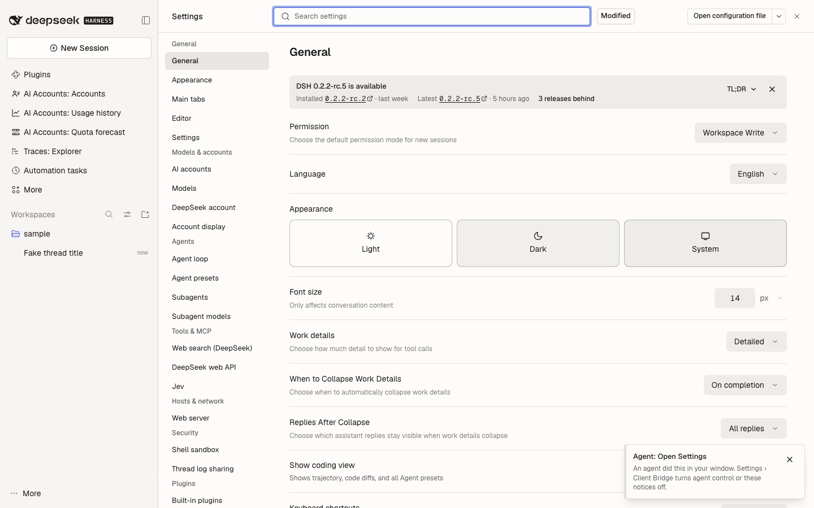

# @dshfiles/client-bridge



Agents run on the DSH Host, so a Host tool cannot open Settings or a tab in the user's browser. This plugin lets them:
the plugin that owns a browser action declares it as a **client tool**, and the bridge carries the Agent's call to the
user's window and the result back.

> "Open a new tab on Settings › Plugin Market" → the Agent calls `client_tool_call { tool: "settings_open", input:
{ section: "market" } }`, Settings opens at Plugin Market in your window, and a notice says an agent did it.

## Agent tools

| Tool                | What it does                                                                                                                                                                                                                                                                                                                      |
| ------------------- | --------------------------------------------------------------------------------------------------------------------------------------------------------------------------------------------------------------------------------------------------------------------------------------------------------------------------------- |
| `client_tools_list` | Read-only. The open DSH windows, best first: `clientId`, label (`Chrome on macOS`), focus, the thread it shows (`showsYourThread`), and the client tools it offers with their input JSON Schema.                                                                                                                                  |
| `client_tool_call`  | Runs one client tool, or a chain with `steps` (see below). `tool`, `input`, optional `clientId` (else: the focused window showing the Agent's thread, then any focused window, then the most recent) and `timeoutMs` (1–60 s, default 10 s). Returns the window, the tool and its JSON result, or a refusal that says what to do. |

The Agent decides which window when several are open: `client_tools_list` gives it what it needs, and `clientId`
targets one.

## Chaining actions

Two ways, depending on what the chain needs.

**`steps`: a fixed sequence, no code.** Pass `steps` instead of `tool`/`input`: up to 20 calls run in order in one
window, in one round trip, under the same timeout. The window stops at the first failure and the Agent is told which
step failed, why, and what already ran (the earlier steps' effects stay); the result lists each step's tool and result.
One notice names every page-changing step that ran.

```json
{
  "steps": [
    { "tool": "tabs_open", "input": { "target": { "kind": "panel", "panelId": "dshfiles-settings" } } },
    { "tool": "settings_open", "input": { "section": "Plugin Market" } }
  ]
}
```

**Code Mode: loops and conditions.** A thread on DSH's **PTC mode** preset (Settings › General › Show coding view,
then Agent presets, or the agent-mode chip of a new thread) calls tools from one `run_code` TypeScript program. Both
bridge tools are in its SDK, so a program can read the windows, branch on what they show and chain calls:

```ts
const { windows } = await tools.client_tools_list({})
const mine = windows.find(window => window.showsYourThread) ?? windows[0]
const done = await tools.client_tool_call({ clientId: mine.clientId, steps: [/* … */] })
return done.steps.map(step => step.tool)
```

With `@dshfiles/tool-search` in cache-safe mode, this needs its `codeModePresets` (default `[ptc]`) so the preset keeps
its PTC executor, and the two bridge tools in `alwaysVisible` (the default); see the
[tool-search README](../tool-search/README.md#code-mode-presets). Every nested call keeps its own `execute_tool` span
under `execute_tool run_code`.

## Client tools today

| Owner                                  | Tools                                                                                                                             |
| -------------------------------------- | --------------------------------------------------------------------------------------------------------------------------------- |
| [settings-shell](../settings-shell/)   | `settings_sections` (read-only: every Settings entry id and label), `settings_open` (`section` by id or label, `target`, `query`) |
| [main-tabs](../main-tabs/)             | `tabs_list` (read-only), `tabs_open` (a thread or main panel, new tab by default), `tabs_focus`                                   |
| [command-palette](../command-palette/) | `palette_commands` (read-only: the commands available where the user is), `palette_run` (`id`, `confirm: true`)                   |
| [editor](../editor/)                   | `editor_files` (read-only: open files, active first), `editor_open_file` (`path`, `line`)                                         |
| [workbench](../workbench/)             | `workbench_panels` (read-only), `workbench_open_panel` (`panelId`, `region`)                                                      |
| [chat](../chat/)                       | `browser_open` (`url`, in the browser pane beside the thread)                                                                     |

## Declaring a client tool in another plugin

The bridge declares no action of its own: the plugin that owns the behavior adds it, next to the code that already does
it, so the two cannot drift.

```ts
import { ClientTools, defineClientTool } from '@dshfiles/dshx/client'
import * as Schema from 'effect/Schema'

plugin.add(
  ClientTools,
  defineClientTool({
    name: 'my_panel_open', // lower-case, digits, `_`
    title: 'Open My panel', // shown in the notice
    description: 'Open My panel in the user’s window. Call only when the user asked.',
    readOnly: false,
    input: Schema.Struct({ id: Schema.String }),
    execute: input => openMyPanel(input.id), // the same function the UI calls; its JSON result goes back
  }),
)
```

The registry lives in dshx, so the owner does not depend on this plugin; without the bridge its tools simply wait unused.
The input is validated against the schema before `execute` runs; a throw becomes the Agent's error message, so make it
say what to change. Writes say "Call only when the user asked"; destructive verbs need an explicit opt-in argument (see
[agent tool parity](../../docs/agent-tool-parity.md#client-tools-agent--browser-window)).

## Settings

Settings › Client bridge (`dshfiles-client-bridge`), applied live:

| Key       | Default | Effect                                                                                   |
| --------- | ------- | ---------------------------------------------------------------------------------------- |
| `enabled` | `true`  | Off refuses every `client_tool_call`, with a message naming this setting.                |
| `notify`  | `true`  | A notice in the window names each page-changing action an Agent ran. Reads never notify. |

## How it works

1. **Presence.** Each window announces itself (`client-bridge/announce`): a random id per page load, focus, visibility,
   the thread `SessionScreen` says is on screen, and the descriptors of every `ClientTools` item. It re-announces on any
   change, every 30 s, and when the event stream comes back after a Host restart; it calls `leave` on `pagehide`. The
   Host keeps windows in memory and forgets one silent for 90 s.
2. **Call.** `client_tool_call` picks the window, registers a pending call, and publishes the `invoke` event with a
   request id and the current `traceparent`. Every window receives the event; all but the addressed one ignore it
   (client-side filtering, P0).
3. **Run.** The window validates the input, runs the tool with an abort signal bounded by the timeout, shows the notice
   for a write, and replies through `client-bridge/complete`. The Host accepts the reply only from the addressed window.
   A window that leaves fails its pending calls at once; a silent one times out.

## Tracing

Each call is one trace:

- `execute_tool client_tool_call` (automatic, agent-telemetry), with the Agent's input and result in the transcript;
- `client-tool invoke` (Host, this plugin): tool name, caller kind, window focus, whether it showed the Agent's thread,
  outcome;
- `client-tool execute` (browser, `dshfiles-web`), continuing that span from the `traceparent` in the event, with one
  `client-tool step` child per step and the `client-tool reply` child, whose `client-bridge/complete` call carries the trace back to the Host's dispatch span.

Spans carry identities and outcomes only, never the tool's input or result.

## Limits (P0)

- Every window receives every `invoke` event and filters by `clientId`; a targeted Host → browser publish belongs in dshx.
- Presence is in memory: a Host restart forgets windows until they re-announce (within seconds of reconnecting).
- Command-palette actions are not yet offered as client tools.

## Restart

New plugin: Host and client halves arrive together, so the first install needs a **DSH restart**. Client-only changes
afterwards (a new tool in settings-shell or main-tabs) hot-reload.
