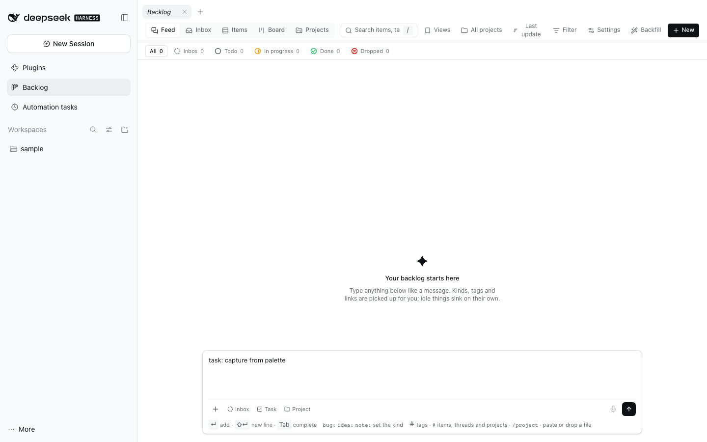
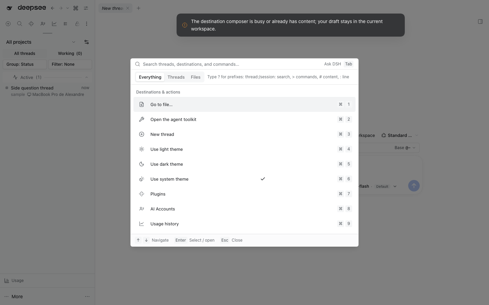

# Command Palette





The app-wide searchable palette lives in this plugin and mounts into DSH's additive `shell.overlay` slot. It owns the UI, keyboard shortcut, action registry, thread/file/content search, and global theme/workspace actions. Thread Sidebar contributes sidebar navigation and actions for the currently open thread.

Type `<` to switch into **Backlog** capture, then Enter opens the full Backlog composer with the typed draft carried over. The composer keeps its attachments, `@` mentions, tags, and link support; the Backlog plugin is required for the handoff.

## Threads tab scope

The **Threads** tab lists the current project's threads, its JJ thread
workspaces included; **Everything** still searches every project, and a session
ID or link finds any thread. Settings › Command palette › `threadsScope`
switches the tab to `all` projects. Without a current project it lists them all.

## Ask DSH

On an empty search the palette shows **Ask DSH** with a `Tab` keycap. Tab (or a click on the hint) swaps the
search box for a one-question ask bar; Enter, or clicking the `Ask DSH: <question>` row, creates a **fresh
thread** with the question as its first message and opens it in the main view. The thread is titled
`Ask DSH · <question>` so asks group together in the sidebar (the title is best-effort; a failed rename
logs a warning and the question still sends). The thread lands in the project
the main view shows, including the project a blank New-thread screen has picked; with no project picked it uses
the Host default directory. It always creates a thread (the Host only reuses a blank Session when the request
names one), so an open New-thread screen is never taken over. A failed send keeps the palette open with the
typed question and an explanation; Escape first clears the question, then returns to search.

The quick chat runs the default Agent preset: it answers about DSH itself and operates it through the tools the
thread already has, and the normal composer carries follow-up questions. Prefixes are plain text inside the ask
bar, and recent asks are ordinary threads (searchable with `thread:`).

## Contribute a command

The simplest way: add a dshx `Command` from any Client plugin, with no dependency on this package. The palette lists it under Commands and `@dshfiles/shortcuts` binds its `keys`:

```ts
import { Command, defineClientPlugin } from '@dshfiles/dshx/client'

export default defineClientPlugin({
  id: 'example',
  setup(api) {
    api.add(Command, { id: '@dshfiles/example.open', title: 'Open example', keys: ['Mod+Shift+E'], run: () => openExample() })
  },
})
```

The id must start with the package scope. `hidden` keeps it out of the palette (its keys still work); `enabled: false` greys it out and turns its keys off; a `run` that returns `false` from a key press lets the key through.

## Register an action from a Client plugin

For rows that need the palette's thread and workspace context, add `@dshfiles/command-palette` as a workspace dependency, then import `registerPaletteAction` from `@dshfiles/command-palette/api`:

```tsx
ctx.effect(
  () =>
    registerPaletteAction({
      id: '@dshfiles/example/open-panel',
      label: () => translate('openPanel'),
      aliases: ['panel', 'workspace'],
      isAvailable: context => context.thread !== null,
      run: context => openPanel(context.thread?.id),
    }),
  'example: command palette action',
)
```

IDs must begin with the registering plugin's scope (`@scope/plugin/...`). `context` is a read-only snapshot of the active thread (ID, title, cwd, workspace ID, pinned, archived, unread), active workspace, available workspaces, and theme preference; it intentionally contains no Service objects. Labels can be functions for localization. `isAvailable` and `isSelected` receive that context. The `command` group appears under Commands; other groups appear under destinations/actions. `keys` adds keycaps. `run` may return a promise; the palette closes on success and shows an error notice on failure. Tie the registration disposer to the contributor's Client lifecycle with `ctx.effect`.

The API uses a versioned browser-local registry, not a Cordis Client Service. Contributors don't inject or wait for the palette provider; they only depend on its public API contract. If the palette is not installed, registrations are inert.

## Build and verify

```sh
pnpm typecheck
pnpm test
pnpm build
fnm exec --using=22.23.3 node -e "import('./dist/index.js')"
```
