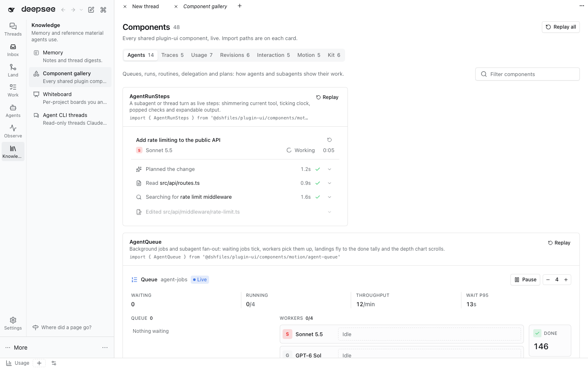

# @dshfiles/component-gallery



One page that renders every shared `@dshfiles/plugin-ui` component live: the animated agent, trace, usage, revision
and interaction components, the motion primitives and the base kit. Open **Knowledge › Component gallery** from the
sidebar. Tabs switch categories; the filter matches titles, descriptions and import paths; **Replay** restarts one
card and **Replay all** restarts the page. Each card shows the import a plugin writes to use the component.

It is not Storybook: no stories format, no addons, no separate server. A demo is a plain entry in
`src/demos/<category>.tsx`; the component itself always lives in `@dshfiles/plugin-ui`, so the gallery never owns UI
another plugin needs.

## Add a component

1. Write it in `plugins/@dshfiles/plugin-ui/src/components/motion/<name>.tsx` (or `components/` for a static one),
   props-driven, animating only through `@dshfiles/plugin-ui/motion` so reduced motion is respected.
2. Add a `GalleryDemo` to the category file in `src/demos/` with `id` (unique across tabs), `title`, a one-sentence
   `description` of where it fits in DSH, `source` (the import line) and `render()`. Simulated live data (timers,
   scripted loops) belongs in the demo, not the component.
3. New category: add a file and register it in `src/demos/index.ts`.
4. Rebuild `@dshfiles/ui-styles` (new classes) and this package.

## Verify

```sh
pnpm --dir plugins/@dshfiles/component-gallery test
pnpm --dir plugins/@dshfiles/component-gallery typecheck
pnpm check:e2e component-gallery
```

Client-only: it starts no Host work and stores nothing; leaving the page stops every demo.
