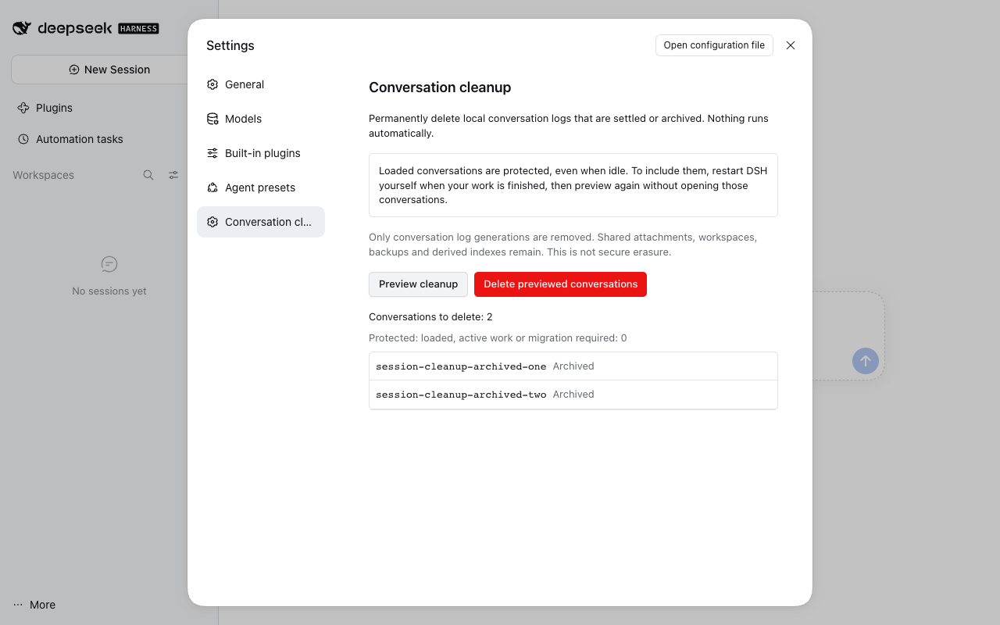

# Thread cleanup



Optional bulk cleanup of **done (settled) OR archived** local threads. Nothing runs automatically.

## Use

1. Install this bundle with `pnpm profile:sync --profile <name> --bundle @dshfiles/conversation-cleanup` or `dshx add @dshfiles/conversation-cleanup --profile <name>`, then load its Host half with a user-managed restart if required. The `dshx add` route also writes the profile row. A Plugin Manager local package install skips that row. It is not enabled in the shared Web profile.
2. Open **Settings → Thread cleanup → Preview cleanup**.
3. Inspect the listed threads (by title, or Untitled thread · project; the thread id is in each row's tooltip). Export anything worth keeping using DSH's thread export before continuing.
4. Choose **Delete previewed threads**, then **Permanently delete**. Cancel changes nothing.
5. Read the per-thread receipt. Preview again for another batch when more than 200 threads qualify.

**Deletion is irreversible.** Only canonical local JSONL log generations are deleted. Shared attachments, workspaces, backups, sidecars and derived search/memory/usage indexes remain. This is not secure erasure or a data-retention compliance feature. Those other owners may retain copies or excerpts; this plugin does not claim to erase them.

## Protected conversations

A loaded Session or Agent is never deleted, even when idle. The native `workspace/session-activity` providers also protect conversations with jobs, schedules or other reported activity. No turns, jobs or other work are stopped. To include those conversations, finish work and restart DSH yourself, then preview without opening those conversations first. Historical logs that need migration are protected too: open/migrate them through DSH, then restart and preview again.

Only the exact snapshot in a single-use, ten-minute preview can be processed, and only by the caller that created it: the owner's Settings UI, each agent Session and each plugin keep their own latest preview. A new preview from the same caller replaces its previous one. Each conversation's lifecycle and storage revision are rechecked before deletion. A changed, reopened, loaded or absent conversation is skipped. A competing writer causes a per-item failure, not forced ownership. A failed item may have lost historical generations already; its current log is removed last. Generate a fresh preview after inspecting a failure.

Archive and settled markers remain with their existing owners; they do not recreate a missing conversation log. Other windows or derived indexes can keep stale rows until they refresh/reconcile.

## Supported storage and safety boundary

This is a **plugin-owned, version-pinned filesystem operation**, not an invented native delete API or a DSH core patch. Supported: stock `@deepseek-ai/dsh-session-persistence-jsonl` **0.2.1-rc.2**, current Session format **v4**, macOS/Linux, one configured local root. Package engine and peer constraints deliberately do not admit another release. Do not exempt the plugin from these constraints. Remote hosts and other persistence providers are out of scope.

The Host reads the backend's resolved active configuration and obtains `sessionPersistence.open(id, 'write')` for each target. This takes both the backend's in-process writer claim and its kernel write lease. The native resume path takes that lease before publishing a Session. The plugin checks for attached Sessions and Agents again after acquisition.

The filesystem adapter reproduces the pinned backend's path encoding and current-file revision (`dev`, `ino`, `size`, nanosecond `mtime` and `ctime`); the computed file must match the previewed native revision. It refuses directory/file symlinks, ambiguous current encodings, future generations and paths without a current log. It validates the inventory before deleting, removes historical generations first and current format last, syncs the directory before and after removing the current generation, and **never removes the directory or `session.lock` inode**. The native writer is closed without appending or recreating logs.

The storage tree must be trusted against hostile local filesystem mutation. These path-based APIs do not provide an `openat`/directory-descriptor transaction against another OS user renaming directories during deletion. Kernel leases protect cooperating DSH writers, not arbitrary filesystem tools. Stop any manual storage migration before using cleanup.

Path/revision encoding adapted from DeepSeek's MIT-licensed `dsh-session-persistence-jsonl` 0.2.1-rc.2. Original upstream: <https://github.com/deepseek-ai/deepseek-harness/tree/main/packages/session/session-persistence-jsonl>. No private package subpaths are imported.

## Agent tools

- `conversation_cleanup_preview`: read-only preview with eligible IDs, protected count and remaining count. Any caller may preview, so any agent, including delegated or restricted ones, can list the Session IDs of settled or archived conversations across projects. Preview grants no deletion right.
- `conversation_cleanup_delete`: same Host operation; requires the exact `previewId` and explicit `confirm: true`. Call only after the user asks for and confirms permanent deletion. Only the authenticated owner (Settings) bypasses the agent rules. Agent calls require an attached root conversation with native `danger-full-access` policy; missing policy, restricted modes and child/fork sessions are refused. Plugin callers are always refused with `cleanup-forbidden`.

Previews are kept only in bounded plugin memory, one per caller. They expire after ten minutes, on Host restart or on plugin unload; no stale request is automatically replayed.

## Verification

From the repository root:

```sh
pnpm --dir plugins/@dshfiles/conversation-cleanup typecheck
pnpm --dir plugins/@dshfiles/conversation-cleanup test
pnpm --dir plugins/@dshfiles/conversation-cleanup build
pnpm check:e2e conversation-cleanup --force
```

Tests use real temporary files and the real native JSONL persistence provider. Browser journeys use an isolated scratch home, never the running personal DSH or existing conversations.
