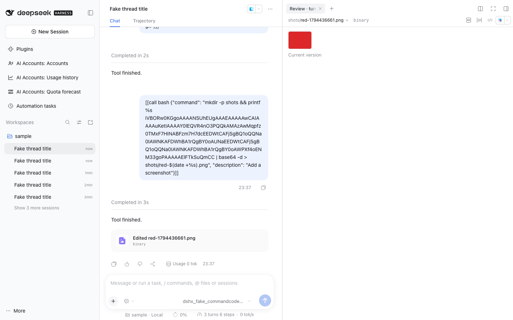

# Deliverables



Owned whole-package fork of `@deepseek-ai/dsh-client-ui-deliverables` from stock DSH **0.2.2-rc.1**, tag
`dsh-v0.2.2-rc.1`, upstream
[`packages/client/ui-deliverables`](https://github.com/deepseek-ai/deepseek-harness/tree/dsh-v0.2.2-rc.1/packages/client/ui-deliverables).
The original MIT notice is retained in [LICENSE](LICENSE).

It renders the turn's "Edited N files" card, the changed-files review tab, the delivery cards and the closing-prose
file mentions, exactly as the native row does.

## Why fork the native row?

The card and the review tab answer every binary file with "Binary file; changes cannot be shown", and the comparison
component and its routes are private to the package: no slot reaches them.

## Composition

[cordis.patch.yml](cordis.patch.yml) disables stock Loader row `ui-deliverables` and inserts `dshfiles-deliverables`.
Both halves are forked: the Host half registers the same routes and system-prompt section as the native one.

## Native delta and updates

Provenance and path mappings live in [native-fork.json](native-fork.json). Vendored files stay byte-identical except
the recorded delta.

| File                                                                                       | Owned delta                                                                                           |
| ------------------------------------------------------------------------------------------ | ----------------------------------------------------------------------------------------------------- |
| [host.ts](src/host.ts)                                                                     | Registers `api/changes.image` ([changed-image-route.ts](src/changed-image-route.ts)).                 |
| [FileDiff.tsx](src/native/FileDiff.tsx)                                                    | Optional `imageUrl`: a binary or oversized image renders [ChangedImage](src/native/ChangedImage.tsx). |
| [ChangedFiles.tsx](src/native/ChangedFiles.tsx), [ReviewTab.tsx](src/native/ReviewTab.tsx) | Pass the file's `api/changes.image` address to `FileDiff`.                                            |
| [locales.ts](src/native/locales.ts)                                                        | `image.*` copy for the label and each refusal, in all eight dictionaries.                                                        |

## Changed images

A changed png, jpg, jpeg, gif, webp, svg or avif file that the card's hover preview or the review tab would answer
with "Binary file" or "File too large" shows the image, labelled **Current version**. `api/changes.image` serves the
listed file's bytes from disk:

- only inside the Session's working directory, after symlinks and `..` resolve (403 otherwise);
- only an image extension (415 otherwise), under its own media type with `nosniff` and a sandboxing
  Content-Security-Policy, so an SVG opened directly runs no script;
- at most 8 MB, read through the filesystem's bounded read (413 above it, and the card says to open the file);
- 404 once the file was moved or deleted, and the card says to restore it from version control.

The turn-start ("before") side is not shown. `workspaceChanges` serves no bytes and keeps its turn-start snapshot
objects in a Session-private temporary object directory; jj and git record no working copy at turn start, so
`jj file show -r @-` or `HEAD` would show an older state whenever earlier turns left uncommitted changes. The current
file is the only correct side available; a later turn that changed the image again shows that newer version.

```sh
node scripts/native-fork-diff.mjs deliverables
pnpm --dir plugins/@dshfiles/deliverables typecheck
pnpm --dir plugins/@dshfiles/deliverables test
pnpm --dir plugins/@dshfiles/deliverables build
```

The vendored files are excluded from Oxlint and Oxfmt like the other forks. Upstream's specs need
`@deepseek-ai/dsh-client-test-runtime` and are not vendored; `tests/` covers the delta.
