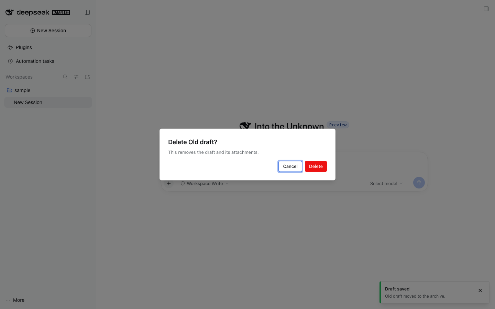

# @dshfiles/dialogs



The app's own confirm, alert, prompt and select dialogs, and its toasts, for every plugin. It provides the dshx
`Dialogs` and `Toasts` contracts from `@dshfiles/dshx/client`, so any plugin's `api.dialogs.confirm(...)` or
`api.toast.show(...)` opens plugin-ui components here instead of the browser's `window.confirm` / `window.prompt` and a
console line, which is what dshx falls back to while this plugin is absent or disabled.

```ts
// any plugin
if (await api.dialogs.confirm({ title: 'Delete Old draft?', confirm: 'Delete', danger: true })) remove()
const name = await api.dialogs.prompt({ title: 'Rename', initial: current })
const model = await api.dialogs.select({ title: 'Model', options, current: selected })
const dismiss = api.toast.show({ title: 'Saved', tone: 'success', action: { label: 'Undo', run: undo } })
```

## Dialogs

One dialog is open at a time; a request made while another is open waits, in arrival order. Cancel, Escape and a
press outside each dialog answer `false` (confirm) or `undefined`.

| Call      | Shows                                                                                                     |
| --------- | --------------------------------------------------------------------------------------------------------- |
| `confirm` | Alert dialog with Cancel and confirm. `danger` makes confirm destructive and starts focus on Cancel.      |
| `alert`   | Alert dialog with one OK button.                                                                          |
| `prompt`  | Dialog with one field, its initial value selected. `secret` hides the text. An empty submit does nothing. |
| `select`  | Dialog with a searchable list (title and description), grouped by `group`, the `current` option marked.   |

## Toasts

A stack in the bottom-right corner. `tone` colors the edge (`info`, `success`, `warning`, `danger`), an `action`
button runs and closes the toast, and each toast closes after `duration` ms (5000 by default; `0` keeps it). `show`
returns a function that dismisses it.

## Agent parity

These are presentation helpers other plugins call while serving their own verbs, not user capabilities of their own,
so this plugin adds no agent tool: the verb a dialog confirms (delete, rename, pick a model) carries its tool in the
plugin that owns it.

## Develop

Client-only bundle (Cordis row `dshfiles-dialogs`, no Host entry). From this folder: `pnpm test`, `pnpm typecheck`,
`pnpm build`; rebuild `@dshfiles/ui-styles` after a class change. The journey is
`tooling/dshx/e2e/features/dialogs.feature` (`pnpm check:e2e dialogs`); `dshx dev open dialogs/app-dialogs` reaches the
screenshot through the `app-dialog-sample` seed.
