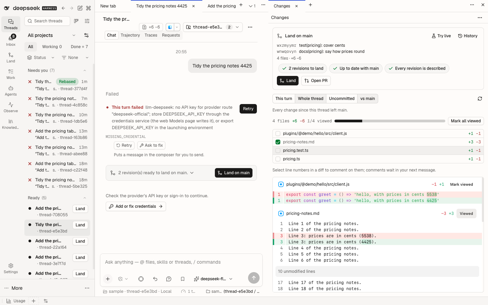
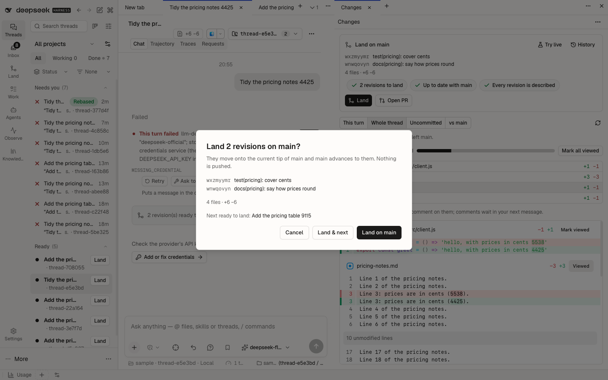
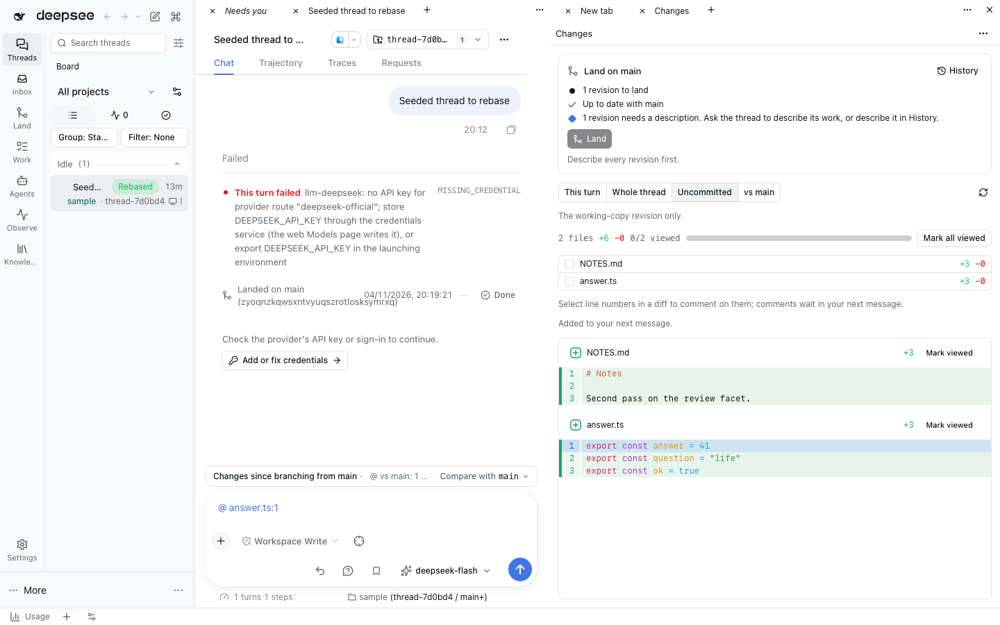
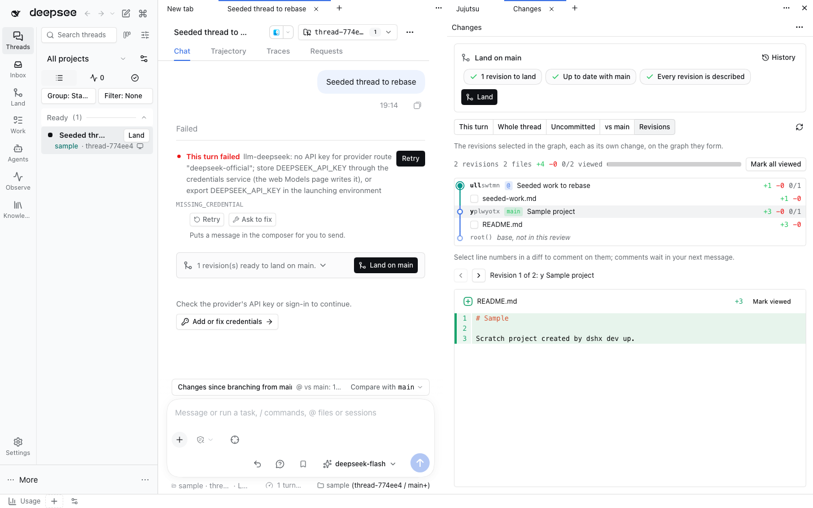
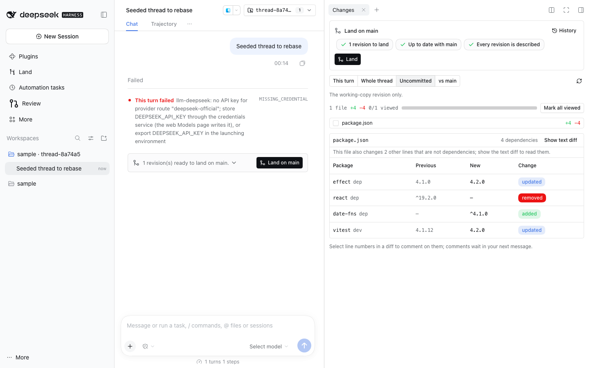
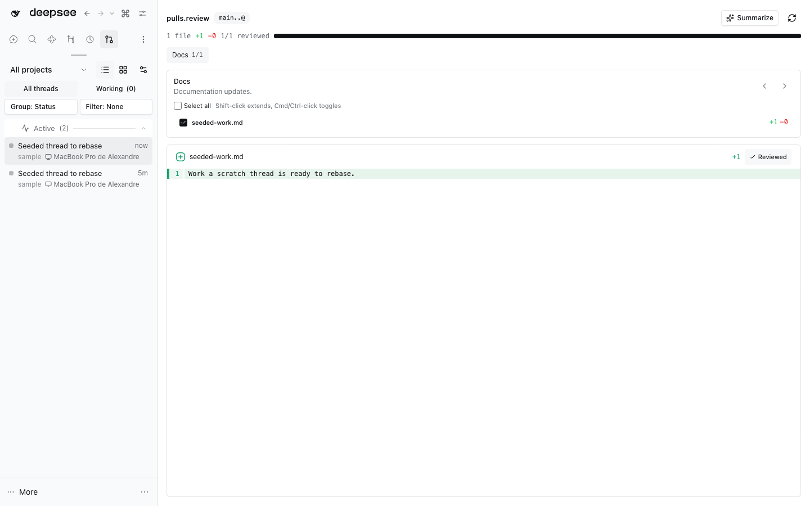
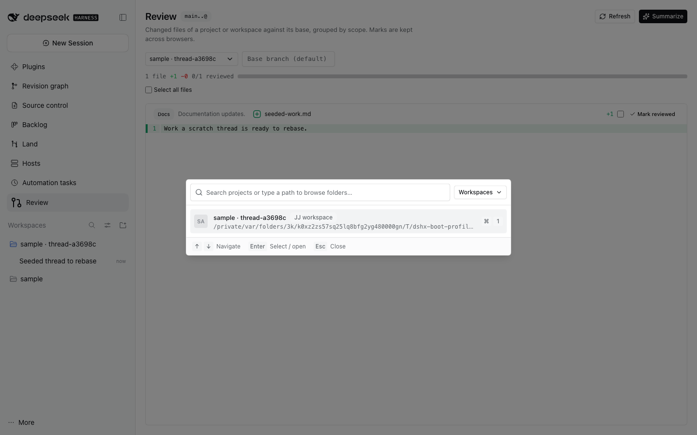

# Diffs review



This plugin reviews diffs: a thread's turns, a jj or git workspace against its bookmark, a saved
landed range, or several selected revisions. It owns the thread panel's **Changes** facet (review →
land on one surface) and the cross-project **Review** page. Scopes come from
[pulls.review](https://pulls.review)'s rules; the plugin itself is not tied to pull requests.

## Renamed from pulls-review

Until 2026-11 this plugin was `@dshfiles/pulls-review`. What changed, and what still works:

| Was                                              | Is                                       | Compatibility                                                                                                   |
| ------------------------------------------------ | ---------------------------------------- | --------------------------------------------------------------------------------------------------------------- |
| package `@dshfiles/pulls-review`                 | `@dshfiles/diffs-review`                 | `pnpm profile:sync` swaps the dependency and bundle row (it drops `@dshfiles/*` rows the seed no longer lists). |
| Loader row `dshfiles-pulls-review`               | `dshfiles-diffs-review`                  | The row comes from this package's `cordis.patch.yml`; the plugin has no settings, so nothing else moves.        |
| agent tools `pulls_review`, `…_revisions`        | `diffs_review`, `diffs_review_revisions` | Same inputs and output. Agents read the tool list each turn; no deny policy or preset named the old ones.       |
| `/pulls`                                         | `/diffs`                                 | `/pulls` stays registered as an alias.                                                                          |
| Review page panel `pulls-review`                 | `diffs-review`                           | The former id still renders the page, so a saved workbench tab opens; it is hidden from Add.                    |
| Changes tab kind `dshfiles-pulls-review-changes` | `dshfiles-diffs-review-changes`          | A right pane saved with the former kind reopens the facet with the same scope and closes the old tab.           |
| Host record `@dshfiles/pulls-review` `reviewed`  | (none)                                   | Read once from the former namespace (`hostStorage(api, { formerId })`), moved into diff-viewed, then emptied.   |
| API id `pulls-review`, `pullsReviewApi`          | `diffs-review`, `diffsReviewApi`         | In-process only; every caller is in this repository.                                                            |

The navigation open counter keys the page by panel id, so its count restarts under `land/diffs-review`.

## Changes facet

A right-pane tab that follows the thread on screen. It answers "what did this thread change, have I
read it, and can it land?" without leaving the thread:

- **Scopes**, each a pair of revisions: **This turn** (DSH's own turn-start/turn-end snapshot, the
  same data as the "Edited N files" card; works for any version control), **Whole thread**
  (`fork_point(<bookmark> | @)` to `@`, the thread's own work), **Uncommitted** (`@-` to `@`) and
  **vs main** (the target bookmark's tip to `@`, which also shows what the bookmark gained since).
  Revision scopes read `jj diff` on the Host; in a workspace that is not a Jujutsu repository they
  say so and This turn keeps working.
- **Files and viewed marks.** A file list with +/− counts, one diff view, and a viewed checkbox per
  file (list and diff header), plus Mark all viewed. Marks live in
  [diff-viewed](../diff-viewed/README.md)'s one store: per-turn marks are the same ones the native
  review tab's Viewed toggle writes; revision-scope marks are keyed by workspace, base and head
  commit, so a new revision starts unread. Files are ordered by deterministic importance: entry
  points and source first, then tests, lockfiles and generated files, with larger changes first within
  each group. Viewed marks never change the order. This uses no model and incurs no model cost.
- **Line comments.** Click or drag line numbers in a diff, write a comment and choose **Add to next
  message**: it becomes a line-comment chip in the thread's composer through the public dshx
  `Composer` contract (rich-composer sends it as `<comment path lines>`).
- **Land card** on top: the target bookmark, how far behind it the workspace is, conflicts,
  undescribed revisions and the thread's project-check receipts. **Land** previews the exact
  revisions in a confirm dialog and then calls jj-integration's `land` with all of its Host guards;
  it is disabled with the reason when revisions conflict or lack a description. A thread that is
  working or waiting offers **Land when idle** (jj-integration's queued land, with Undo). **History**
  opens the revision graph for rebase-only or describe work. After a land, the Inbox's Ready to land
  item resolves at once.





**Several revisions together.** Selecting revisions in the Jujutsu graph and choosing **Review
together** opens them as one review, the **Revisions** scope of this facet. Each revision stays its
own change: `jj diff` refuses a selection with gaps, and a net diff would lose which revision made
which line. So every revision has its own files, **Previous** and **Next** step through their diffs
oldest first, a viewed mark belongs to one file of one revision (a file two revisions touched is
read twice; rewriting a revision starts it unread), and a line comment says which revision it is
on. A revision that is gone or divergent is named and left out. The graph reads a revision by its
change id, so a review left open follows a rewrite. When no thread on screen owns the repository,
the same review opens on the Review page. Agents read it with the `diffs_review_revisions` tool,
whose text also counts the revisions each gap leaves out.

The revisions are drawn as a small revision graph, newest first like the Jujutsu panel, with the
layout and row cell jj-integration shares as its `revision-graph` module. Ideas taken from
[lightjj](https://github.com/chronologos/lightjj) (MIT; reimplemented, no code copied):

- **Gaps on the graph.** A revision builds on the nearest selected revision below it; when others
  sit between, the edge is dashed and the row under it reads “N revisions not in this review”. The
  Host counts them with one bounded `jj log -r 'connected(S) | parents(roots(connected(S)))'`
  (400 revisions); past that bound edges link direct parents only and the review says the gaps were
  not counted.
- **The base.** The graph ends on what the selection sits on, named by its bookmark (`main`) when it
  has one, muted because it is not part of the review.
- **State at a glance.** The node glyph marks the working copy, conflicts and divergence; chips
  repeat them with `empty` and up to two bookmarks; the change id shows its shortest unique prefix
  apart from the rest; each row counts its viewed files.
- **Keys.** With the graph focused, `j`/`k` (or the arrow keys) move to the older or newer revision.

A Host from before the graph sends no links, and the rows then stand unconnected.



**package.json as a table.** In this facet, the Revisions scope and the Review page, a changed
`package.json` shows its dependency changes as a table instead of text lines: package and section
(dep, dev, peer, optional), previous version, new version, and added, removed or updated. The table
replaces the file's text diff, and **Show text diff** puts the lines back. Other changed lines in the
file (scripts, version) are counted on the table so it hides nothing. A diff carries only a few
lines of context; when a changed entry's section is out of view, its row has no section label and
the text diff stays on screen, because the line may be `engines.node` or an override rather than a
dependency. Registry data (license, downloads, release date) is not shown.



Ways in: the turn card (this plugin claims the native `dsh-resource://changes-review/…` address,
so the card opens Changes on that turn instead of a second review tab), the right pane's tab
chooser, the jujutsu composer bar ("Review workspace changes"), **Open in thread** on a Land row or
on the Review page, and the dshx `Changes` contract (`review({ workspacePath, sessionId })` opens the
thread and its facet; without `sessionId` it opens the Review page; `reviewRevisions` does the same
for a graph selection).

Why here and not in sidebar-right: this plugin already owns scoped review (Host diff reads and
review scopes) and the `Changes` contract, and it already depends on jj-integration's API, so
the Land card adds no new dependency direction. sidebar-right is a native fork that hosts tabs;
product features stay out of it.

## Review page

Review a project's or workspace's changes the way [pulls.review](https://pulls.review) does:
all changed-file diffs in one vertically scrollable view, ordered by importance and
with per-file review progress — inside DSH.



The searchable project picker keeps existing thread workspaces in their own scope:



Open the reusable **Review** view from navigation or the Workbench chooser.

## What it does

Choose any registered project or existing JJ thread workspace from the
searchable project picker. Workspaces have their own scope instead of crowding
projects. You can also browse to a folder. If a selected workspace has
disappeared, choose another project or workspace without leaving the review.
Optionally enter a base bookmark (the Host otherwise chooses `main`, `master` or
`trunk`). Live workspaces are read as `jj diff --from <base> --to @`. Landed
threads also retain exact ranges of persistent JJ change IDs. When the panel's
current thread workspace has been removed, it automatically reads that thread's
saved integration history and shows the latest landed range from the owning
repository. Agents can use `jj_thread_review_history` to get the saved base/head
IDs and call `diffs_review` with `path` set to the repository root plus
`fromChangeId` and `toChangeId`. The Host reads that patch and groups it with
[`@pulls.review/core`](https://github.com/antfu/pulls.review)'s deterministic
rule-based adapter (MIT): no model call, no GitHub token, and the same rules the
site uses, so a scope reads `Code` / `Tests` / `Docs` / `Config` /
`Dependencies` / `Generated` / `Other` here exactly as it does there.

### Git-only repositories

A workspace whose nearest repository marker is `.git` with no `.jj` (see `VcsDetector` in
[`vcs-provider-port`](../vcs-provider-port/README.md)) is read through git instead, by the `ReviewGit` adapter of the
same review port (`src/review-backend.ts`), over [`@dshfiles/git-cli`](../git-cli/README.md):

- **Live review:** `git diff <merge-base with base>` to a snapshot of the worktree, built in a throwaway index, so
  uncommitted and untracked (non-ignored) files count and neither `HEAD` nor the real index moves. The range reads
  `<base>..HEAD`, and the base candidates are `main`, `master`, `trunk`, then `origin/main`, `origin/master`, `origin/trunk`.
  Unlike jj (a two-tree diff from the bookmark), git diffs from the merge base, so commits that reached `main` after the
  thread started do not show up as reverts.
- **Saved ranges:** jj-integration's git backend records commit ids as `baseChangeId`/`tipChangeId`, and
  `fromChangeId`/`toChangeId` take them as is (`git diff <from> <to>`).
- Failure reasons keep their names (`jj-missing` means the VCS executable is missing); the messages say git.

Real temporary repositories in `tests/git-output.spec.ts` cover the git CLI output, and the
`pulls-review.git-thread-scopes` journey (`tooling/dshx/e2e/features/pulls-review.feature`) starts a thread in its own
git worktree of a git-only repository and checks the Review panel reads its files in two scopes as `main..HEAD`.

The panel shows the range and totals, then every changed-file diff in one
scrollable view. Each diff header carries its scope and summary, and a per-file
action marks that file reviewed. The review-wide selector can batch-mark files
across scopes. Review marks are diff-viewed's revision-range marks (the same store
the Changes facet reads), keyed by workspace, base and working-copy revision, so a
new revision starts fresh. Marks an earlier version kept in this plugin's own Host
record (or, before that, in this browser's localStorage) move into that store once
on load, in batches; the old record is emptied only after the move succeeded, so a
failed move retries on the next load and loses nothing. **Open in thread** opens the
thread on screen with its Changes facet; this page stays the cross-project view.

**Summarize** replaces the deterministic scope text with one model call over the
whole diff, using the provider the thread last requested with and the first model
that provider offers. The route is resolved from the thread's session log, so no
key is typed twice, and the call borrows that session id because providers keyed
per session (OpenCode Go) reject a call without it. The model answers with one
`scope: sentence` line per scope; anything unusable leaves the deterministic
summaries in place and says why.

## In a thread

`/diffs` (or its former name `/pulls`) prints the same grouping as text, without opening the panel:

```
Diffs review · main..@ · 3 files · +42 −7
Code (2) · +40 −7 · Source changes.
  - plugins/app/src/host.ts (+38 −6)
  - plugins/app/src/api.ts (+2 −1)
Docs (1) · +2 −0 · Documentation updates.
  - README.md (+2 −0)
```

Agents get the same through the `diffs_review` tool (`path`, optional `base`),
so an agent can inspect a workspace's change shape before reading it. For a removed workspace, first read its exact landed range with `jj_thread_review_history`, then pass `path`, `fromChangeId` and `toChangeId` to `diffs_review`. Older records without a saved base cannot be reconstructed safely.

## Why the rules rather than the site

The site is a GitHub-PR product and its UI is Vue, which DSH's React client cannot
reuse. Embedding the shipping CLI (`npx pulls.review@0.3.3`) was measured in a thread
workspace and rejected:

1. A thread workspace has no `.git` (`.jj/repo` and `working_copy` only), so the CLI's
   git-backed targets resolve nothing. It works only with `GIT_DIR` pointed at the
   colocated main checkout and an explicit range (`main...<commit>`), never `/worktree`.
2. The dev server gates the browser behind a one-time code printed on the first
   untrusted connection. Consuming it from the URL fragment is racy: pairing succeeded
   once, then failed four times in a row in the same flow with no new code printed.
3. A deep link to a ref route (`/compare/A...B`) resolves `./assets` under the ref path,
   so the entry bundle 404s (`/compare/assets/index-*.js`); the CLI's own printed URL hits
   this.

`@pulls.review/core` (MIT, `packages/core`) exports the patch parser and the rule-based
grouper with no model call and no GitHub token. On a 366k-line jj patch it parsed and
grouped 1789 files, so the scopes here are pulls.review's own behavior, not a lookalike.

The Summarize route is the thread's own provider rather than a configured cheap model,
so a review plugin does not depend on another plugin's settings. Its route, parse and
failure paths are unit-tested; a profile without an account can only show the failure.

A DSH "Local agent" adapter for the pulls.review CLI
(`packages/cli/src/agents/dsh.ts` in [antfu/pulls.review](https://github.com/antfu/pulls.review))
was written and committed on a local branch, not pushed: the upstream PR is the owner's
call. It takes the task on stdin, maps the `--json` projection (`session` to a resumable
id, `text`/`tool_call`/`tool_result` to the transcript, `final` to the answer), resumes
with `--session-id`, refuses a per-run model because the profile owns it, and honors
`PULLS_REVIEW_DSH_PROFILE`. DSH has no per-run tool restriction, so its docs tell users to
point the analysis profile at a read-only tool set.

## Not done

- **Open in pulls.review** for a GitHub PR branch. A thread's branch is usually detached
  in jj, so resolving its PR needs `gh` against a git dir the workspace does not have.
  Nice to have; [pull-requests](../pull-requests/README.md) already links a thread's PR.
- No component test pins the facet's file-name join for paths with spaces, unicode or
  binary files; both parsers were checked by hand to agree on real jj output.

## Host API

`diffsReviewApi.review({ path, base?, fromChangeId?, toChangeId? })` returns one of:

- `{ status: 'ok', path, base, head, range, patch, truncated, fileCount, additions, deletions, files, scopes }`
  — `base` defaults to the first of `main`, `master`, `trunk` that resolves. Exact reviews require both persistent change IDs and use the owning repository root as `path`; the Host verifies both revisions resolve before reading their diff.
  `truncated` says the patch hit the 1.2 M-character cap **or** that the file
  lists were clipped to 4000 entries; totals stay exact either way.
- `{ status: 'failed', path, reason, message }` with `reason` one of
  `workspace-missing`, `not-a-repository`, `no-base`, `jj-missing`, `jj-failed`.

`diffsReviewApi.summarize({ path, base?, sessionId?, provider?, model? })` reads
the workspace again and returns `{ status: 'ok', route, summaries }` — one entry
per scope key, an answer missing a scope is still a success — or
`{ status: 'failed', reason, message }` with `reason` one of `no-route`,
`llm-unavailable`, `llm-failed`, `unparsed`, `review-failed` (the read failed)
or `no-changes`.

`jj` runs with explicit argv, a bounded output, a timeout and the caller's
signal; its stderr is read only to classify a failure and never leaves the Host.
The model call goes through the Host's `llm` service with `purpose: 'compaction'`,
the thread's session id and the caller's signal, so it is cancellable and never a
second key path.
