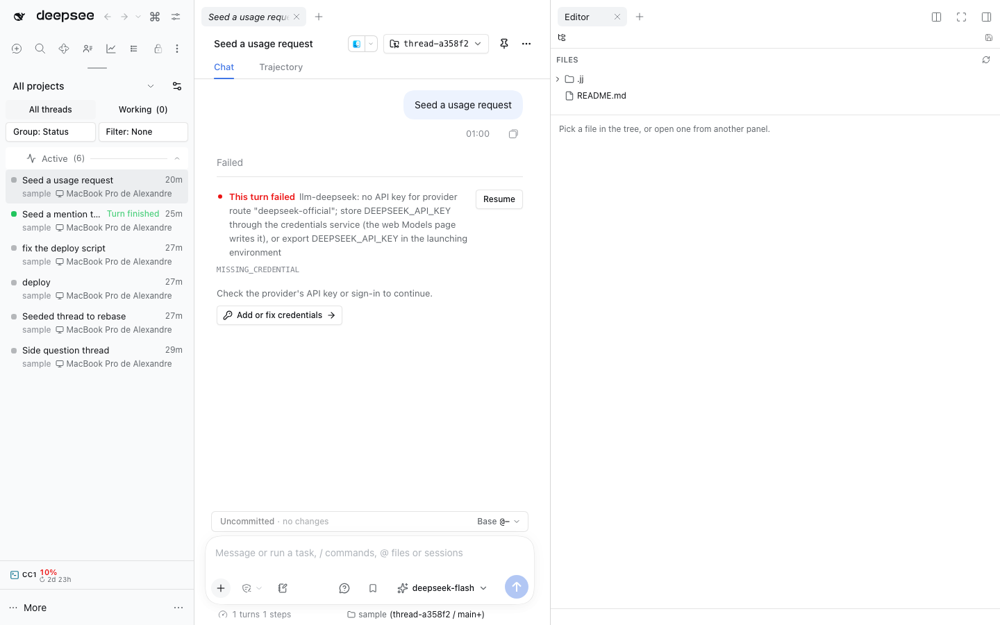
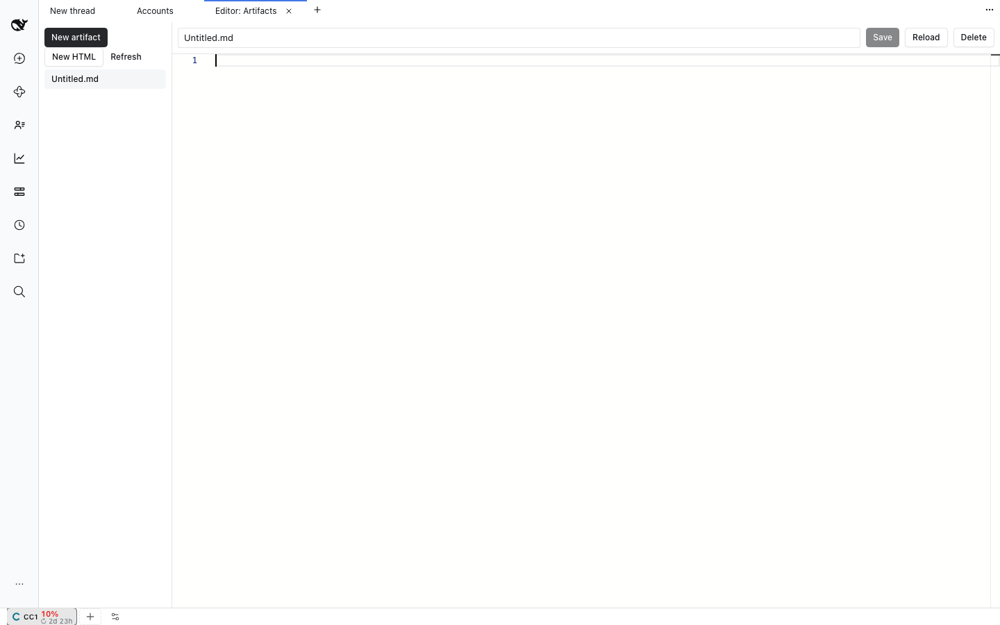

# @dshfiles/editor

Monaco-based workspace file editor for DSH. Provides a workspace tree, editor tabs, open-from-anywhere integration, and confined file saving through Host APIs. Its `openFileLinks` preference appears as a native switch in Settings → General, and Settings search finds it under the Editor's plugin page.

Depends on `@dshfiles/workbench` for its dockable panel and `@dshfiles/plugin-ui` for shared UI. Build, test, and typecheck with `pnpm build`, `pnpm test`, and `pnpm typecheck` from this package.

The Workbench chooser exposes the reusable **Files** view; its open-file tabs retain their filenames.

## Thread artifacts

The Workbench chooser and the command palette expose **Artifacts**: the Markdown and HTML documents that belong to the thread on screen. The page has one primary **New ▾** (Markdown, HTML), the thread's artifacts beside the editor, and Reload and Delete in the editor's ⋯; below the narrow-pane width the list and the editor stack, with Back to return to the list. Artifacts live on the Host in the versioned `@dshfiles/editor-artifacts` plugin-storage namespace, so they survive a DSH restart and are listed per thread. Each document carries a revision; a save sends the revision it started from, and a concurrent edit (from the user or the agent) is refused with the current revision instead of silently overwriting work. Reload replaces the draft after an explicit confirmation; Delete asks first.

The agent drives the same API through the `artifact_list`, `artifact_read`, `artifact_create`, `artifact_update` and `artifact_delete` tools. The read tools set `readOnly`; create, update and delete say they run only when the user asked, and `artifact_delete` requires `confirm: true` with the expected revision.

Content is limited to Markdown (`text/markdown`) and HTML (`text/html`), at most 240 KiB of JSON-encoded UTF-8 text per artifact, the plugin-storage ceiling for one value. The view keeps one Monaco instance for the selected artifact of the active thread; switching threads or artifacts preserves unsaved drafts as plain text, so a draft is never lost to a mount change. Only one editor mounts at a time.

The editor provides dshx's `SessionScreen` contract: the session on screen (`current`) and the one side panels follow (`mounted`), the walked and watched workspace file index the command palette's file search reads, one tree level at a time through `workspaceFiles.list`, and the Host's `@` mention file search.
