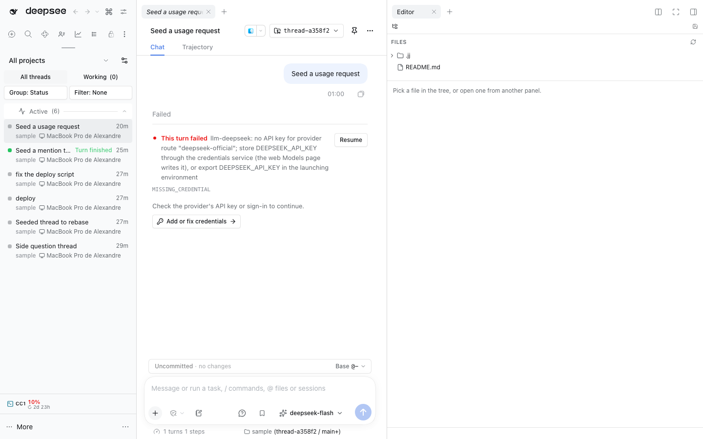

# @dshfiles/editor

Monaco-based workspace file editor for DSH. Provides a workspace tree, editor tabs, open-from-anywhere integration, and confined file saving through Host APIs. Its `openFileLinks` preference appears as a native switch in Settings → General, and Settings search finds it under the Editor's plugin page.

Depends on `@dshfiles/workbench` for its dockable panel and `@dshfiles/plugin-ui` for shared UI. Build, test, and typecheck with `pnpm build`, `pnpm test`, and `pnpm typecheck` from this package.

The Workbench chooser exposes the reusable **Editor: Files** view; its open-file tabs retain their filenames.

The editor provides dshx's `SessionScreen` contract: the session on screen (`current`) and the one side panels follow (`mounted`), the walked and watched workspace file index the command palette's file search reads, one tree level at a time through `workspaceFiles.list`, and the Host's `@` mention file search.
