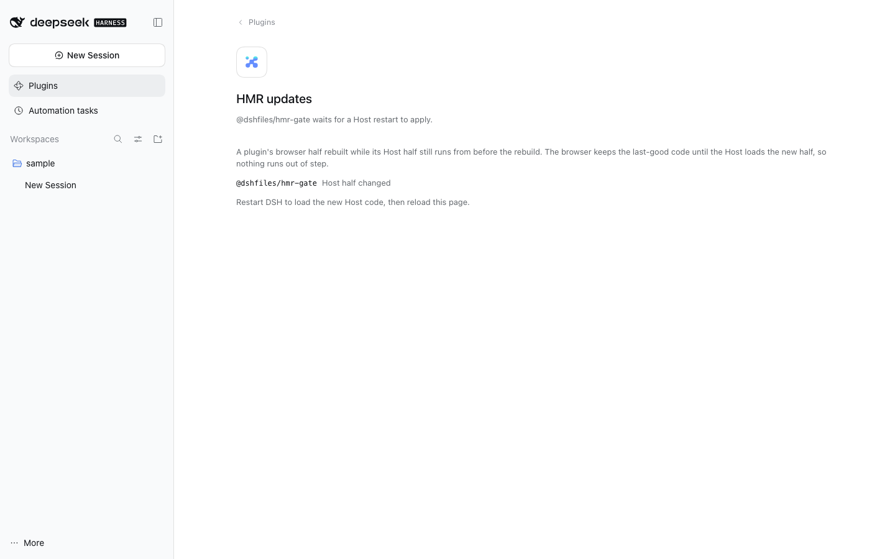
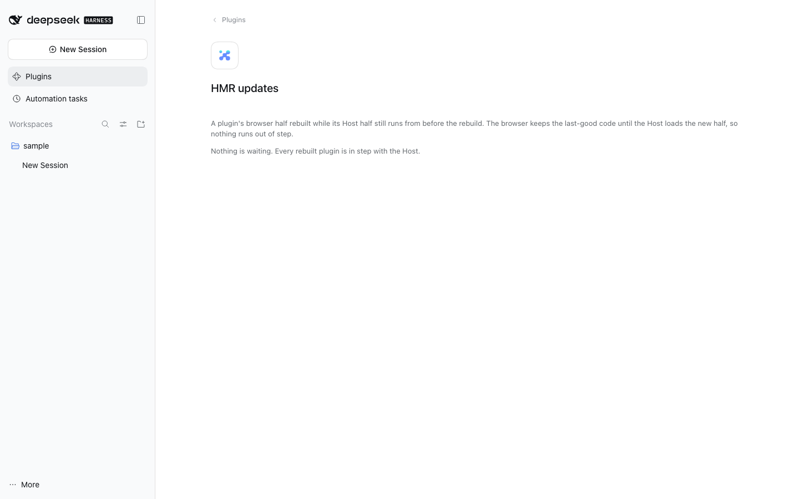

# HMR gate

Web client HMR transport that only announces a rebuilt plugin while its Host half
is the code the running Host loaded.

## Why

DSH loads a plugin as two halves: a Host bundle (`dist/index.js`) in the Node
process and a client bundle (`dist/client.js`) in the browser. The stock Web
transport (`@deepseek-ai/dsh-client-hmr`) stat-polls every client bundle and
announces each rebuild, so the browser runs the new client immediately. In the
`web` profile the Host `hmr` row is **disabled on purpose**: a 2026-10-19
recomposition dropped `sessionQuery` and took `session-controller` down twice
(see [recovery](../../docs/recovery.md)). The documented cost is that a rebuild
reaches the browser but not the running Host, so a rebuilt plugin can ask the old
Host for a service or a field it does not have — which is how the composer died
on 2026-10-22.

Deferring is the rollback. The browser tears the old client code down only when it
receives the `rebuilt` frame, and the Host serves the current file for every rev,
so an applied reload cannot be undone. Withholding the frame keeps the last-good
client code live.

## What it does

| Frame | Meaning |
| ----- | ------- |
| `graph` | the composed client graph (same as stock) |
| `rebuilt` | a client bundle the page may apply now (same as stock) |
| `deferred` | this package's addition: a rebuild held back because its Host half changed |

The Host tracks, per client row:

1. the package's Host entry, resolved from its own `package.json` (`exports['.']`,
   then `main`), so native packages (`lib/index.js`) and owned bundles
   (`dist/index.js`) both resolve;
2. the digest of that file as the running Host loaded it;
3. the digest currently on disk.

A client rebuild applies only while (2) and (3) agree. On each poll the client
bundle's stat change is the trigger; the Host half's bytes are the verdict. If the
Host later reloads the package in-process (`hmr/reload`), the deferral is released
and the frame is announced.

The same decision is exposed to the browser and the agent through the `hmr-gate`
API: `hmr_gate_status` returns `{ deferred: [{ id, reason }], watched }`.

## Where the user sees it

Settings → Plugins gains an **HMR updates** row (the `plugins.item` seat). Its
summary line names how many plugins wait for a Host restart; its page lists them
and says what a restart applies. This is the notice, not a gate bypass: the
browser keeps running the last-good code either way.



With nothing pending the page says so; the row clears by itself once the Host
artifact on disk matches the loaded one again:



## Limits

- The browser half uses a same-origin `EventSource` on `plugins/events`. A shell
  that exposes only `__DSH_TRANSPORT__.fetch` (no same-origin EventSource) would
  need the fetch path the stock client also carries.
- This replaces the stock row, so `webWork` profile composition must disable
  `client-hmr`; the bundled `cordis.patch.yml` does that.
- It gates *announcements*, not Host loading: a Host restart is still the only way
  to run the new Host half in this profile.

## Verify

```sh
pnpm --dir plugins/@dshfiles/hmr-gate test      # gate model + Host entry resolution
pnpm --dir plugins/@dshfiles/hmr-gate build
fnm exec --using=22.23.3 node -e "import('./dist/index.js')"
```

Then, in a scratch DSH, touch one plugin's `dist/client.js` (HMR applies) and then
`dist/index.js` + `dist/client.js` (no reload, the Plugins row names the package).
See [`../../plans/hmr-compat-gate`](../../plans/hmr-compat-gate/README.md).
