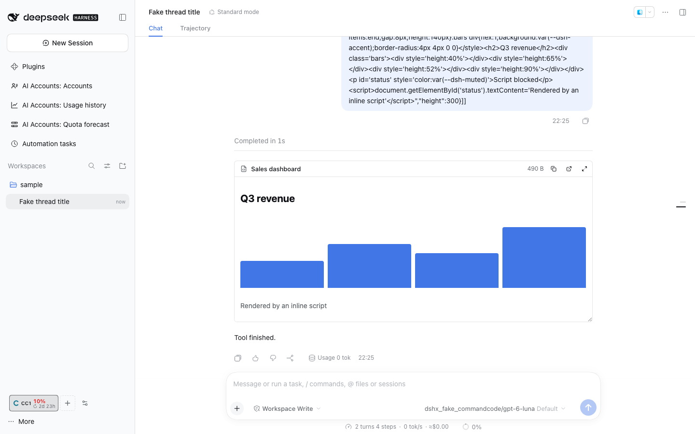

# @dshfiles/html-render



The `html_render` agent tool publishes a self-contained HTML page — a chart, a mockup, a table — and `html_preview` shows
an HTML file from the thread's workspace; the chat transcript shows either as a card instead of a tool row:

- a sandboxed iframe themed with the DSH light/dark tokens;
- resizable from its bottom edge, **Expand** to full screen;
- **Copy HTML** and **Open in new tab**;
- still visible after the Turn completes: the plugin registers `html_render` and `html_preview` in Chat's `PinnedToolCalls`
  (`@dshfiles/chat/pinned-tool-calls`), so the call stays outside the "Completed in" fold and the step groups.

Built with dshx (no port). The idea comes from t3code's visual replies (`plans/t3code-parity.md`, A2); nothing is
vendored from it.

Run `pnpm build`, `pnpm test` and `pnpm typecheck` from this package.

## The tool

| Argument | Required | Meaning                                                                                     |
| -------- | -------- | ------------------------------------------------------------------------------------------- |
| `title`  | yes      | Card header, at most 200 characters.                                                        |
| `html`   | yes      | A full document or a body fragment, with inline CSS and JavaScript. At most 512 KB (UTF-8). |
| `height` | no       | Initial card height in pixels, clamped to 80–2000; default 360.                             |
| `theme`  | no       | `auto` (default) follows the DSH theme; `light` or `dark` pins a fixed palette.             |

The page reads `--dsh-bg`, `--dsh-surface`, `--dsh-fg`, `--dsh-muted`, `--dsh-border`, `--dsh-accent`,
`--dsh-success`, `--dsh-warning`, `--dsh-danger`, `--dsh-font` and `--dsh-mono-font`. In `auto` they come from the live
Host `--dsw-alias-*` tokens and follow a theme switch; default `html`/`body` colours use them through `:where()`, so the
page's own CSS always wins.

The model gets one line back (`Published "<title>" (<size>) …`), not the markup. The page itself is stored in the
tool result's presentation metadata (`output.presentationMeta`, never model-visible), so a reload or a transcript
window that lost the call still shows the card. A result without that metadata falls back to the recorded call
arguments.

An oversized or empty page is refused: the error names the size and how to shrink or split it, and the card shows it.

## Showing a workspace file

`html_preview` shows an HTML file the thread already has (a generated report, a built page) in the same card.

| Argument | Required | Meaning                                                           |
| -------- | -------- | ----------------------------------------------------------------- |
| `path`   | yes      | An `.html`/`.htm` file, relative to the thread working directory. |
| `title`  | no       | Card header; defaults to the file name.                           |
| `height` | no       | As for `html_render`.                                             |
| `theme`  | no       | As for `html_render`.                                             |

- **Boundary.** The path resolves through the Host filesystem (`ctx.fs`, symlinks followed) and must land inside the
  thread's workspace (the Session's creation `cwd`); a path outside it, absolute or through a symlink, is refused.
- **Assets.** Relative `<link rel="stylesheet" href>`, `<script src>` and `` (png, jpeg, gif, webp, avif, svg,
  ico, bmp) are inlined when they resolve inside the workspace, at most 32 of them. The rest stays as written and the
  card's no-network policy blocks it: CSS `url()` and `@import`, web fonts, `srcset`, `<source>`, `fetch`,
  root-absolute (`/x.css`) and remote URLs. The model's summary lists what was not inlined.
- **Size.** At most 512 KB, after inlining, like `html_render`.

The file is read once when the tool runs; the card keeps that copy, so later edits need another `html_preview` call.

## Checking a page

`html_render_screenshot` lets the agent see what it published: it renders an `html_render` or `html_preview` page in
the `@dshfiles/preview` Host Chromium and returns a JPEG.

| Argument      | Required | Meaning                                                                          |
| ------------- | -------- | -------------------------------------------------------------------------------- |
| `callId`      | no       | The publishing call; defaults to the thread's latest page.                       |
| `fullPage`    | no       | Capture the whole page height (up to 6000 px) instead of the card height.        |
| `colorScheme` | no       | `light` (default) or `dark` for an `auto` page; a pinned page theme always wins. |
| `width`       | no       | Viewport width, 320 to 1920; default 800, about the card's width.                |

- **Same sandbox.** The page gets the card's CSP and the fixed light or dark theme tokens, then runs in an
  `allow-scripts`, opaque-origin `srcdoc` frame inside an offline browser context whose every request is aborted.
- **Which pages.** Each thread's last 16 pages published since DSH started (32 MB in total); after a restart, publish
  the page again. Another thread's pages are never reachable.
- **Dependency.** html-render calls preview's `preview-render` contract (`@dshfiles/preview/render-api`) with
  `createHostApiClient`; without the preview plugin the tool says to enable it.

## Isolation

The page is untrusted (the model wrote it, possibly from untrusted input), so it never runs as a DSH document:

| Layer                                             | What it stops                                                                                                                                |
| ------------------------------------------------- | -------------------------------------------------------------------------------------------------------------------------------------------- |
| `sandbox="allow-scripts"`, no `allow-same-origin` | Opaque origin: no DSH cookies, `localStorage`, `parent.document` or authenticated Host API; no top navigation, pop-ups, forms or downloads.  |
| Content-Security-Policy, first in `<head>`        | `default-src 'none'`: no fetch/XHR/WebSocket, external script, stylesheet, font, frame or image; only inline code and `data:`/`blob:` media. |
| Re-serialization through `DOMParser`              | Drops `<base>` and every `<meta http-equiv>` (refresh redirects, a looser CSP) before the frame parses it.                                   |
| Theme values                                      | A Host token value that could close the declaration (`; { } < >` or `\`) falls back to the fixed palette.                                    |

**Open in new tab** opens a blob URL, which would inherit the DSH origin. So the tab is a script-free shell (same CSP)
whose only child is the same sandboxed `srcdoc` frame; the page is attribute-escaped into it, never inlined.

Residual risk: a script or a clicked link can still navigate its own frame to another URL (CSP cannot restrict that),
which could carry data the page itself holds. The page never holds DSH data, so this leaks at most what the agent put in
it.

## Verify

```sh
pnpm check:e2e html-render                                   # sandbox, CSP, expand, reload
dshx dev up --plugin @dshfiles/html-render --plugin @dshfiles/chat --plugin @dshfiles/ai-accounts
dshx dev open html-render/html-page-card && dshx dev shot --label html-page-card
```
