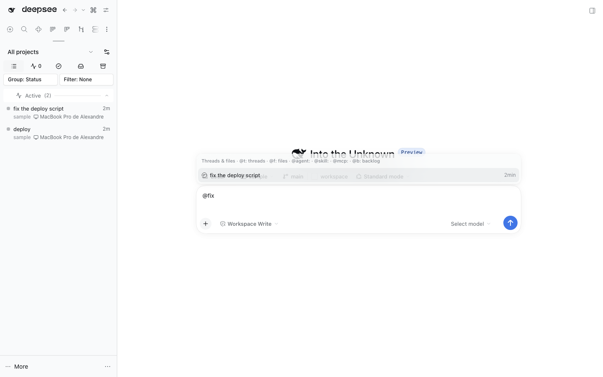
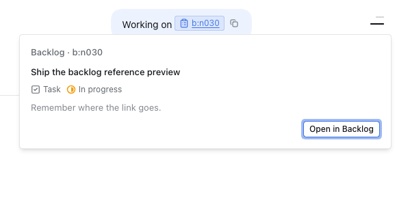

# `@dshfiles/input-trigger`



Owned MIT fork of DSH's shared `/` and `@` autocomplete engine. It preserves the upstream source/controller/menu pipeline and resolves typed `@` tokens the way Codex's composer does ([`src/caret-token.ts`](./src/caret-token.ts), ported from `codex-rs/tui/src/bottom_pane/chat_composer/completion_target.rs`):

- the token is the whitespace-delimited run the caret touches, on either side of same-line separator whitespace; a line break never gives affinity, and a chip is an atomic boundary;
- the hit spans the whole token, so a pick with the caret mid-token replaces all of it;
- whitespace closes the menu: `@ some sentence` or `@dsh trying to select it` searches nothing. A title with spaces is found by one of its words (`@deploy`) or a quoted phrase (`@"fix the deploy`).

The backlog's plain text boxes import the same resolver through the `@dshfiles/input-trigger/caret-token` module, so every composer in the app opens and closes `@` (and `#`) completion on the same rules.

The native Loader row is disabled by this bundle's Cordis patch. Source registrations keep using the `inputTriggers` service and its existing contract. This is tokenization only, not the separate Host session-query cost, so lookup latency is unchanged. See [`UPSTREAM.md`](./UPSTREAM.md) for provenance and the update policy.

## One mention and reference-preview registry



`@dshfiles/input-trigger/entity-registry` is the one place a plugin makes something mentionable (plan
[`ade-ux` §5 `entityProvider`](../../../plans/ade-ux/README.md)). A provider adds one `EntityKinds` item:

```ts
plugin.add(EntityKinds, {
  kind: 'backlog',
  label: 'Backlog item',
  mentionPrefixes: ['b', 'backlog'], // `@b:` / `@backlog:` list only this kind
  mentionSource: mentions, // registered with `inputTriggers` here, in registry order
  Preview: decorate(BacklogCard), // the body of the one shared reference card
})
```

- **`@` groups:** input-trigger registers every `mentionSource` with its own `inputTriggers` service, so `@` sources
  go through the registry. `EntityRegistryModel.foreignScope(kinds, kind, query)` tells a source that another kind owns
  the typed scope (mentions' file/thread source uses it instead of a hard-coded list).
- **References:** a link installer calls `EntityPreview.request({ kind, id, range? }, element)`. One `shell.overlay`
  card (`[data-dshfiles-entity-preview="<kind>"]`) positions itself under the reference, follows it while the page
  scrolls, closes when it scrolls away, and draws the kind's `Preview`. `Decorations` is an optional headless
  component the overlay keeps mounted (agents uses it to decorate `@handle` mentions from its live agent list).
- Providers today: mentions (files and threads), thread-sidebar (skills), mcp-servers (`@mcp:`), backlog (`b:`),
  agents (`@handle`), memory (`memory: n:… / t:…`). A provider that is not loaded simply contributes nothing.

```sh
pnpm test
pnpm typecheck
pnpm build
```
