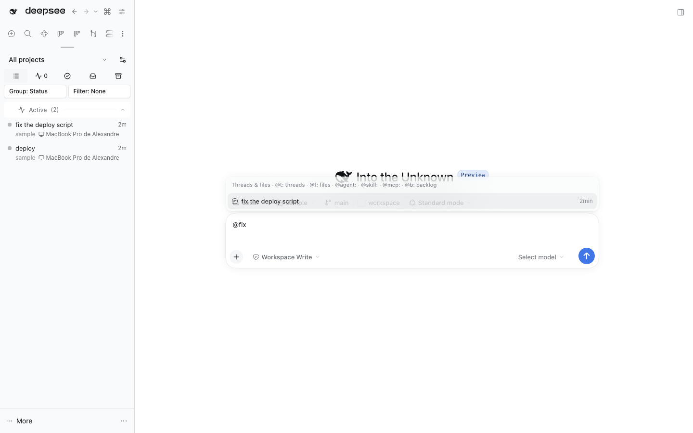

# `@dshfiles/input-trigger`



Owned MIT fork of DSH's shared `/` and `@` autocomplete engine. It preserves the upstream source/controller/menu pipeline and resolves typed `@` tokens the way Codex's composer does ([`src/caret-token.ts`](./src/caret-token.ts), ported from `codex-rs/tui/src/bottom_pane/chat_composer/completion_target.rs`):

- the token is the whitespace-delimited run the caret touches, on either side of same-line separator whitespace; a line break never gives affinity, and a chip is an atomic boundary;
- the hit spans the whole token, so a pick with the caret mid-token replaces all of it;
- whitespace closes the menu: `@ some sentence` or `@dsh trying to select it` searches nothing. A title with spaces is found by one of its words (`@deploy`) or a quoted phrase (`@"fix the deploy`).

The backlog's plain text boxes import the same resolver through the `@dshfiles/input-trigger/caret-token` module, so every composer in the app opens and closes `@` (and `#`) completion on the same rules.

The native Loader row is disabled by this bundle's Cordis patch. Source registrations keep using the `inputTriggers` service and its existing contract. This is tokenization only, not the separate Host session-query cost, so lookup latency is unchanged. See [`UPSTREAM.md`](./UPSTREAM.md) for provenance and the update policy.

```sh
pnpm test
pnpm typecheck
pnpm build
```
