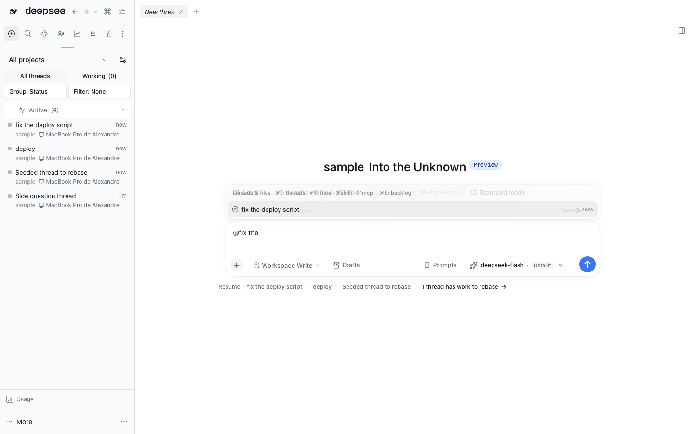

# `@dshfiles/input-trigger`



Owned MIT fork of DSH's shared `/` and `@` autocomplete engine. It preserves the upstream source/controller/menu pipeline and extends typed `@` detection so titles such as `@fix the deploy script` can be searched without quotes.

The native Loader row is disabled by this bundle's Cordis patch. Source registrations keep using the `inputTriggers` service and its existing contract. This fixes phrase tokenization, not the separate Host session-query cost, so lookup latency is unchanged. See [`UPSTREAM.md`](./UPSTREAM.md) for provenance and the update policy.

```sh
pnpm test
pnpm typecheck
pnpm build
```
