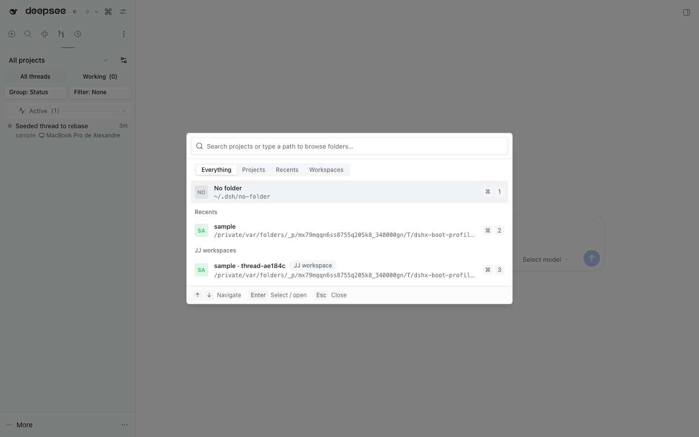
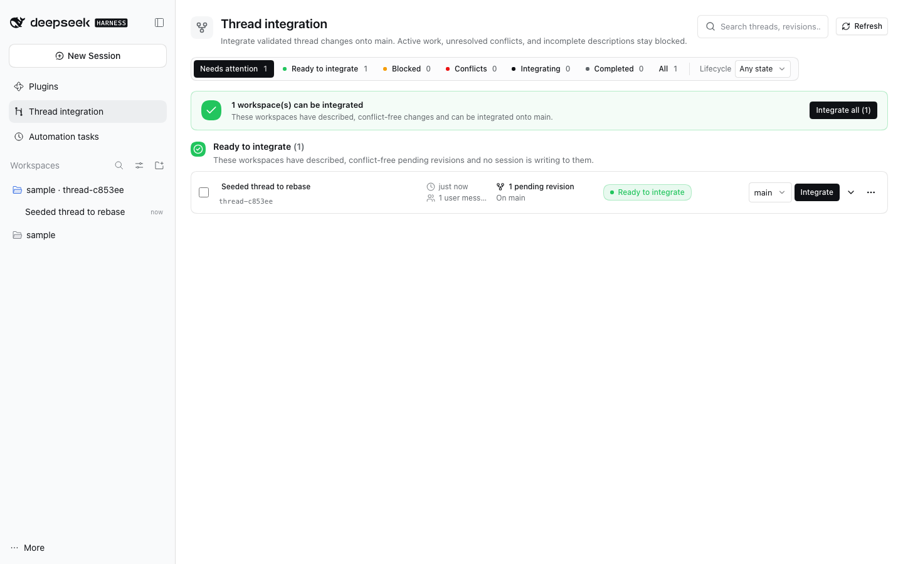
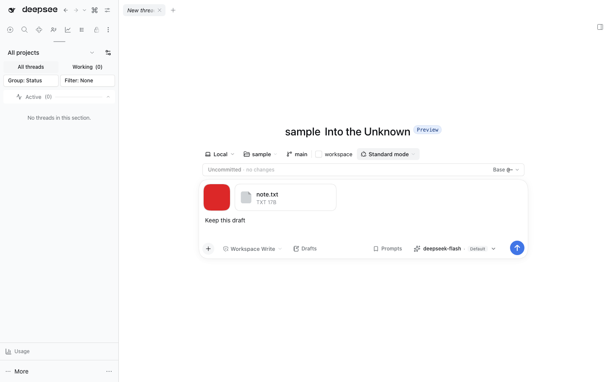

# Thread workspaces (jj-integration)







Lets many agents work on one jj repository at once: a thread can run in its own
jj workspace beside the repository, and **Integrate** moves its finished work
into `main`. Internally, jj rebases the thread revisions onto current `main`,
then advances the bookmark to the new tip; existing `main` ancestry stays intact.
Works on stock DSH 0.2.0-rc.2; no core patch.

## Starting a thread

A blank thread shows a destination bar above its composer:

- **Host**: `Local`, or a machine registered with
  [`@dshfiles/multi-host`](../multi-host/README.md) (status dot, **Add host…**,
  **Manage hosts…**). With a remote host chosen, the folder, bookmark and
  workspace chips describe that host (through its own jj-integration), and the
  composer starts the thread there; see the multi-host README.
- **Folder**: a registered project, **No folder** (a scratch directory,
  `~/.dsh/no-folder`), or **Open folder…**.
- **Bookmark** (jj repositories): the bookmark the thread starts from. Picking
  one starts the thread in its own workspace at that bookmark.
- **workspace** toggle: run the thread in its own jj workspace,
  `<repository>-threads/thread-<id>`, created with `jj workspace add -r <bookmark>`.

A Session's directory is fixed once created, so each change opens a blank
thread at the new destination. Leaving an unused thread workspace keeps it as
the project's spare for that bookmark, so toggling back reuses it and its blank
Session.

**Two threads never share a thread workspace.** Three guards hold this, whatever
the toggle remembers:

- A blank Session that sends from a thread workspace another Session uses moves
  to a fresh one first, even with isolation off. This also covers the blank
  source Session a first send leaves behind (the send moves only the draft), so
  reopening and sending from it isolates again.
- `thread_create` (and every caller of the `ownWorkspaceFor` API) pointed at an
  occupied thread workspace starts in a new one branched from that workspace's
  latest revision: its working copy when it holds work, else its parent.
- A thread started from a backlog item always takes the `provision` path with
  `isolate: true`, whatever `isolateByDefault` says: backlog work is
  independent, so `@dshfiles/backlog` never starts it in a checkout another
  thread is editing. Outside a jj repository `provision` answers the project
  workspace unchanged, and a Host without this plugin leaves backlog on its own
  fallback.
- The Host never reuses a requested workspace name that a folder or jj workspace
  already holds; it silently picks another.

**New thread provisions nothing until its first send.** The sidebar button, the
palette and the project picker open the composer at once in the project (or
current) checkout, and with `isolateByDefault` on the blank thread stays there:
the destination bar shows the workspace it will take (the spare when there is
one, else a workspace named by the client) without creating it. The first Send
creates or claims that workspace, gets its blank Session without changing the
main view, copies the draft, attachments and structured references into it and
sends there; the view follows only while it still shows the thread that sent.
Each first send runs on its own, so opening another New thread right after Send,
or sending two threads back to back, keeps every prompt in its own workspace.
Typing never waits on jj, and a New thread the user abandons leaves no jj
workspace behind. With isolation off, a thread that started in another thread's workspace
returns to the project checkout on arrival, which creates nothing. The chip
shows the workspace name with a spinner while the first-send switch runs. Each
new thread is moved at most once, so a manual toggle sticks, and a blank thread
already alone in a thread workspace is already at its destination: a page
reload, or the fresh Session DSH opens in the workspace a switch moved it to,
keeps that workspace instead of provisioning another. The thread sidebar shows a
thread workspace's sessions under its project.

Creating a thread workspace never runs dependency setup; any previously saved
`setupCommand` is ignored. After the thread starts, check the project's single
`jj workspace preparation` memory note,
verify its command against current project instructions, and prepare only when
its explicit conditions match; no note or unmet conditions means no setup. This
keeps workspace allocation fast for docs-only and other non-code work.

## The thread workspace control

One control in the conversation header carries the workspace state:

- It names the thread workspace (`thread-<id>`) with a badge for the revisions
  waiting to rebase, or the shared project checkout when the thread runs beside
  the other threads. It never disappears while the state loads, so the header
  cannot lose the only way to the thread's workspace actions.
- Its menu shows the workspace path, what the workspace state is (ready to
  integrate, up to date, behind `main`, conflicted, shared checkout, or blocked),
  **Integrate into `main`**, **Open thread workspaces in side panel**, and
  **Download session log**.
- While a session is running or a question waits, **Integrate** becomes
  **Queue integration into `main`**: the Host keeps the request and runs the
  regular guarded integration as soon as every Session working in that jj
  workspace is idle (woken by Session events, with a 30 s fallback). The menu
  then says it is queued, the
  trigger shows a clock, and **Undo** cancels it until the rebase actually
  starts. Queueing and cancelling also leave dated inline chat notices; the
  active queue notice has its own **Undo** action. The thread list shows a subtle
  **Integration queued** tag until cancellation or completion. Repeated queue
  requests add no duplicate notice; a rejected cancellation adds none either.
  The queue and its latest 1,000 notice events live in Host memory, so a Host
  restart drops them. Reloading the browser keeps them. Notices during a running
  turn require the owned `@dshfiles/chat` renderer; stock chat renders turn-tail
  contributions only once the turn ends. The sidebar tag works with either.

### Integrate from the end of a turn

The newest completed turn carries the same integration one click away: when the
turn ends and the thread workspace is ready (described, conflict-free revisions,
no Session writing, no question waiting), an inline row beside the answer names
the pending revisions and offers **Integrate into `main`**. It runs the header
control's own land action; the header stays the permanent entry point, and the
row disappears as soon as the work lands.

- Only the newest turn offers it: older turns keep their dated notices, so a
  long thread never grows a column of stale buttons.
- It is hidden for a shared checkout, an archived thread, a queued or running
  integration, unverified activity, and any workspace the control center
  classifies as blocked — undescribed, conflicted or missing. It never offers
  work the Host would refuse.
- It rides the stock `conversation.chat.turnTail` slot, which renders once the
  turn closes: the offer appears exactly when the thread stops working.

### Session-log export

DSH's `@deepseek-ai/dsh-session-log-export` (MIT, `0.2.0-rc.2`, upstream
`packages/session-query/session-log-export`) draws its trigger and its progress
modal inside one header cell, so a plugin cannot move the trigger without the
modal. The slot ledger shadows a cell by priority, so this plugin registers the
same `session-log-download` cell at `priority: -1`: its own row in the workspace
menu is the only trigger, and the cell it shadows keeps reporting through the
plugin's controller service (`ctx.sessionLogDownload`) as a toast instead of the
modal.

- The row appears only while that service exists, so a profile without the
  export plugin keeps its own header and simply has no export row.
- Both entry points report: the menu row and the `/export` composer command run
  the same controller, and the shadowed cell turns each finished export
  (success or error) into one toast.
- Re-read the cell's contract when the pinned DSH version changes: if upstream
  splits the trigger from its feedback, drop the shadow and the port.
- The remaining gap (no way to keep a native modal while moving its trigger) is
  recorded in [`plans/dsh-host-gaps.md`](../../../plans/dsh-host-gaps.md).

## Finding a thread workspace

The **Thread integration** page is available from the left panel and as a tab in
the conversation's right side panel, beside Jujutsu and other tools. The main tab
dragged onto the open side panel moves there through the cancelable
`dshfiles:move-panel-aside` request this entry answers; the side tab's menu row
_Move to main area_ reverses it. It is the
integration control center: a tab per integration state with live counts, a
separate lifecycle filter, a banner with the primary **Integrate all (n)** action
while work is ready, and one compact row per workspace grouped into
**Conflicts**, **Ready to integrate**, **Blocked**, **Integrating** and
**No changes or already integrated**. Empty groups are not rendered at all; their
counts stay in the filter bar.

Integration state and lifecycle are deliberately separate. Integration state is
`ready` (described, conflict-free pending revisions and no writing session),
`blocked` (pending revisions plus one specific unmet prerequisite), `conflicts`,
`integrating`, `integrated`, `no changes` or `unverified` (the workspace
directory is gone, or the Host could not verify its sessions). Lifecycle is
active, waiting for input, idle, finished or missing, and the **Lifecycle**
filter narrows rows by it without changing the integration classification.

A workspace that merely sits behind the bookmark has no work to offer: it is
**No changes** with an advisory "base is N behind main" note, never a blocker.
"Behind" counts the commits the bookmark has that the workspace lacks, so a
thread's own pending revisions are never counted as being behind. The default
**Needs attention** view hides completed rows; **All** and a lifecycle filter
reach everything.

Each row keeps a human title first (the conversation title, else the pending
revision's description, else the project name), with the workspace name and
lifecycle as secondary metadata. It shows when it was last active, how many user
messages the thread holds, how many revisions are pending, how far its base sits
behind the bookmark, its status chip and the primary blocker. The message count
rides the Host's `turnOutline` projection, which the client asks for per thread
session, so it costs no log read and no conversation opening. Clicking anywhere
in the row expands it (or use the chevron); the details list every blocker,
the pending revisions, the thread's sessions, the workspace path with a copy
action, and **Preview**, which loads the latest three user/assistant text
messages on demand. Hover the current thread workspace chip in the conversation
header to load a compact revision graph for the thread, configured bookmark and
origin ref, and default workspace.

Only rows that are ready carry a checkbox; the banner then offers **Integrate
selected (n)**, and the queue runs those workspaces one after another through the
same coordinator, reporting queued, validating and rebasing phases as they
happen. A queue line names what is active, queued or failed. Behind-only work and
revisions already integrated are never offered again, and a failed row keeps its
**Retry** action.

## Integrating into main

**Integrate** (the thread workspace control or panel) runs in the thread's own
workspace, serialized per repository. It rebases the thread's described
revisions onto current `main`, then advances `main` to the resulting tip; it
never rebases existing `main` ancestors or pushes. `/rebase` and the
`jj_thread_rebase` tool remain compatible names for the same operation. They
refuse from any workspace that is not a managed thread workspace (including a
shared checkout), where there is no safe per-thread target. Integration is
available only after every Session in the thread has stopped running and no
question is waiting for an answer, except the calling agent's own session (see
the hand-back note below):

1. Abandon empty leftovers between `main` and `@`.
2. Refuse revisions described as nothing or `wip`.
3. `jj rebase -b @ -d main`; on conflict, report the files and leave `main`
   where it was.
4. `jj bookmark set main -r <tip>` (forward only; retried after a rebase if
   another writer moved `main`), then `jj new main` when `@` held work.

5. When `syncWorkspaceAfterLand` names a workspace (`default`, the checkout
   `dsh web` usually runs from), run `dshx checkout sync` for it in the
   background with the exact landed commit (`--revision <commit-id>`); it keeps
   local edits and refuses if that commit is no longer on the bookmark. This
   avoids silently syncing a later bookmark tip. dshx and changed plugins are
   rebuilt. The panel shows the outcome, e.g.
   `default updated · 3 plugins rebuilt · restart to apply`, with **Restart**
   (the thread sidebar's restart) when a Host bundle changed; client-only
   changes arrive over HMR. Conflicts or described work the bookmark lacks
   leave that checkout untouched and are reported there instead.

When Rebase stops on conflicts or descriptions, it queues a message asking the
thread's agent to fix them and rebase again with `/rebase` or the
`jj_thread_rebase` tool (`askAgentToFixLanding`). Nothing is pushed. That
handed-back agent is the one session exempt from the idle check above: it cannot
resolve conflicts and then rebase while its own turn still counts as running.
Every other session of the thread must be idle, and the UI paths keep the caller
in scope, so Rebase stays refused while a user's session works.

A jj thread workspace is one folder, and more than one DSH thread can end up
working in it (a thread started from inside another one, a fork). The idle check
therefore covers every Session with that folder as its working directory, not
just the conversation you are looking at. A refusal names the Sessions actually
keeping it busy, with their titles, so "this thread is idle" never disagrees
with the message: another thread in the same workspace is what blocks it. The
queued integration drains once those Sessions fall idle too.

That idle check reads the Host's Session list, which folds every stored
Session's projections and can take longer than one budget on a large store or a
busy Host (~18 s cold on a store with a thousand Sessions). It reads with a 15 s
budget per attempt and keeps waiting on the same read for up to three attempts
instead of restarting it, so a fold that was nearly done still answers and the
rebase proceeds; only a read that stays unreadable for 45 s refuses with "refresh
and retry", and by then its work has warmed the next attempt.

Each successful rebase adds a row to the conversation, after the turn it
followed, with the target bookmark and 12-character tip change ID; a thread that
keeps working and lands again gets one row per land. The latest row's actions are
what `integratedThreadActions` selects: **Settle** alone by default, **Archive**,
both, or none. Archive acts on that Session only; Settle asks
`@dshfiles/thread-sidebar`, which owns the settled status, through the cancelable
`dshfiles:thread-settle` window event (`src/settle-request.ts`), so the status has
one writer. Both are disabled while the Session is running. Automatic settling
and archiving are not a second policy here: "Settle integrated threads" and
"Archive settled threads" in Settings › Thread sidebar already do it on a delay.

### Verified automatic integration

`autoIntegrationScope` defaults to `none`, so the manual dashboard and `/rebase`
remain the only integration paths unless automatic integration is enabled. With
`isolated`, a completed turn can integrate only when its Project Checks pass and
the thread workspace has exactly one owning Session. Scope `all` also makes
isolation the default for new threads; existing shared workspaces remain manual.
The composer workspace control can still opt a new thread out of isolation.

A repository can opt out of automatic integration entirely with the **Auto**
switch beside its project header in **Thread integration**, or by adding its
absolute path to `autoIntegrationExcludedRepositories`. Use it for a checkout
whose bookmark only accepts pull requests, such as a protected `main` on a team
repository: automatic integration never moves that bookmark, while a manual
**Integrate** on a row still does.

Automatic integration is separate from **Integrate**: it checks the completion
receipt against the source revision, pins the current bookmark, and fails closed
on detached work, represented or mixed patches, or scans that cannot prove patch
equivalence. It rebases the thread, reruns Project Checks against the exact
rebased working-copy revision, then advances the bookmark only if the checked
candidate and target are still current. Stale work, conflicts, and failed checks
stop before the bookmark moves. A cancellation received before the move also
stops it; if cancellation races a completed move, the confirmed landing is
reported instead of a false cancellation. The thread agent receives a repair
message when it can safely continue. After a successful automatic landing,
`syncWorkspaceAfterLand` applies to the DSH checkout just as it does after manual
integration.

## Cleanup

Every 10 minutes, a thread workspace whose threads are all archived and that
holds no revisions to rebase is removed: `jj workspace forget`, its own empty
revisions abandoned (no stray heads), its directory deleted, its registry entry
dropped. The conversation sessions stay in DSH and remain archived. A workspace
with revisions to rebase is never removed automatically; its row's More menu
offers **Remove workspace and work to rebase…** behind a confirmation that names
how many revisions will be abandoned.

Manual removal forgets the jj workspace, removes its DSH workspace registration,
and permanently deletes its folder. It does **not** archive or delete the
conversation sessions; they remain in DSH with their original archive state.
The confirmation dialog explains these effects before removal.

### Clean up idle workspaces in one pass

The Jujutsu panel's repository menu (⋮) offers **Clean up thread workspaces…**.
Pick how long a workspace must have been unused (1h, 6h or 24h) and which kinds
to remove: **Empty** (never landed anything) and/or **Already integrated**
(landed, nothing left above the bookmark). The dialog previews the list before
anything is removed. One confirmation then discards every match exactly as the
row's own Remove does (never forced) and abandons the empty, undescribed
revisions nothing builds on: no working copy, bookmark, tag or revision with
content or a description descends from them, so no live workspace is rewritten.

The confirmation starts a **background job** and closes at once. Removing a
workspace deletes its `node_modules`, so the pass can run for minutes; it
continues on the Host whether or not the panel stays open. A trail line under
the panel header polls the job (scanning, then `3/8` while removing workspaces
and untracked folders, then abandoning empty revisions) and keeps the last
result on screen — `6 thread workspaces removed · 2 kept` — until dismissed.
The same job is readable and replayed from the activity timeline, and a second
click on the same scope attaches to the job already running instead of queuing
it twice. A Host restart drops the trail with the job; what it had already
removed stays removed.

**Untracked folders** also deletes threads-directory folders and files no jj
workspace owns (forgotten workspaces, stray logs, recovery copies) that were not
modified for the chosen time, never under an hour. Dotfiles (the plugin's own
metadata) stay. An entry counts as owned when its name matches a workspace, it
is jj's recorded root, or a working `.jj` sits inside it: a renamed workspace
folder leaves jj's recorded root stale.

A workspace is kept when it holds unlanded revisions, a non-archived Session in
it is working, waiting for an answer or its activity cannot be read, or an
integration is queued. "Last used" is the latest of its working-copy commit
time, its creation and its last land. A later turn in a thread whose workspace
was removed checks a fresh workspace out from the bookmark. Agents get the same
verb as `jj_thread_cleanup` (`apply: false` previews, `apply: true` waits for
the pass and returns its result), plus `jj_thread_cleanup_jobs` to read the
background trail.

### Automatic cleanup

The Host also runs that same job on its own (setting `autoCleanup`, on by
default): every `intervalMinutes` (60) it cleans the repositories used recently
of the selected `kinds` (`empty` and `integrated`; `untracked` is opt-in) unused
for `olderThanHours` (24). The first run waits five minutes after the Host
starts, a run is skipped while any cleanup job is queued or running, and
disposing the plugin cancels the next run. It uses the same qualifiers as the
button, so a workspace with unlanded revisions, a working, waiting or unreadable
Session, or a queued integration is always kept. Each run lands in the cleanup
trail (`jj_thread_cleanup_jobs` marks it `automatic`) and in the activity
timeline as `workspace.cleaned` — routine when nothing was removed, with the
skip counts (`Skipped 41: 29 activity-unknown, 12 has-work.`) as its detail — or
`workspace.cleanup-failed` when the job failed. An empty `kinds` list or
`enabled: false` turns it off; settings are read at each run.

A run is scoped to the projects in use: only repositories whose checkout or one
of whose thread workspaces changed within `activeWithinHours` (2) are scanned,
one job per repository, so an idle project keeps its trail clean. The signal is
directory mtimes plus the workspace registry timestamps — never the Session
list — so it stays cheap on a store with a thousand Sessions. `activeWithinHours:
0` restores the old behaviour of one job over every registered repository.

The activity read is the same Session list a Rebase guard uses (15 s per
attempt, all waiting on the same read). When the Host's Session list stays
unreadable, every Session reads as `activity-unknown` and the run removes
nothing; the skip counts say so.

This replaces `jjc` and `jjw cleanup` from nixfiles for thread workspaces: both
are terminal tools (an fzf picker, day-granularity ages, no knowledge of DSH
Sessions), while the cleanup has to skip busy threads and drop the DSH
registration. `jjc`'s revset is the model for the empty-revision pass, minus the
revisions a live workspace still builds on.

## Agent tools

- `jj_thread_isolate`: before the first code edit, create a dedicated jj workspace when the current Session is not isolated. It starts from the current working-copy revision. The Session cwd stays unchanged, so use the returned absolute path for all file operations and as shell `workdir`; status and rebase tools follow the isolated workspace automatically.
- `jj_thread_status`: this thread's revisions not yet on the target bookmark and whether it moved.
- `jj_thread_rebase`: rebase this thread's work onto the target bookmark.

## Settings (`jj-integration`)

| Key                                   | Default   | Meaning                                                                                                                                    |
| ------------------------------------- | --------- | ------------------------------------------------------------------------------------------------------------------------------------------ |
| `autoIntegrationScope`                | `none`    | `none` is manual; `isolated` auto-integrates uniquely owned thread workspaces; `all` also isolates new threads by default.                 |
| `autoIntegrationExcludedRepositories` | empty     | Absolute repository paths that automatic integration never touches; manual Integrate still works.                                          |
| `isolateByDefault`                    | `false`   | Initial state of the new-thread workspace toggle; `all` scope forces isolation on by default.                                              |
| `bookmark`                            | `main`    | Exact bookmark threads start from and Rebase advances.                                                                                     |
| `threadsDirectory`                    | empty     | Parent for thread workspaces; empty uses `<repository>-threads`.                                                                           |
| `askAgentToFixLanding`                | `true`    | Hand Rebase problems back to the thread's agent.                                                                                           |
| `syncWorkspaceAfterLand`              | `default` | Workspace brought onto the bookmark after Rebase (`dshx checkout sync`); empty disables it.                                                |
| `removeFinishedThreads`               | `true`    | Remove finished thread workspaces without revisions to rebase.                                                                             |
| `autoCleanup`                         | object    | `{ enabled: true, kinds: ['empty', 'integrated'], olderThanHours: 24, intervalMinutes: 60 }`; see [Automatic cleanup](#automatic-cleanup). |

The settings keys `askAgentToFixLanding` and `syncWorkspaceAfterLand` retain
their names for saved-settings compatibility; their descriptions and UI copy
use **Rebase**.

## Limits

- jj repositories only; git worktrees are not handled yet.
- A thread workspace starts without `node_modules`; run project-specific
  preparation only after the thread starts and only when its memory-note
  conditions match.
- Isolation is a working directory, not a sandbox: a shell command can still
  write anywhere.
- With a custom `threadsDirectory`, the thread sidebar cannot group thread
  sessions under their project.

## Verify

```sh
pnpm --dir plugins --filter @dshfiles/jj-integration test
```

The tests drive real `jj` in temporary repositories.
