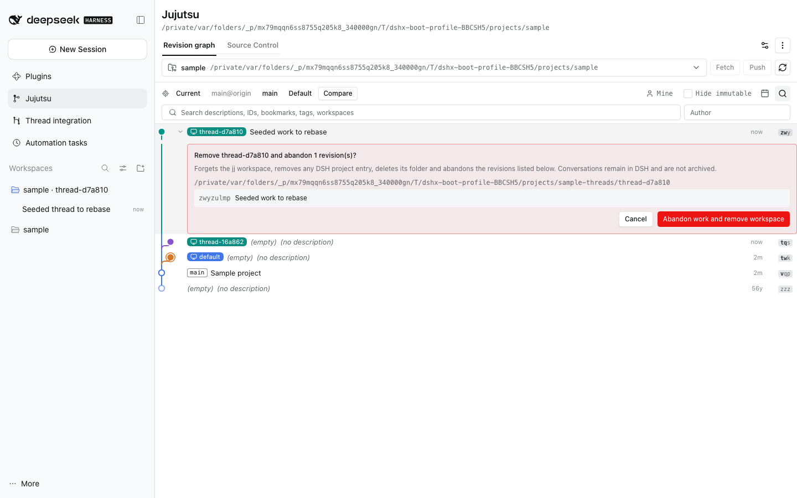
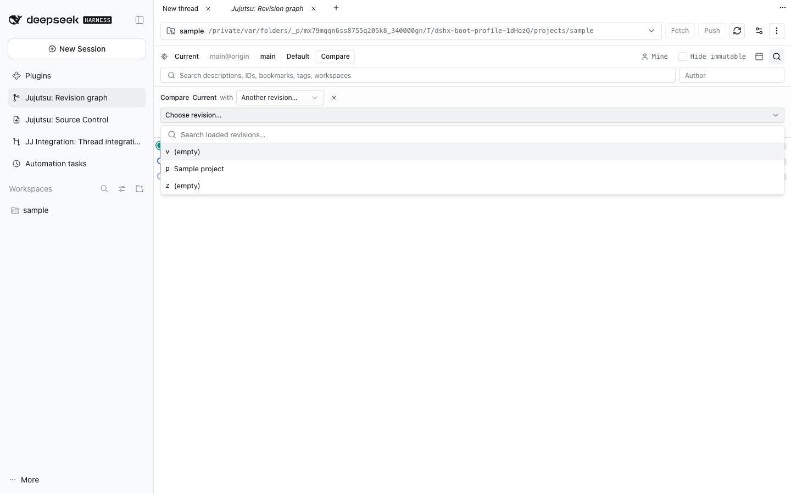
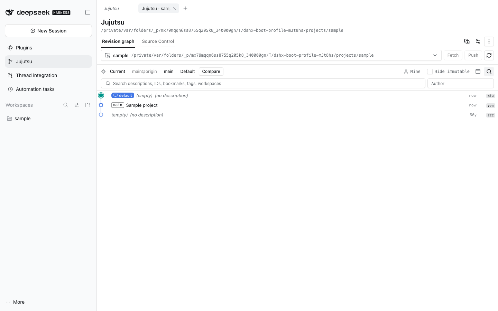
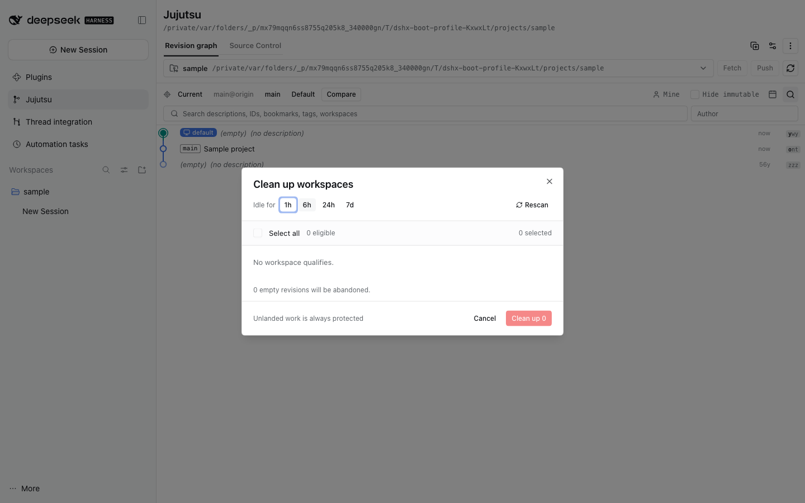
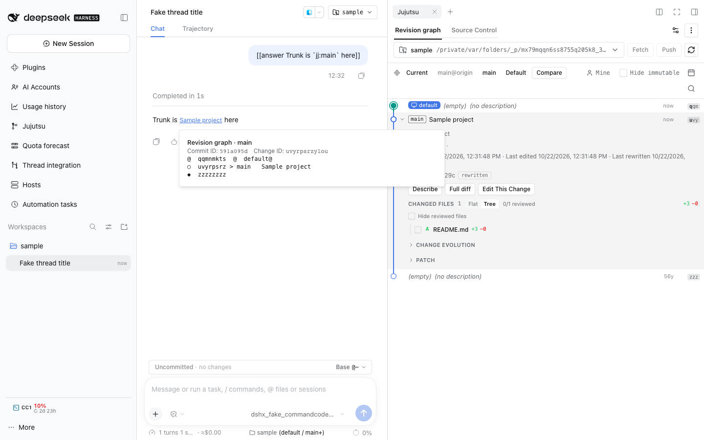

# @dshfiles/jujutsu











A DSH sidebar plugin for browsing and changing a Jujutsu repository. It is built
with this repository's local `@dshfiles/dshx` fork and DSH 0.2 client/host
contracts.

## What it provides

- A revision graph laid out like VisualJJ: the trunk (`main`/`master`/`trunk`
  and its first-parent ancestry) stays straight in lane 0; every other head
  opens a branch whose revisions form one contiguous block down to its fork
  point, placed directly above the trunk revision it forks from (newest head
  first) or directly above the side branch it is nested on. Each branch joins
  its parent with one turn, takes the leftmost lane whose run and turns cross
  no other lane, and frees that lane when it ends; without a visible trunk
  bookmark, branches simply stack by their newest head. Lanes
  bend with rounded corners in the lower half of the row, so every row keeps
  one height (28 px Comfortable, 22 px Compact). The trunk uses the accent
  colour and each side branch one of six hues (`graph-1..6` in the kit),
  different from the branch above it and from its parent. Lanes are 2 px.
  Nodes follow VisualJJ: workspace heads are filled, @ is filled with a halo,
  every other revision is a hollow ring (dimmed when immutable, whose text is
  dimmed too), a divergent copy gets a violet outline, and a conflicted
  revision is a red ✗. Every
  row is one line at any width: workspace pills (teal, blue for this
  checkout's @) and boxed bookmark and tag labels on the branch's head row,
  then the description or a muted italic `(empty)` / `(no description)`
  truncated with an ellipsis, then fixed right-aligned columns for the
  relative time (dropped below ~320 px; **Revision date** picks the last
  content edit, the creation time, or both, and hovering lists all three) and
  the change ID as a small pill
  (`changeid/N` for divergent copies). Describe appears on hover for
  undescribed revisions, and the expand chevron on hover. Optional
  collapsible day
  groups dated by each revision's last rewrite, author-name, text, mine,
  immutable and date filters, and a
  Comfortable / Compact density setting. The ideas (straight first-parent
  lanes, rounded corners, node styles) come from studying the jj-view VS Code
  extension (Apache-2.0); no code is copied from it.
- Expanded revisions show the description, Describe / Full diff / Edit This
  Change / Squash into parent, and changed files as a Flat or Tree list with
  M/A/D status (a conflicted file gets a red ✗ and red name), +/- counts, folder counts, and per-file review marks.
- Full diff expands every file of a revision in its own row, with numbered rows
  and collapsed "N unmodified lines" separators, rendered from `jj diff --git`.
- Right-click a revision for full diff, describe, edit, new change, squash,
  duplicate, revert onto @, rebase onto main, set or move a bookmark, create a
  workspace there, remove a workspace it holds, copy the full displayed
  revision ID, and abandon; right-click a local bookmark to push or delete it.
  Every one of these opens **inside the revision row it acts on** — no modal —
  and Escape or Cancel collapses it; only the shared folder picker for a new
  workspace parent is still a dialog. A panel whose row the current filter
  hides stays reachable above the list.
- A Source Control view modelled on jj-view: a message box that describes or
  commits @, then Working Copy and `@-1 … @-N` groups with per-file open diff,
  discard (`jj restore`), move to parent/child (`jj squash` with literal
  filesets), split by selected files, and group describe/new/edit/squash.
- One-click toggle of the right-panel Jujutsu page on the current thread's
  repository: the composer chips, a conversation-header button (setting
  `headerToggle`, **off by default** so the header keeps thread state; the page
  also opens from its own rail), and the `jujutsu.toggleSessionRepository`
  command, unbound by default under Settings › Shortcuts. It opens the page on
  that repository, or collapses the panel when it already shows it.
- One Jujutsu tab per repository in the main view, through the copy-plus button
  in the page header (_Open this repository in a new tab_): `@dshfiles/main-tabs`
  opens a tab scoped to that repository, named _Jujutsu · <repo>_ and renamed
  after whichever repository the tab shows later. A scoped tab keeps its own
  repository, view, filters, selection and expanded rows; closing it leaves the
  others alone.

- Each context keeps its own repository: a thread's right-panel Jujutsu page
  opens on that thread's project and remembers what it was changed to, and the
  global dock and the default main page keep theirs. Switching threads no
  longer retargets every side panel to the last repository picked anywhere.
- Repository selection through the shared project/folder command palette
  (registered DSH projects, recent repositories, `/` folder browsing).
- Dragging a local bookmark or revision onto a revision (main page and side
  panel) prepares a move/rebase preview while the moving branch is dimmed.
  Every mutation, fetch, and push needs a second explicit confirmation.
- View settings (default tab, ancestor groups, file layout, raw patch expanded,
  day grouping, graph density, hide immutable, mine only, revisions loaded) are saved in this
  browser and shared live by every Jujutsu surface; the repository, view and
  filters a given tab, thread or the dock was left on are kept per scope
  (`dshfiles.jujutsu.panel-scopes.v1` for the repository and view).
- Inline code in a chat message becomes a link when it is an explicit JJ
  identity: a `jj:`-prefixed name (`` `jj:main` ``, `` `jj:94526da8` ``), a
  revision-shaped token (a hex commit prefix of 7+, or a k–z change ID), or a
  name that really is a local bookmark of the Session repository. The prefix is
  the writing convention: the Host adds a system-prompt section telling every
  Agent to write references that way, it needs no repository lookup, and the
  reader sees the referenced revision's first-line description as a blue link
  (`jj:main` may render as `Base fixture`), truncated when long. The accessible
  name and hover tooltip retain the full title and reference. Visible links
  resolve titles lazily and fall back to the bare reference if unavailable.
  Hovering
  one lazily previews a bounded revision graph around it: the reference, its
  neighbours, and the working copy, main, main@origin and default workspace
  landmarks, with the referenced row marked `>`. The preview labels the selected
  revision's commit-ID prefix and change ID separately; hover the prefix for the
  full commit ID. A click
  opens the Jujutsu side panel on that repository and either
  focuses the revision or compares it with main/default while showing its
  history path (`chatReferenceClickBehavior`); `chatReferenceLinks` turns the
  behavior off. A token outside the loaded page falls back to the graph search.
- **Move between surfaces**: the Jujutsu main tab dropped on the open right side
  panel moves there, through the cancelable `dshfiles:move-panel-aside` request
  this entry answers by opening its right-pane tab. That tab's own menu row, _Move
  to main area_, closes it and selects the main panel again.
- Right-click a revision → New workspace here… names and places an isolated JJ
  workspace checked out at it in that row, previews the setup, then explicitly
  opens a DSH Session in that directory. Forking a Session is left to DSH's
  native Branch action, and thread workspaces to `@dshfiles/jj-integration`.
- Right-click a workspace pill (or that revision) → Remove workspace… to
  unregister it, with the confirmation expanding in that row. A managed thread
  workspace is removed whole — jj workspace forgotten, DSH project entry
  removed, folder deleted, unlanded revisions abandoned only after the panel
  names them — while any other workspace is only forgotten: its folder, files
  and commits stay on disk. `default` is never offered, and a repository keeps
  at least one workspace.
- Repository actions → Clean up thread workspaces previews idle candidates with
  1h, 6h, 24h, or a custom positive whole-hour threshold and explains skipped
  workspaces; removing candidates starts a background job.

## Graph landmarks and temporary views

- **Current**, **main@origin**, **main**, and **Default** locate exact revisions.
  Current is the selected JJ workspace's `@`; Default is `default@`, not the
  trunk bookmark. Missing or conflicting landmarks are disabled rather than
  guessed. Coincident landmarks remain separate shortcuts to the same row.
- Locate scrolls, focuses, and briefly highlights its row. A filtered or
  outside-page target offers **Show temporarily** or **Clear filters and
  locate**; temporary reveal preserves existing filter settings and is removable.
- Comparison is opt-in: the **Compare** toolbar button uses the selected row,
  or the current workspace revision when no row is selected. Right-click any
  revision and choose **Compare with** to compare it with a specific landmark
  or another loaded revision without opening that revision's details. The compact
  comparison strip reports ahead/behind direction and exact per-side ancestry
  counts; path actions are disabled when there is no useful path or no work
  since the target. It compares ancestry, not file contents or patch equivalence.
  Rewritten comparison subjects follow a unique current change ID; ambiguous
  divergent copies are never selected automatically.
- **Highlight path** dims unrelated text while preserving graph membership and
  passing rails. **Show only path** loads bounded connecting DAG, including all
  relevant merge paths and best common ancestors. **Work since target** shows
  only selected ancestry absent from target ancestry; identical endpoints yield
  an empty view and disable this action.
- Right-click **Focus history leading here** for all-parent ancestry.
  **Hide exclusive history leading here** hides only ancestry not needed by
  any retained repository head, bookmark, remote bookmark, or workspace tip.
  Internal revisions with retained descendants normally have nothing exclusive
  to hide. Multiple hidden histories have individual restore chips and Undo.
- All filters participate in a visible status strip. **Show all** clears
  temporary views, hidden/revealed sets, search, author, date, collapsed days,
  Mine, and Hide immutable. Focus, lens, and hide sets capture the operation
  when applied; clear/reapply them to incorporate subsequent history changes.
  They remain local to the mounted graph and reset when switching repositories.
- Every membership filter is applied before layout, so omitted ancestry uses
  dashed bridges or dotted boundary stubs rather than misleading adjacent rails.
  Navigation reads use `--ignore-working-copy` at one pinned JJ operation.
  Graph/ID output is capped at 500 revisions and advertises truncation. Counts
  remain exact independently of that cap; overly large or timed-out exact
  reads fail explicitly instead of returning estimates.
- The graph loads history ahead of the scroll instead of at its end: two Host
  pages (200 revisions) load before anything scrolls, and every later page that
  lands tops the list up again while less than three viewport-heights of loaded
  history remains below the viewport. The automatic top-up stops at 2,000 loaded
  revisions — scrolling continues past it — and a short list that a filter
  emptied keeps loading until it shows rows.

### Verification

The navigation journey covers one-click landmarks, hidden-by-default comparison,
toolbar and context-menu entry points, exact counts, path highlighting, disabled
empty actions, temporary reveal, focus/hide/undo, unchanged repository history,
and 360/480/768/1024 px pane widths. Real JJ integration fixtures cover
multiple merge bases, concurrent operations, missing/conflicting bookmarks,
independent default workspaces, local remote bookmarks, and history beyond 500 rows.

Local-remote fetch tests need the Git version supported by the installed JJ
(at least 2.41); macOS system Git may be too old. Use an ephemeral cached tool,
not a global install:

```sh
nix shell nixpkgs#git --command pnpm --dir plugins/@dshfiles/jujutsu exec vitest run --fileParallelism=false
DSHX_E2E_PREBUILT=1 pnpm --dir tooling/dshx run test:e2e jujutsu --workers=1
```

## Host and command boundary

The Host injects both `subprocess` and `webServer`: DSH's ConnectionService
registers API routes through the Host owner's `webServer` context. It uses the
DSH 0.2 `ctx.subprocess` service, resolves the literal `jj` executable once,
then invokes it only as an argv array with the registered repository root as
`cwd`; it never builds a shell command or forwards ambient environment
variables. Output is byte bounded, requests are cancellable, and commands have
fixed timeouts. Stderr is not returned to the browser because a remote helper
may put credentials in it.

The browser supplies an absolute path only when registering a repository. The
Host canonicalizes it, verifies it with `jj root`, and stores an opaque,
process-local repository id. Later API calls accept only that id. Before and
after commands, the Host checks the canonical directory and its device/inode;
before confirmation it recomputes the revision/status/path and remote-config
fingerprint. Remote configuration is hashed in memory and never sent to the
client. Remote preview and command output is redacted before it crosses the
API.

Confirmation tokens are one-use, expire after five minutes, and bind the
action to the repository identity and current state. Fetch cannot provide an
exact incoming-change preview through the supported JJ command used here, so
its preview explains that remote changes depend on the fetch response. Push
uses `jj git push --dry-run` when available; a failed dry run is disclosed in
the preview and never starts the real push.

The subprocess contract accepts `cwd` as a path string and has no opened-
directory handle or Host-issued repository capability. Canonicalization and
device/inode checks substantially constrain symlink replacement, but a narrow
TOCTOU window remains between the final path check and process launch. Closing
that last race requires a Host/subprocess contract that binds process launch to
an already-open directory handle. Repository registration still uses a typed
path field because the Host contract exposes no repository picker.

Workspace provisioning uses the Client `uiWorkspace.pickDirectory` picker.
The Host treats its result as untrusted: it canonicalizes an existing parent,
rejects destinations inside or above the registered repository tree and any
existing destination, and binds the preview to the parent directory's device
and inode before repeating the checks at confirmation. `jj workspace add`
receives the validated path and name as separate argv values. The final path
check and process launch still have a narrow TOCTOU window because the Host
subprocess API has no opened-directory handle. Opening a Session in the created
directory is a separate user action through the native Session and UI
Workspace services.

Revision details show file counts, diff line counts, evolution history, and the
selected revision's full diff. Description drafts are keyed by revision, so
switching revisions or moving between the detail and working-copy panels does
not reuse text from a different change. After a rewrite, the detail selection
follows the stable change ID to its current commit.

Split passes every selected listed path as its own `root-file:"..."` fileset
argument. The encoder escapes JJ string-literal quotes, backslashes, tabs, and
control bytes, so spaces, Unicode, and glob/fileset metacharacters remain part
of one exact workspace-relative filename. Absolute paths, traversal segments,
NUL, CR, and LF are rejected. CR/LF cannot be represented unambiguously by the
current line-delimited `jj diff --name-only` path response; supporting those
filenames requires a NUL-delimited Host query.
The last-push marker matches the recorded `args: jj git push` command invocation
(plus the fixed `--color=never --no-pager` flags this plugin adds), then shows
that operation's JJ end time. It excludes `--dry-run` commands so preparing a
preview cannot advance the marker. The timestamp identifies a recorded command
invocation; JJ operation data does not prove the remote accepted it. It never
treats an unrelated recent operation as a push. The scan is bounded to the
latest 1,000 operations and 512 KB of output. Direct `git push` commands, JJ
push invocations created with `--no-integrate-operation`, older operations
outside that scan, and unavailable or truncated operation history cannot be
identified from this query; the UI reports when the scan is incomplete and
when no marker was found in its window.

## Runtime compatibility and composition

The package peer ranges target `@deepseek-ai/* >=0.2.0-rc.1 <0.3.0-0`, which
includes the installed DSH `0.2.0-rc.2`. Its source imports the installed
`@deepseek-ai/dsh-subprocess` contract and DSH 0.2 client layout/sidebar/slots
contracts; it does not use BB APIs or direct `child_process` calls.

The package's `cordis.patch.yml` inserts the `@dshfiles/jujutsu` loader row.
To enable it in a chosen profile, the parent composition must add the local
package to that profile's bundle dependencies and bundle list. This child
workstream does not edit the active DSH profile or the root workspace
manifests/lockfiles.

## Marketplace decision

Decision: **build with local dshx**. The marketplace survey did not find a
Jujutsu/VisualJJ-like DSH UI that covers this workflow. The closest catalog
candidate inspected, `changestab@0.3.0`, has no declared DSH peer range, and its
published code imports older client runtime/primitives and uses direct
`child_process` execution. It is a read-only changes sidebar, so its package
metadata and actual imports do not establish compatibility with installed DSH
0.2 or cover the requested graph and confirmed Source Control actions. A port
would carry obsolete runtime assumptions without providing the needed
capability.
