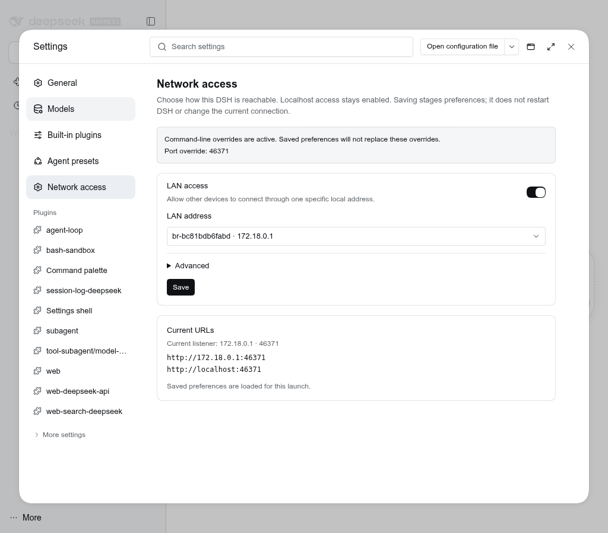
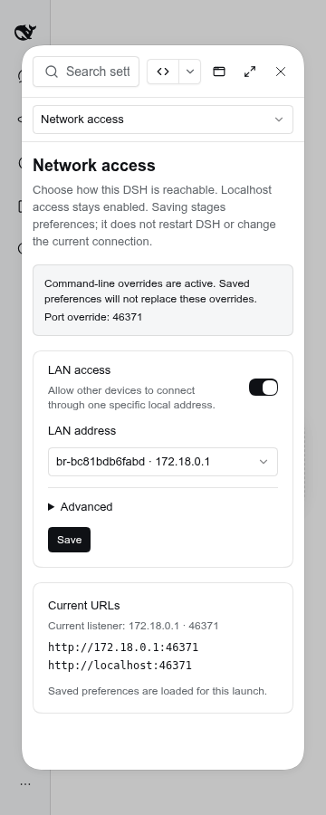

# Loopback access

Keep the same authenticated DSH available on **localhost and its selected LAN
address**, without changing the native Web server, its routes, or its security
policy. This plugin uses Node's cross-platform TCP implementation;
it needs no systemd, launchd, shell utility, fixed LAN IP, or fixed port.




## Network access settings

Settings → **Network access** lets you enable LAN access, explicitly choose an
available interface address, and set an advanced port. **Localhost stays enabled**
whether LAN access is on or off; there is no localhost-disable option.
A fresh profile is **localhost-only** (`127.0.0.1`): LAN access is off unless you
explicitly enable it or supply an explicit native `--host` override.
**Save** stages validated, revision-checked preferences without changing
active listeners or disconnecting clients. A later user-controlled restart loads
them. Explicit native `--host` / `--port` flags retain priority. Missing addresses
stay visible rather than silently selecting a different network; a custom native
binding remains read-only when startup integration is overridden.

The `network_access_settings` and `network_access_save` tools expose the same
snapshot and staged write contract. Saving is not permission to restart DSH.
Legacy saved `localhostEnabled: false` values are ignored at startup and removed
on the next settings save. The API retains an always-true compatibility field for
older clients/Hosts, not a setting that can disable access. Active status still
reports actual availability rather than claiming that a failed listener works.
No checked-in profile enables this bundle.

## Behavior

- A native loopback bind is left completely unchanged. Installing this plugin
  does **not** enable LAN access.
- With a concrete non-loopback bind, the plugin forwards `127.0.0.1` and `::1`
  on the native port to that same native listener. IPv6 is optional only when
  the OS genuinely does not support it; occupied ports are reported, not hidden.
- HTTP bytes, cookies, Origin, WebSocket upgrades, streaming and TLS pass
  unchanged. Native launch-token authentication and same-origin fencing remain
  authoritative. No trusted hosts are added and no local login is bypassed.
- Native `webServer.host` and the actual initialized `webServer.port` are the
  only target configuration. Outgoing connections pin their source to that
  native interface. No arbitrary target or listening-address configuration is
  exposed.
- Connections use stream backpressure, a five-second connect deadline and a
  256-pair limit. Unloading the plugin closes both listeners and every accepted
  and upstream socket, including idle streams. Startup failure rolls back.

After startup settles, the terminal lists the actual **localhost launch URL
first**, followed by the selected LAN URL when available. These use the native
process token and normal login redirects, not a second authentication scheme.
Only actual listeners are listed: installing the bundle does not enable LAN,
invent listeners on other network interfaces, or promise localhost after a
forwarding failure. An explicitly configured public/proxy URL is listed
separately as advertised, not as a verified local listener.

On the serving computer, use the first link; on your phone, use the LAN link.
Each authority needs its own native login because cookies do not transfer
between LAN and localhost. Launch URLs contain credentials: do not share logs.
The status API and tools continue to return token-free origins only.

For HTTPS, keep the `https` scheme: the configured certificate must also cover
localhost. A TCP forwarder does not terminate TLS or bypass certificate checks.

## Install

This bundle is **optional**: no checked-in profile enables it. Build the
package, then explicitly select it in a profile you own: add a local `link:`
dependency pointing to this package and include `@dshfiles/loopback-access` in
that profile's `dsh.profile.bundles` list. Install that profile's dependencies
and restart it normally. Its bundle patch inserts the owned adjunct and
`dshfiles-network-terminal-output` rows. It replaces the native Web runtime's
single-link print policy while preserving its current CLI-aware browser/public
URL/context configuration. It never edits the native Web server's binding.
Disabling the adjunct removes forwarding without modifying the LAN listener.
To suppress all startup links, disable the terminal-output row too and keep
native `web-runtime.config.printUrl: false`. Profile overrides apply after the
bundle: if you restate the Web runtime config, retain that false print policy
to avoid duplicate native output.
Installing or building the repository alone does not activate this plugin.
The seeded `web` synchronizer follows its explicit seed bundle list, which
omits this package. The existing **all-owned** development flows (scratch
compositions and syncing an unseeded profile without `--bundle`) deliberately
select every owned bundle, including this one. For a custom profile, select
bundles explicitly rather than using that bulk opt-in.

The read-only `loopback_access_status` agent tool reports actual listeners and
non-secret origins. It never returns launch tokens or cookies.

## Why an owned plugin

This is a new owned package, contributed from Neolectron's forwarding-only
implementation at `ab67ee7797a3119b42724e59d44a25c654b0446d`. It is not a fork of
a native DSH package or a port of another network proxy. It adds only inward
loopback access and deliberately preserves the stock authentication and
routing model. No third-party implementation was copied; dependencies are the
repository's existing dshx SDK, native DSH libraries, Zod and standard Node APIs.

Verified public contract: `@deepseek-ai/dsh-host-webserver@0.2.1-rc.2` exposes
`host`, initialized `port`, `protocol` and `getOrigin`. No native private field
or core patch is used. The startup lifecycle uses the official Cordis promised
disposer contract through upstream dshx's public `defineHost({ setup })` API.
The startup provider reads immutable desired preferences before the native Web
server starts. The narrow public dshx `readWebStartupOverrides` helper validates
native CLI overrides without restating the native Context contract in the plugin.
There is no personal launcher integration, trusted-host exception or replacement
authentication layer. Listener changes require a user-controlled Host restart.

## License and provenance

The author explicitly selected the **MIT License** for this contribution and
authorized its upstream merge. The complete grant is included in [LICENSE](LICENSE).
The package remains `private` to prevent accidental registry publication; this
does not restrict the MIT grant. Existing SDK/libraries retain their own licenses.
The implementation provenance above is unchanged; no third-party proxy code or
license ownership is claimed.

## Verification

```sh
pnpm --dir plugins/@dshfiles/loopback-access typecheck
pnpm --dir plugins/@dshfiles/loopback-access test
pnpm --dir plugins/@dshfiles/loopback-access build
pnpm check:e2e loopback-access
```

The package pins the native component test dependencies to `0.2.1-rc.2` via
the repository catalog. It does not import or install the monolithic Core
package. Consequently dshx emits `DSHX5104` / `DSHX5109` support-range and local
Core-pin warnings: compatibility is proven against the component contracts
and a stock `0.2.1-rc.2` scratch runtime, not asserted for other Core releases.
These warnings are not suppressed.

The socket tests use real IPv4/IPv6 connections, exact HTTP headers, duplex
streams, half-close behavior, occupied-port rollback and disposal/rebind checks.
The isolated stock-DSH journey checks native authentication and real RPC on
both origins, rejected hostile Host/Origin/cross-site requests, authority-bound
cookies, and a browser WebSocket through the loopback listener.

The implementation uses portable Node sockets. Linux is checked locally;
macOS and Windows execution is unverified. `loopback listen` and
`loopback connect` spans record bounded socket setup only, not headers, bytes,
cookies, launch tokens or addresses; real-socket tests assert their metadata.
