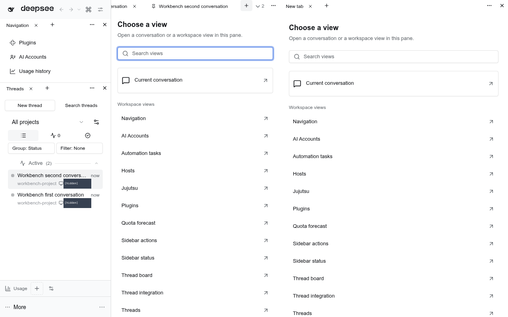

# @dshfiles/main-tabs



<details>
<summary>Native fallback strip</summary>


</details>

Tab semantics for DSH's main view. Every thread or global panel the main view shows (for example **Jujutsu: Revision graph**, **AI Accounts: Accounts**, **Usage: Analytics**, **Memory: Browser** and **JJ Integration: Thread integration**) opens or focuses a tab; picking a tab shows it again. In the owned stack, Workbench tabs are mandatory: Dockview owns pane chrome and the old strip is removed, not the centre surface. There is no native-layout opt-out. Deployments without Workbench retain the native-style strip (`dsh-client-ui-dockkit`) as package compatibility, using the same actor, computed metadata and actions. The Workbench right pane is fullheight; collapsing it preserves its live tabs instead of restoring native sidebar chrome.

This is an owned DSH bundle built with dshx (no port: nothing upstream does this). Run `pnpm build`, `pnpm test` and `pnpm typecheck` from this package.

## Use

The shared Workbench snapshot also publishes the authoritative native current Session ID independently of the selected tool tab. Reset layout uses that existing conversation/editor owner rather than cloning another input for the same Session. This is derived from `uiSession.adapter.current`, not a second selection store or an inference from retained views.

- **New tab (Workbench)**: each group's **+**, accessible as **New tab**, opens an actual **New tab** chooser tab. Semantic _Start_ tabs opened by Mod+T (Web: Mod+Alt+T) show that same chooser: **Choose a view**, **Search views**, one **Settings Shell: Settings** hub and plugin views. There is no separate Rich Composer/current-conversation entry: the thread list opens complete fixed-session chat-and-editor tabs. There is no duplicate Add panel dropdown or persistent Workbench toolbar.
- **New tab (standalone fallback)**: native core **Plugins**, **Automation tasks** and **Settings** keep their original names outside Workbench. Workbench presents those reusable templates as **Plugin Manager: Plugins**, **Schedule: Automation tasks** and **Settings Shell: Settings**. Otherwise unchanged. "+" after the last tab, or the same shortcut, opens a _Start_ tab with focused command-palette search. Typing filters New thread, five recent threads (running first), main panels and Settings; Arrow keys and Enter pick a result. A thread or panel replaces Start (or focuses its existing tab); New thread and Settings close it. Start is not saved.
- **Window scope (Workbench)**: selecting a conversation changes the subject, not the scene. Tabs from different projects keep the same window's tab identities, order, pins, drafts and unrelated New tab choosers. The current saved set key is an opaque scene anchor; no dormant project/global sets are merged and no user preference is rewritten. Host project metadata and navigation acknowledgements still follow the selected Session exactly. Native fallback keeps project-follow behavior. Explicit persistence changes and named-layout commands remain scene-changing actions.
- **Open conversations (Workbench)**: a normal sidebar click keeps each conversation in its own Session-bound tab. Opening another conversation does not replace it, and selecting an already open conversation focuses its tab. Explicit sidebar open intent also reopens the same native-current conversation after all tabs were closed; it does not depend on a native selection-change notification. This remains true with an old saved `enabled: false` or `openMode: preview/replace`; those settings cannot collapse the owned Workbench into one conversation view. Existing layouts, pins and drafts are preserved.
- **Open panels and standalone fallback**: the configured opening mode still applies. By default a _preview_ tab (italic) is replaced by the next panel you open, VS Code style; double-click it, pin it or drag it to keep it. Standalone conversation tabs retain that same configurable preview behavior.
- **Close**: × on the tab, a middle click, or Delete on a focused tab. Closing the active tab shows its right neighbour. The context menu adds _Close other tabs_ and _Close tabs to the right_; pinned tabs survive both. Thread tabs also open the thread in the right side panel, copy their ID or a clean deep link, and insert the thread into the active composer as a native `@mention` (_@Mention thread_) from this menu.
- **Pin**: from the context menu. Pinned tabs lead the strip and have no ×.
- **Reorder**: drag a tab. Pinned and unpinned tabs stay in their own groups.
- **Mention**: drag a thread tab into the composer to insert that thread as a native reference chip, or pick _@Mention thread_ from its tab menu. The drag carries `@dshfiles/thread-sidebar`'s `application/x-dshfiles-thread-mention` type rather than plain text, so a rich editor never receives the tab title, and the composer highlights while the thread hovers over it.
- **Move to the side panel (Workbench)**: the tab menu docks the same semantic tab in the fullheight right pane, preserving its pin, unread state and actor identity. Collapsing the pane hides its live tabs; reopening restores them, without native sidebar chrome. Drag a tab back to the centre without creating another tab or archiving its thread. A rejected docking request leaves the source in place.
- **Move to the side panel (native fallback)**: drag any tab onto the open right side panel. The right column highlights, a _Move to side panel_ hint follows the pointer, and dropping closes the main tab once the panel took the content. A thread goes through `@dshfiles/thread-sidebar`; a panel (Jujutsu, Workbench, Thread integration, Settings) answers the cancelable `dshfiles:move-panel-aside` event through its own plugin, which serves the same panel as one right-pane tab. A panel whose plugin offers no side-panel view keeps its tab and the strip says so. The side-panel tab's own menu row, _Move to main area_, moves it back.
- **Overflow**: the strip scrolls (mouse wheel works) and a ▾ button lists every tab once they do not fit.
- **Thread indicators**: a dot for _needs your input_ (an approval or a question), _working_ (pulsing), and _finished, unread_.
- **Keyboard**: Closing the active tab without archiving its thread has no default chord: DSH's own `page.close` already owns Mod+W on every desktop shell and the Host's shortcut registry refuses two commands that claim one default, so `Close active tab` ships unbound and rebindable in Settings › Shortcuts. Desktop Mod+1…8 / Mod+9 (last), Ctrl+Tab / Ctrl+Shift+Tab (Ctrl+Shift+] / [ on Linux). The browser keeps those keys, so the Web defaults are Mod+Alt+1…9 and Mod+Alt+] / [. Mod+T (Web: Mod+Alt+T) opens a new tab and Mod+Shift+T (Web: Mod+Alt+Shift+T, the browser keeps Mod+Shift+T) reopens the last closed one. All are listed and rebindable in Settings › Shortcuts. Arrow keys, Home/End, Enter and Delete work inside the focused strip.

- **Scoped panel tabs**: one panel plugin can keep a tab per subject (Jujutsu on two repositories). `dshfiles:open-panel-tab` with `{ panelId, scope, title? }` opens or focuses a tab on that scope; before navigating the strip dispatches `dshfiles:panel-scope` with `{ panelId, scope }` (and `scope: null` for the plain panel), so the plugin swaps the state it shows, and the plugin keeps the tab title live through `dshfiles:panel-tab-title` with `{ panelId, scope, title }`. Scope and title are saved with the tab, so a reload restores the same tab on the same subject. `@dshfiles/jujutsu` opens each repository tab this way.
- **From other plugins**: a cancelable `dshfiles:open-thread` window event with `{ sessionId, newTab }` opens a thread in a tab; `newTab: true` keeps every tab whatever `openMode` says (Cmd/Ctrl-click on a thread reference in `@dshfiles/mentions`). The `dshfiles:replace-thread-tab` event with `{ sourceSessionId, sessionId }` replaces a temporary thread tab when first-send workspace isolation moves its composer to a new Session. The dispatch comes back cancelled when a tab took it; otherwise the caller opens the thread itself.
- **To other plugins**: a thread tab's _Open in side panel_ dispatches the cancelable `dshfiles:open-thread-aside` window event with `{ sessionId }`; `@dshfiles/thread-sidebar` cancels it once it put the thread in the right panel. An uncancelled dispatch leaves the thread alone and the strip announces that the side panel is not available there, so a profile without an aside owner never looks broken.
- **Panel moves**: a dropped panel tab dispatches the cancelable `dshfiles:move-panel-aside` window event with `{ panelId }`; the panel's owner cancels it when it can show the same panel in the right sidebar, and the strip then closes the main tab. An uncancelled dispatch leaves the tab in place and says the panel has no side-panel view. The reverse row is registered by that owner on its own right-pane tab kind, under the `sidebar.right.tab.menu.item` seat.
- **Thread links**: a plain click on a same-origin `?thread=session-…` link anywhere in the app opens that thread in a new tab instead of loading the app again — a document load replaces the whole client, which inside an installed PWA looks like the page reloading rather than a new tab. Every plugin's links get this without asking: `@dshfiles/chat`'s Markdown, `@dshfiles/backlog`'s activity lines and a relative `?thread=` link written by hand. Modified clicks (Cmd/Ctrl/Shift/Alt, middle click) keep the browser's own behavior, and a thread the strip cannot open (unlisted, archived) keeps the link's own navigation.

Native panel owners register their actual synchronous opener with `NativeAsideOwners.register(mainPanelId, open)` from `@dshfiles/workbench/registry`; the same callback serves their window-event listener.
Workbench invokes that explicit authority before generic placement and acknowledges only acceptance, so listener load order cannot open two side-panel owners.

## Settings (`dshfiles-main-tabs`)

| Key           | Default   | Meaning                                                                                                                                                                                                                                                         |
| ------------- | --------- | --------------------------------------------------------------------------------------------------------------------------------------------------------------------------------------------------------------------------------------------------------------- |
| `enabled`     | `true`    | Enable the standalone compatibility strip. Workbench always keeps its conversation-tab owner enabled.                                                                                                                                                           |
| `maxTabs`     | `12`      | Past it the least recently used unpinned tab closes.                                                                                                                                                                                                            |
| `openMode`    | `preview` | Panels and standalone conversations: `preview`, `new`, or `replace` (never pinned). Workbench conversations are always kept.                                                                                                                                    |
| `persistence` | `project` | Native: `project` follows each project (including jj thread workspaces; subagents follow their parent), `global` shares a set. Workbench holds the adopted scene while browsing conversations; changing this setting explicitly can select another saved scene. |

Tabs, order, pins, the preview flag and the active tab are saved in `localStorage` (`dshfiles.main-tabs.v1`). A reload that lands on the New thread screen reopens the saved active tab. A malformed document is ignored.

## Design

Workbench's effective preferences derive `keepScope` without changing saved Settings. The actor keeps its established `lastProjectKey`/set key (including a fresh `project:none` window), while `hostProjectId` remains the actual selected Session's project. This prevents a Host ACK for an already-open tab from restoring another project's older Dockview layout. Native preferences and scope-follow transitions are unchanged when Workbench is absent or released.

The two-project browser regression uses genuine registered projects and native workspace-attached Sessions through the existing public thread-actions API. Its legacy A scene has an ordinary New tab and both conversations; B has no chooser and a different order. The baseline loses the chooser on B selection. The repaired contract preserves the same identities/order/pin and editable drafts through repeated A/B selections and reload, then respects explicit chooser close without resurrecting an older cached scene. Actor regressions additionally cover active-close neighbors, external opens, stale/native ACK ordering and explicit persistence changes.

`tabs-machine.ts` (xstate) owns the tab sets, the active tab, order and persistence. The Host's main view stays the truth for what is shown: the client reports it (`host.navigated`, from `layout.panelInfo`, the Session list and Workspaces), and the machine opens or focuses a tab. Picking a tab asks the Host to navigate and ignores its in-between reports until it lands (two-second limit). The Start tab is the one tab with no Host target: while it is active the strip renders `start-page.tsx` below itself and hides the `main` outlet (still mounted, so a thread keeps its state); whatever the Host opens next, from the page or elsewhere, replaces it. Settings are only readable from components, so the machine waits in `gate` until the persistent shell-overlay semantics component reads them (even when workbench mode removes the strip).

## Tabs contract for other plugins

`@dshfiles/main-tabs/tabs-contract` declares the `MainTabs` dshx contract, provided while this plugin runs. Add `@dshfiles/main-tabs` as a workspace dependency (a dev dependency is enough: the module holds only the token) and read it through the plugin context:

```ts
import { MainTabs } from '@dshfiles/main-tabs/tabs-contract'

const tabs = api.use(MainTabs).get()
const opened = tabs.status === 'active' ? tabs.value.open({ kind: 'thread', sessionId }, { newTab: true }) : undefined
if (opened === undefined) openSession(sessionId)
```

- `tabs`: the current project's tabs in strip order (the same computed view the Workbench reads), empty while tabs are off. `track` it or `useSubscribable` it.
- `open(target, { newTab?, title? })`: a thread or a main panel (with an optional `scope`); returns the tab id, or undefined while tabs are off or the thread is not listed, so the caller opens it itself.
- `focus(tabId)` and `close(tabId)`: false when the current strip has no such tab.
- `pin(tabId, pinned)`: pins a tab to the start of the strip (no close button) or unpins it; false when the strip has no such tab.
- `reopenClosed()`: reopens the tab closed most recently in the current strip on this page, as **Reopen closed tab** does; false when none was. Up to 20 closed tabs are remembered per page; eviction past the tab limit is not a close.

`@dshfiles/mentions` opens a Cmd/Ctrl-clicked thread reference this way. The window events above stay for `@dshfiles/thread-sidebar`, which this plugin depends on and so cannot import the contract, and for callers not moved yet.

## Workbench semantics provider

`@dshfiles/main-tabs/workbench-tabs` is a declared dshx public module with a built runtime export. It re-exports the canonical `@dshfiles/workbench/tabs` contract: placing the neutral channel/types with the renderer avoids a reverse package dependency on main-tabs. The page-global `dshfilesWorkbenchTabsV1` channel survives cross-bundle module duplication; it creates no actor and owns no saved tab state.

```tsx
import { workbenchTabs } from '@dshfiles/main-tabs/workbench-tabs'

const provider = workbenchTabs()
const snapshot = useSyncExternalStore(provider.subscribe, provider.getSnapshot)
// Reconcile Dockview from snapshot; do not open/activate tabs during adoption.
// Only user actions call provider.actions.activate(tabId), close(tabId), etc.
```

- Snapshot: `{ enabled, scopeKey, activeTabId, tabs }`, the current project/global set only. Each tab is the existing computed `TabView` plus actor-owned `target: TabTarget`, preserving scoped panel identity, title, availability, preview/pin, thread/workspace id and status precedence (needs-you → running → unread). Snapshots remain referentially stable until their data changes.
- Actions: `activate`, `close`, `keep`, `togglePin`, `move`, `closeOthers`, `closeToRight`, `moveAside`, `open(target, newTab = false, title?)`, `newTab`, `renameThread(sessionId, title)`. They drive the existing actor/navigation adapters, including sidebar focus and scope announcement. `keep` clears preview; `togglePin` also keeps the tab. Closing is not archiving. `moveAside` retains the actor tab when the workbench docking port accepts or rejects it; only an accepted native independent-pane request closes that source tab. The page-global docking port is lifetime- and HMR-token-owned separately from semantic publication, so an old bundle cannot remove a replacement handler.
- In Workbench, semantic Start renders the same **New tab** chooser as each group's plus and empty right/bottom panes. The renderer owns its panel container and quiet group chrome; main-tabs never hides `shell.main` to show it. `renderStart()` retains the existing suggestions renderer for standalone compatibility; that fallback is unchanged.
- Without the provider, the stable snapshot is disabled/empty, action calls do nothing (rename rejects), and `renderStart()` returns null. Disposal disconnects subscriptions; a stale HMR disposer cannot remove a newer provider.
- `ctx.get('mainSurface')` is optional. Workbench ownership removes the native strip host and its observer; deployments without Workbench (including a stock frame without the service) retain the original portal route. This is package compatibility, not an owned-stack user preference. The shell-overlay contribution stays mounted to publish settings, actor state and live metadata in either case.

The channel exports presentation state, not render authorization. A renderer must use its declaring frame's keyed-main renderer for panel content, and explicit public Session references/providers for independent thread content. Adopting snapshots must not navigate/report them back to the actor; user selection goes through `activate`. Selecting the already-active semantic id does not navigate again; an explicit re-click still clears the thread's rendered unread record and follows the sidebar-focus preference. Both native and workbench selection clear attention through the Host's versioned `clearUnread` API, so a newer finish cannot be cleared by a stale tab.

## Conversation ownership regression

The Workbench fixture seeds the old `enabled: false` / `openMode: preview` combination and verifies those actual Settings controls remain unchanged. Two plain sidebar opens then retain separate fixed Session tabs, messages and unsent drafts across switches and reload; closing one leaves the other. The fixture has no AI credential, so its expected failed model turns are unrelated to tab retention. [Reload evidence](docs/evidence/independent-conversations.png).

The policy tests also preserve standalone disabled/preview behavior, panel previews, restored conversation previews, project tab sets and pins across surface changes. No stored settings or tab schema migration is required.

Verified: 117 main-tabs unit tests (`node plugins/@dshfiles/main-tabs/node_modules/vitest/vitest.mjs run --root plugins/@dshfiles/main-tabs`) and 142 Workbench unit tests pass. All 23 Workbench and 12 standalone browser journeys pass against stock core across focused batches, including the legacy-settings RED→GREEN regression. The catalog's Workbench reach uses the platform-independent New tab button rather than a Web keyboard binding unavailable on Linux. Its scratch walk passes with no page errors; the stock runtime's missing VSCode icon produces an unrelated 404.

## Host limits and workarounds

See [`plans/dsh-host-gaps.md`](../../../plans/dsh-host-gaps.md).

- **Native fallback: no seat above the main panel.** Only in native mode, the strip renders from a `shell.overlay` entry through a portal into a node placed right before the `main` slot outlet. The slot renderer wraps every outlet in `<div data-slot="<key>" style="display:contents">`, and only the frame (the `root` occupant) may render `main`, so `[data-slot="main"]` is unique and independent of the frame's own markup (`src/strip-mount.ts`). The node is re-attached when the frame replaces the outlet or its column.
  - _Why not a real seat:_ the frame's `AppFrame` is not exported (`@deepseek-ai/dsh-client-ui-layout` exports `apply`, `inject` and `LayoutController` only), a lower-priority shadow of `root` cannot re-declare `main` (declaring a declared child throws), and a keyed shadow of a `main` entry cannot render the entry it shadows (each entry's props are composed privately by the renderer). Disabling `ui-layout` in `cordis.patch.yml` drops its module from the boot graph, so a wrapper could not reuse its `apply` either; the only plugin-side seat would be a fork of the frame.
  - _Detection:_ if no `[data-slot="main"]` outlet appears within 3 s, the console warns once (`main-tabs: the tab strip cannot mount …`) and the strip stays hidden while tabs keep following the main view. If the strip renders anywhere but directly above the main panel, the console warns too. The e2e journey `main-tabs.strip-mount` fails on either.
- **Settings gets a tab through `@dshfiles/settings-shell`.** Settings is the `ui-settings-general` modal, not a `main` panel, and nothing plugin-side can render its sections elsewhere (only the declaring `sidebar.settings` entry may render `settings.section`, and its shell is not exported). `@dshfiles/settings-shell` ports that shell and adds a `main` panel (`dshfiles-settings`), so this strip gives it a tab like any other panel with no coupling between the two plugins; without the port, the gear keeps showing the native modal over the tabs.

- A panel's own sidebar icon can only be rendered through the `sidebar.panellist` slot by its declarer. Tabs show only the label, as the right panel's tabs do; the Start page renders each entry's registered glyph component directly with the sidebar's owner props (`{ size, active }`), behind an error boundary that falls back to a generic panel icon.
- **Settings has no open action for plugins.** Its shell store is private to `ui-settings-general` and the shortcut registry cannot run a command, so the Start page's Settings row presses the sidebar's own trigger (`[data-slot="settings.launcher"] button[aria-haspopup="dialog"]`).
- **Panels have no shortcut field.** The Start page shows the bound shortcut command named after the panel (`Jujutsu` or `Open Jujutsu`), if any.
- With no tab left, the main view keeps showing what it showed: DSH has no way to show "nothing" without creating a blank Session.
