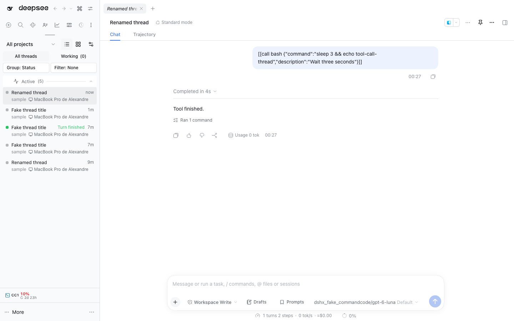

# @dshfiles/main-tabs

Browser-like tabs above DSH's main view. Every thread or global panel the main view shows (Plugins, Jujutsu, AI Accounts, Usage analytics, Memory, Thread workspaces, Workbench, …) opens or focuses a tab; picking a tab shows it again. The strip looks like DSH's own right-panel tabs (`dsh-client-ui-dockkit`): same 28px pills, typography, hover and active colors, hairline separators and close cross, built from the same `--dsw-*` tokens.

This is an owned DSH bundle built with dshx (no port: nothing upstream does this). Run `pnpm build`, `pnpm test` and `pnpm typecheck` from this package.

## Use

- **New tab**: "+" after the last tab, or Mod+T (Web: Mod+Alt+T), opens a _Start_ tab with a focused command-palette search. Typing filters New thread, the five most recent threads (running ones first), main panels and Settings by title or description; Arrow keys and Enter pick a result. A picked thread or panel takes the Start tab's place (or focuses its existing tab); New thread and Settings close it. The Start tab is not saved.
- **Open**: anything shown in the main view gets a tab. By default it is a _preview_ tab (italic) that the next thing you open replaces, VS Code style; double-click it, pin it or drag it to keep it.
- **Close**: × on the tab, a middle click, or Delete on a focused tab. Closing the active tab shows its right neighbour. The context menu adds _Close other tabs_ and _Close tabs to the right_; pinned tabs survive both. Thread tabs also open the thread in the right side panel, copy their ID or a clean deep link, and insert the thread into the active composer as a native `@mention` (_@Mention thread_) from this menu.
- **Pin**: from the context menu. Pinned tabs lead the strip and have no ×.
- **Reorder**: drag a tab. Pinned and unpinned tabs stay in their own groups.
- **Mention**: drag a thread tab into the composer to insert that thread as a native reference chip, or pick _@Mention thread_ from its tab menu. The drag carries `@dshfiles/thread-sidebar`'s `application/x-dshfiles-thread-mention` type rather than plain text, so a rich editor never receives the tab title, and the composer highlights while the thread hovers over it.
- **Move to the side panel**: drag any tab onto the open right side panel. The right column highlights, a _Move to side panel_ hint follows the pointer, and dropping closes the main tab once the panel took the content. A thread goes through `@dshfiles/thread-sidebar`; a panel (Jujutsu, Workbench, Thread integration, Settings) answers the cancelable `dshfiles:move-panel-aside` event through its own plugin, which serves the same panel as one right-pane tab. A panel whose plugin offers no side-panel view keeps its tab and the strip says so. The side-panel tab's own menu row, _Move to main area_, moves it back.
- **Overflow**: the strip scrolls (mouse wheel works) and a ▾ button lists every tab once they do not fit.
- **Thread indicators**: a dot for _needs your input_ (an approval or a question), _working_ (pulsing), and _finished, unread_.
- **Keyboard**: Closing the active tab without archiving its thread has no default chord: DSH's own `page.close` already owns Mod+W on every desktop shell and the Host's shortcut registry refuses two commands that claim one default, so `Close active tab` ships unbound and rebindable in Settings › Shortcuts. Desktop Mod+1…8 / Mod+9 (last), Ctrl+Tab / Ctrl+Shift+Tab (Ctrl+Shift+] / [ on Linux). The browser keeps those keys, so the Web defaults are Mod+Alt+1…9 and Mod+Alt+] / [. Mod+T (Web: Mod+Alt+T) opens a new tab. All are listed and rebindable in Settings › Shortcuts. Arrow keys, Home/End, Enter and Delete work inside the focused strip.

- **Scoped panel tabs**: one panel plugin can keep a tab per subject (Jujutsu on two repositories). `dshfiles:open-panel-tab` with `{ panelId, scope, title? }` opens or focuses a tab on that scope; before navigating the strip dispatches `dshfiles:panel-scope` with `{ panelId, scope }` (and `scope: null` for the plain panel), so the plugin swaps the state it shows, and the plugin keeps the tab title live through `dshfiles:panel-tab-title` with `{ panelId, scope, title }`. Scope and title are saved with the tab, so a reload restores the same tab on the same subject. `@dshfiles/jujutsu` opens each repository tab this way.
- **From other plugins**: a cancelable `dshfiles:open-thread` window event with `{ sessionId, newTab }` opens a thread in a tab; `newTab: true` keeps every tab whatever `openMode` says (Cmd/Ctrl-click on a thread reference in `@dshfiles/mentions`). The `dshfiles:replace-thread-tab` event with `{ sourceSessionId, sessionId }` replaces a temporary thread tab when first-send workspace isolation moves its composer to a new Session. The dispatch comes back cancelled when a tab took it; otherwise the caller opens the thread itself.
- **To other plugins**: a thread tab's _Open in side panel_ dispatches the cancelable `dshfiles:open-thread-aside` window event with `{ sessionId }`; `@dshfiles/thread-sidebar` cancels it once it put the thread in the right panel. An uncancelled dispatch leaves the thread alone and the strip announces that the side panel is not available there, so a profile without an aside owner never looks broken.
- **Panel moves**: a dropped panel tab dispatches the cancelable `dshfiles:move-panel-aside` window event with `{ panelId }`; the panel's owner cancels it when it can show the same panel in the right sidebar, and the strip then closes the main tab. An uncancelled dispatch leaves the tab in place and says the panel has no side-panel view. The reverse row is registered by that owner on its own right-pane tab kind, under the `sidebar.right.tab.menu.item` seat.

## Settings (`dshfiles-main-tabs`)

| Key           | Default   | Meaning                                                                                                                                      |
| ------------- | --------- | -------------------------------------------------------------------------------------------------------------------------------------------- |
| `enabled`     | `true`    | Show the strip and follow the main view.                                                                                                     |
| `maxTabs`     | `12`      | Past it the least recently used unpinned tab closes.                                                                                         |
| `openMode`    | `preview` | Opening from outside the strip: `preview` tab, `new` tab, or `replace` the current one (never a pinned one).                                 |
| `persistence` | `project` | `project` keeps a tab set per project (a jj thread workspace counts as its project; subagents follow their parent); `global` shares one set. |

Tabs, order, pins, the preview flag and the active tab are saved in `localStorage` (`dshfiles.main-tabs.v1`). A reload that lands on the New thread screen reopens the saved active tab. A malformed document is ignored.

## Design

`tabs-machine.ts` (xstate) owns the tab sets, the active tab, order and persistence. The Host's main view stays the truth for what is shown: the client reports it (`host.navigated`, from `layout.panelInfo`, the Session list and Workspaces), and the machine opens or focuses a tab. Picking a tab asks the Host to navigate and ignores its in-between reports until it lands (two-second limit). The Start tab is the one tab with no Host target: while it is active the strip renders `start-page.tsx` below itself and hides the `main` outlet (still mounted, so a thread keeps its state); whatever the Host opens next, from the page or elsewhere, replaces it. Settings are only readable from components, so the machine waits in `gate` until the strip reads them.

## Host limits and workarounds

See [`plans/dsh-host-gaps.md`](../../../plans/dsh-host-gaps.md).

- **No seat above the main panel.** The strip renders from a `shell.overlay` entry through a portal into a node placed right before the `main` slot outlet. The slot renderer wraps every outlet in `
" style="display:contents">`, and only the frame (the `root` occupant) may render `main`, so `[data-slot="main"]` is unique and independent of the frame's own markup (`src/strip-mount.ts`). The node is re-attached when the frame replaces the outlet or its column.
  - _Why not a real seat:_ the frame's `AppFrame` is not exported (`@deepseek-ai/dsh-client-ui-layout` exports `apply`, `inject` and `LayoutController` only), a lower-priority shadow of `root` cannot re-declare `main` (declaring a declared child throws), and a keyed shadow of a `main` entry cannot render the entry it shadows (each entry's props are composed privately by the renderer). Disabling `ui-layout` in `cordis.patch.yml` drops its module from the boot graph, so a wrapper could not reuse its `apply` either; the only plugin-side seat would be a fork of the frame.
  - _Detection:_ if no `[data-slot="main"]` outlet appears within 3 s, the console warns once (`main-tabs: the tab strip cannot mount …`) and the strip stays hidden while tabs keep following the main view. If the strip renders anywhere but directly above the main panel, the console warns too. The e2e journey `main-tabs.strip-mount` fails on either.
- **Settings gets a tab through `@dshfiles/settings-shell`.** Settings is the `ui-settings-general` modal, not a `main` panel, and nothing plugin-side can render its sections elsewhere (only the declaring `sidebar.settings` entry may render `settings.section`, and its shell is not exported). `@dshfiles/settings-shell` ports that shell and adds a `main` panel (`dshfiles-settings`), so this strip gives it a tab like any other panel with no coupling between the two plugins; without the port, the gear keeps showing the native modal over the tabs.

- A panel's own sidebar icon can only be rendered through the `sidebar.panellist` slot by its declarer. Tabs show only the label, as the right panel's tabs do; the Start page renders each entry's registered glyph component directly with the sidebar's owner props (`{ size, active }`), behind an error boundary that falls back to a generic panel icon.
- **Settings has no open action for plugins.** Its shell store is private to `ui-settings-general` and the shortcut registry cannot run a command, so the Start page's Settings row presses the sidebar's own trigger (`[data-slot="settings.launcher"] button[aria-haspopup="dialog"]`).
- **Panels have no shortcut field.** The Start page shows the bound shortcut command named after the panel (`Jujutsu` or `Open Jujutsu`), if any.
- With no tab left, the main view keeps showing what it showed: DSH has no way to show "nothing" without creating a blank Session.
