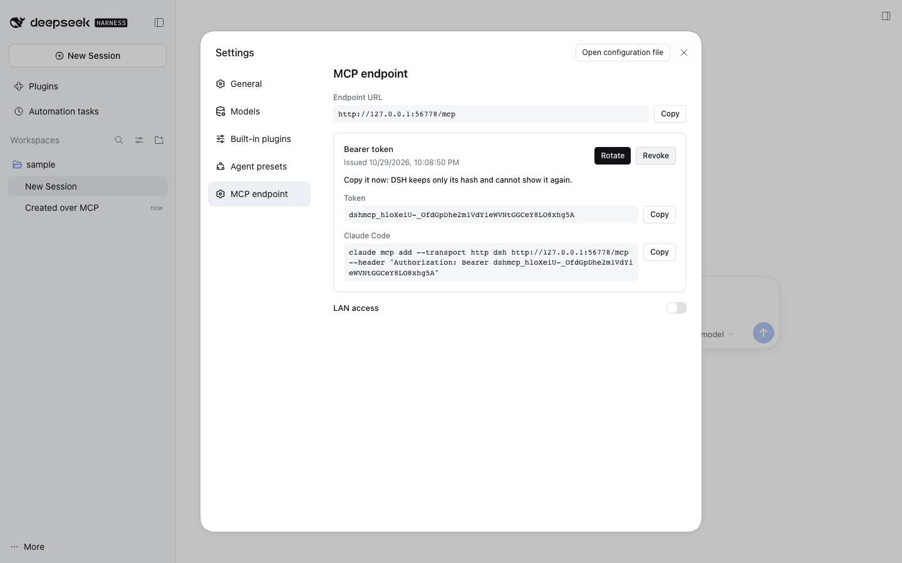

# @dshfiles/mcp-endpoint



An [MCP](https://modelcontextprotocol.io) server on the DSH Web server, so an agent in a terminal (Claude Code, Codex,
any MCP client) can drive DSH threads: list them, read them, start one, message it, wait for its turn and stop it.

```sh
claude mcp add --transport http dsh http://127.0.0.1:3080/mcp --header "Authorization: Bearer dshmcp_…"
```

Settings › **MCP endpoint** generates the token and shows this command, with the real URL and token, once.

## Tools

| Tool            | What                                                                                          |
| --------------- | --------------------------------------------------------------------------------------------- |
| `list_projects` | registered projects (id, title, path), for `create_thread`                                    |
| `list_threads`  | threads newest first: id, title, directory, project, running; `query`, `projectId`, `limit`   |
| `read_thread`   | a thread's last user and assistant messages (default 20, at most 100), and whether it runs    |
| `create_thread` | a thread in a project or directory, with optional title, agent preset, model and first prompt |
| `send_message`  | a user message: `queue` (default, next turn) or `steer` (the running turn)                    |
| `wait_for_turn` | until the thread is idle with nothing queued, or `timeoutMs` (default 60 s, at most 5 min)    |
| `stop_turn`     | stop the running turn; queued messages stay                                                   |

Every tool except `list_projects` is one call of session-controller's
[`sessions-api`](../session-controller/README.md#driving-threads-sessions-api), made in process as
`@dshfiles/mcp-endpoint`. A refused call (unknown thread, busy agent) comes back as an MCP tool error with DSH's
message and code.

## Transport

`/mcp` is a raw route on the Web server (`webServer.register`), outside DSH's cookie-authenticated `/api`. It speaks
MCP streamable HTTP through the official `@modelcontextprotocol/sdk` (1.30.0, `StreamableHTTPServerTransport`),
stateless — a fresh server and transport per POST, no `Mcp-Session-Id` — and answers with JSON rather than SSE,
because the Web server may gzip responses and would hold back an event stream. `GET` returns 405, as stateless
servers do.

## Security

- **Bearer token required.** Only its SHA-256 is stored (dshx plugin storage, `@dshfiles/mcp-endpoint/token`); the
  value leaves the Host once, in the response to Generate/Rotate, and is compared in constant time. Rotate replaces it
  at once; Revoke refuses every client until a new one is generated. Without a token every request gets 401 naming
  where to issue one. The DSH launch cookie is never accepted instead.
- **This machine only, unless LAN access is on.** A peer that is not loopback or one of this machine's own interface
  addresses gets 403. LAN access is off by default; the switch in Settings turns it on. It does not bind DSH to the LAN
  — that is Settings › Network access.
- **No browser cross-origin calls.** A request carrying an `Origin` whose host differs from `Host` gets 403 (the MCP
  spec's DNS-rebinding rule).
- Bodies over 1 MiB get 413.
- A token holder can do what the tools do — start and prompt threads, which run agents with this DSH's permissions.
  Treat it like the launch URL.

The agent sees the endpoint too: `mcp_endpoint_status` (read-only), `mcp_endpoint_revoke_token` (`confirm: true`
required) and `mcp_endpoint_set_lan_access`. There is deliberately no tool that issues a token, so a token never
lands in a transcript.

## Telemetry

Each request is one `mcp request` server span with `dshx.mcp.outcome` (`accepted`, `unauthorized`, `no-token`,
`refused-remote`, `refused-origin`, `too-large`, `parse-error`), `mcp.method.name` and, for `tools/call`,
`gen_ai.tool.name`; the sessions calls under it get their automatic `sessions/<method>` spans.

## Restart

Host plugin: adding it to a profile needs a **DSH Host restart**; so does the session-controller `list`/`messages`
methods it calls.
