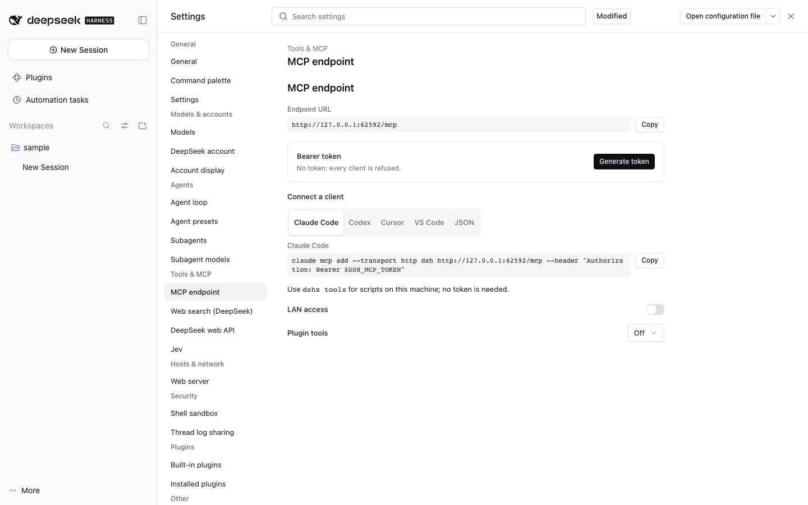

# @dshfiles/mcp-endpoint

An [MCP](https://modelcontextprotocol.io) server on the DSH Web server, so an agent in a terminal (Claude Code, Codex,
any MCP client) can drive DSH threads: list them, read them, start one, message it, wait for its turn and stop it.

## Connect a client

Open Settings › **MCP endpoint**, or use the palette command **MCP endpoint: connect a client**. This is a Settings section, not a reusable view, so it has no New tab chooser entry. Generate a token and copy it immediately: DSH stores only its hash. The client tabs always show instructions, and insert the token only immediately after Generate or Rotate.

1. **Claude Code:** `claude mcp add --transport http dsh <url> --header "Authorization: Bearer $DSH_MCP_TOKEN"`.
2. **Codex:** `codex mcp add dsh --url <url> --bearer-token-env-var DSH_MCP_TOKEN`; Codex reads the variable at runtime. The freshly issued token is supplied as an export line.
3. **Cursor:** add the displayed `mcpServers.dsh` URL and headers JSON to `~/.cursor/mcp.json`, or use the install link immediately after issuing a token.
4. **VS Code:** run the displayed `code --add-mcp` command for the editor-managed profile configuration.
5. **JSON:** copy the generic `mcpServers.dsh` HTTP configuration.

Without a freshly issued token, set `DSH_MCP_TOKEN` in the client's environment: Claude expands `$DSH_MCP_TOKEN`, while the JSON examples use `${env:DSH_MCP_TOKEN}` where supported by the client. Generic clients may require their own substitution syntax. For scripts on this machine use `dshx tools` without a token.

## Tools

| Tool            | What                                                                                          |
| --------------- | --------------------------------------------------------------------------------------------- |
| `list_projects` | registered projects (id, title, path), for `create_thread`                                    |
| `list_threads`  | threads newest first: id, title, directory, project, running; `query`, `projectId`, `limit`   |
| `read_thread`   | a thread's last user and assistant messages (default 20, at most 100), and whether it runs    |
| `create_thread` | a thread in a project or directory, with optional title, agent preset, model and first prompt |
| `send_message`  | a user message: `queue` (default, next turn) or `steer` (the running turn)                    |
| `wait_for_turn` | until the thread is idle with nothing queued, or `timeoutMs` (default 60 s, at most 5 min)    |
| `stop_turn`     | stop the running turn; queued messages stay                                                   |

Every tool except `list_projects` is one call of session-controller's
[`sessions-api`](../session-controller/README.md#driving-threads-sessions-api), made in process as
`@dshfiles/mcp-endpoint`. A refused call (unknown thread, busy agent) comes back as an MCP tool error with DSH's
message and code.

## Plugin tools

Settings › MCP endpoint › Plugin tools defaults to **Off**. Choose **Read-only** to expose read-only plugin agent tools, or **Read-write** to include writes. Calls use the existing plugin API bindings and their validation; destructive actions still require their explicit confirmation. The endpoint's own tools, dshx internal tools, and names already used by the thread tools are excluded. The current mode is checked on every call, including calls from clients with cached tool lists. Tools requiring an agent Session may fail because MCP calls identify this plugin, not a Session.

## Transport

`/mcp` is a raw route on the Web server (`webServer.register`), outside DSH's cookie-authenticated `/api`. It speaks
MCP streamable HTTP through the official `@modelcontextprotocol/sdk` (1.30.0, `StreamableHTTPServerTransport`),
stateless — a fresh server and transport per POST, no `Mcp-Session-Id` — and answers with JSON rather than SSE,
because the Web server may gzip responses and would hold back an event stream. `GET` returns 405, as stateless
servers do.

## Security

- **Bearer token required.** Only its SHA-256 is stored (dshx plugin storage, `@dshfiles/mcp-endpoint/token`); the
  value leaves the Host once, in the response to Generate/Rotate, and is compared in constant time. Rotate replaces it
  at once; Revoke refuses every client until a new one is generated. Without a token every request gets 401 naming
  where to issue one. The DSH launch cookie is never accepted instead.
- **This machine only, unless LAN access is on.** A peer that is not loopback or one of this machine's own interface
  addresses gets 403. LAN access is off by default; the switch in Settings turns it on. It does not bind DSH to the LAN
  — that is Settings › Network access.
- **Plugin tools are off by default.** Enabling them gives every token holder the selected plugin capabilities; read-write includes mutation and destructive actions. Turn the setting off to refuse cached plugin-tool calls.
- **No browser cross-origin calls.** A request carrying an `Origin` whose host differs from `Host` gets 403 (the MCP
  spec's DNS-rebinding rule).
- Bodies over 1 MiB get 413.
- A token holder can do what the tools do — start and prompt threads, which run agents with this DSH's permissions.
  Treat it like the launch URL.

The agent sees the endpoint too: `mcp_endpoint_status` (read-only), `mcp_endpoint_revoke_token` (`confirm: true`
required), `mcp_endpoint_set_lan_access`, and `mcp_endpoint_set_plugin_tools`. There is deliberately no tool that issues a token, so a token never
lands in a transcript.

## Telemetry

Each request is one `mcp request` server span with `dshx.mcp.outcome` (`accepted`, `unauthorized`, `no-token`,
`refused-remote`, `refused-origin`, `too-large`, `parse-error`), `mcp.method.name` and, for `tools/call`,
`gen_ai.tool.name`; the sessions calls under it get their automatic `sessions/<method>` spans.

## Restart

Host plugin: adding it to a profile needs a **DSH Host restart**; so does the session-controller `list`/`messages`
methods it calls.
