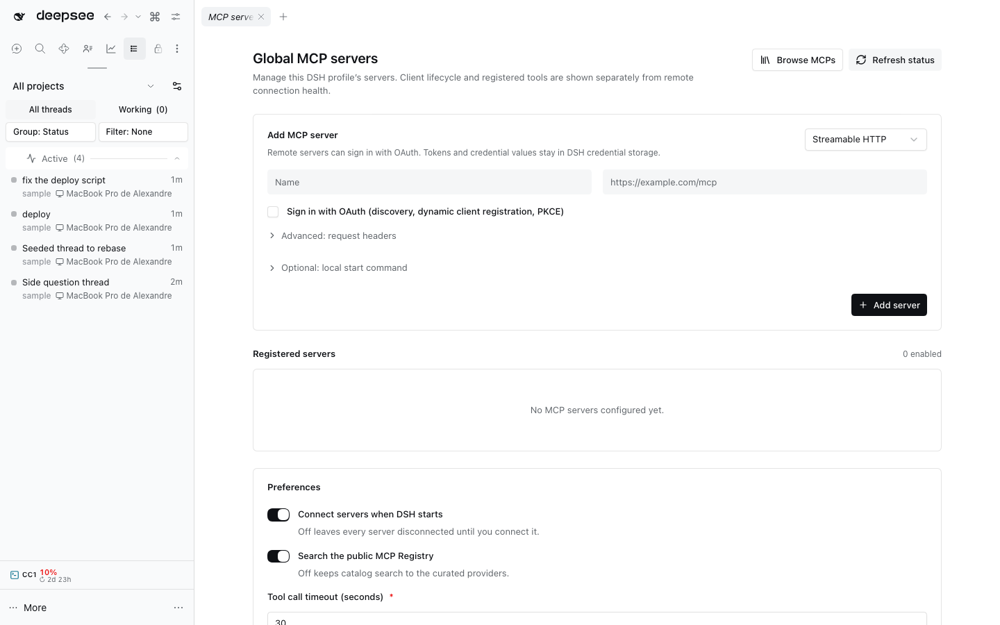

# MCP servers

This dshx bundle manages one MCP server list in the active DSH profile. It
supports local stdio and remote Streamable HTTP, an optional Host-managed local
start process for HTTP entries, custom entries, edits, persisted enable/disable,
confirmed removal, provider documentation, and search of the official MCP
Registry. Catalog entries are discoverability only; they are never installed
or connected automatically.

The Host reads and writes the bundle's own `servers` array through the
installed `dsh-config-editor` service. `ConfigEditor.edit()` validates and
persists the active root-Include row through Loader reconciliation; this bundle
does not write `cordis.yml` or `cordis.patch.yml` at runtime. Client mutations
use the local dshx API over DSH Connection RPC, whose Host route performs
request validation and uses the installed Connection authentication. The Host
plugin explicitly injects both `connection` and `webServer`: native Connection
route registration calls `owner.webServer.register()`, while legacy
`defineHost({ apis })` only adds `connection` to injection automatically. The
official Registry's `search` filter matches server names; the UI filters the
curated provider cards locally by name, category, and description.

The local dshx Host adapter carries a Standard Schema `Config` alongside API
contributions so this entry gets both Loader-row validation and the authenticated
API lifecycle. The shipped dshx adapter previously supported those separately,
not together.

An HTTP entry can optionally start one local helper process on the Host. It
uses `ctx.subprocess` from `dsh-subprocess` and the matching
`dsh-subprocess-local` provider supplied by the standard DSH base profile.
The command is parsed to argv and resolved by that service; it is never
shell-interpreted. The working directory must be absolute. Environment values
come only from existing DSH credential references. Child output is drained and
discarded, not logged or returned to the browser. Disable, disconnect, edit,
remove, and plugin disposal stop the owned process range; Refresh restarts a
configured runner that has exited. The process status reports when the Host
command is starting, running, exited, stopped, or has an unconfirmed stop; a
root command exit does not prove the entire managed process range is empty.
These states do not claim that the remote MCP endpoint is healthy.

Enablement and connection lifecycle are separate controls. Enable/disable is
persisted in the profile. Connect/disconnect starts or disposes the native
`dsh-mcp-client` child fiber and is transient for the current Host process;
reconnecting restarts that fiber, while the native client also owns automatic
retry behavior. Refresh reconciles the configured client fibers (and restarts
an exited local helper) and reads the current DSH tool registry. It does not
ping a remote server. The page reports
the native client's Cordis lifecycle plus the count of matching
`mcp__<serverName>__*` tools registered in DSH. It keeps remote connection
health as “not reported”: `dsh-mcp-client@0.2.0-rc.2` has no exported status
controller or connection event. A loaded client may still be reconnecting, so
neither a loaded state nor a nonzero tool count is presented as a health probe.

Credential fields accept DSH credential reference names only. Values resolve
in memory immediately before native client startup and never enter the saved
server row, API snapshot, fingerprint, catalog metadata, or manager log
messages. HTTP endpoints with userinfo, query strings, or fragments are
rejected. Common inline secret arguments such as `--token` and `--api-key` are
also rejected; use credential references in stdio/local-process environment
bindings or HTTP headers.
Resolved values are redacted from strings, errors, and plain objects passed to
the native client's scoped Cordis logger.

Open the reusable **MCP Servers: Servers** view from navigation or the Workbench chooser.

## OAuth sign-in

`dsh-mcp-client@0.2.0-rc.2` accepts only static headers, so this bundle runs
the MCP OAuth client flow on the Host and hands the native client an
`Authorization: Bearer` header. An HTTP server marked **Sign in with OAuth**
uses RFC 9728 protected-resource metadata, RFC 8414 (or OpenID) authorization
server metadata, RFC 7591 dynamic client registration as a public client, and
PKCE S256 with the `resource` indicator. **Sign in** opens the provider in a
new tab; the provider redirects to `/api/dshfiles-mcp-servers/oauth/callback`
on the origin the browser used for DSH. The callback accepts only an unexpired
single-use `state`, exchanges the code with the verifier, and stores the grant
as an opaque `mcp-servers/oauth-…` credential record through
`ctx.credentials.modifyRecord`. Tokens refresh under that record's lock when
they near expiry (checked on connect, Refresh, and every five minutes), and a
refreshed token reconnects the client. **Sign out** and removing the server
delete the record. Providers without dynamic client registration (GitHub) need
a token stored as a DSH credential and referenced as a header.

A Streamable HTTP endpoint must be HTTPS without embedded credentials; plain
HTTP is accepted only on a loopback host (`127.0.0.1`, `localhost`, `[::1]`), the
same rule the OAuth endpoints follow, so a local server or a local helper's
endpoint can be registered. Catalog and Registry entries stay HTTPS-only.

## Catalog, composer panel, and settings

**Browse MCPs** (page header, or **Add MCP** in the composer panel) lists the
hosted provider endpoints with their brand marks and docs links. **Add** saves
the endpoint in one step and, for OAuth providers, starts sign-in. Typing two
or more characters also searches the public MCP Registry by name for directly
connectable HTTPS Streamable HTTP endpoints, skipping ones the catalog already
lists; entries that are already registered show **Added**. **Custom MCP**
opens the editor in a dialog.

The composer **+** menu (and `/mcp-servers`) opens the quick panel through
`ctx.commandUi.register()`; **Manage** selects this sidebar page through
`ctx.layout.selectPanel`.

**Preferences** at the foot of the page set connect on startup, the tool call
timeout, public Registry search and the OAuth client name. They are stored in
this bundle's Loader row beside `servers` and read on every use, so a save
applies without a restart (a changed timeout reconnects the clients; connect on
startup applies at the next start). They are not on the DSH Settings page:
dshx refuses a Host entry with both a native `Config` and a Settings namespace.

## Adoption audit

The package was built with the repository's local `@dshfiles/dshx` hard fork;
it was not adopted or forked from `@wingsky-1/dsh-mcp-manager@0.2.8`. The exact
published tarball was inspected. Its optional DSH peer versions match
`0.2.0-rc.2`, it has no runtime npm dependencies, and its packed Host bundle
loads `@deepseek-ai/dsh-mcp-client` by its Cordis Loader name rather than
duplicating the MCP runtime. It includes manager CRUD, enablement, and status
UI. However, its mutating `/api/dsh-mcp/*` routes use a loopback-only guard;
the installed `dsh-host-webserver@0.2.0-rc.2` explicitly provides no
authentication for such routes. It does not use the authenticated DSH
Connection RPC for these mutations, so it is not safe to adopt for this
profile. The bundle implements its configuration and secret projection in a
private JSON store, which also bypasses the active-profile ConfigEditor
lifecycle used here.

The broader `dsh-mcp-connector` catalog was also checked. The npm listing for
its current `0.2.63` release declares the peer range
`@deepseek-ai/dsh-mcp-client: ^0.1.1-rc.2`, which excludes the installed
`0.2.0-rc.2` client, so its client lifecycle cannot be treated as compatible
here. The inspected repository
bundle entry (manifest version `0.2.59`, with `lib/` included in the package)
uses Cordis `ctx.storageDomain` and `ctx.loader` to persist records and
provision native MCP-client entries; its Web API routes use a
loopback/same-origin trust fence, not DSH Connection RPC authentication.
Neither its richer OAuth flow nor its catalog makes that Host boundary safe to
reuse in this profile. No marketplace code was ported.

The manager is available from the built-in `+` menu.
`@deepseek-ai/dsh-client-ui-commands@0.2.0-rc.2` exposes the additive
`ctx.commandUi.register()` contribution contract. The menu's `MCP servers`
action opens the session-scoped panel rendered in the declared
`conversation.input.overlay` list slot. This uses only client APIs already
present in DSH 0.2.0-rc.2; no Host change is needed for the plus-menu entry.
The native ActionSpec dispatch consumes the menu's live selected text span
before invoking the action. Therefore choosing `MCP servers` while non-empty
text is selected in the composer removes that selected text; the command API
does not expose a non-consuming action path or selection restoration handle.
With a collapsed caret, the current draft is unchanged.
The native Client command API has no non-consuming action or selection-restore
handle, so preserving an active text selection requires a Client/InputBar
contract change.

The manager's Registered servers list also takes checkbox selection (Shift
range, Cmd/Ctrl toggle, select-all): Enable selected and Disable selected skip
servers already in that state, and Remove selected opens one confirmation that
names the count before every native client stops and the stored grants go.

The native quick panel is a companion to the full manager page. It lists each
configured server's enablement, native client lifecycle, and registered tool
count separately, and offers refresh, connect/disconnect, enable/disable, and
navigation to the full manager. The panel refresh reconciles native client
fibers and reads DSH's tool registry; it is not a remote health probe.

## Composition

The package patch inserts the `@dshfiles/mcp-servers` row; the manager starts
with an empty `servers` array. It uses `@deepseek-ai/dsh-subprocess-local` from
the standard DSH base profile. The parent composition must include this bundle in the
active profile to make the sidebar page and native `+` menu entry available.
This first implementation stores one list in
the active DSH profile; the installed ConfigEditor contract persists edits to
that profile's root Include row, not a DSH-wide catalog shared across all
profiles. A truly server-wide list remains a Host/configuration-scope gap. No
active profile was edited from this worktree.
