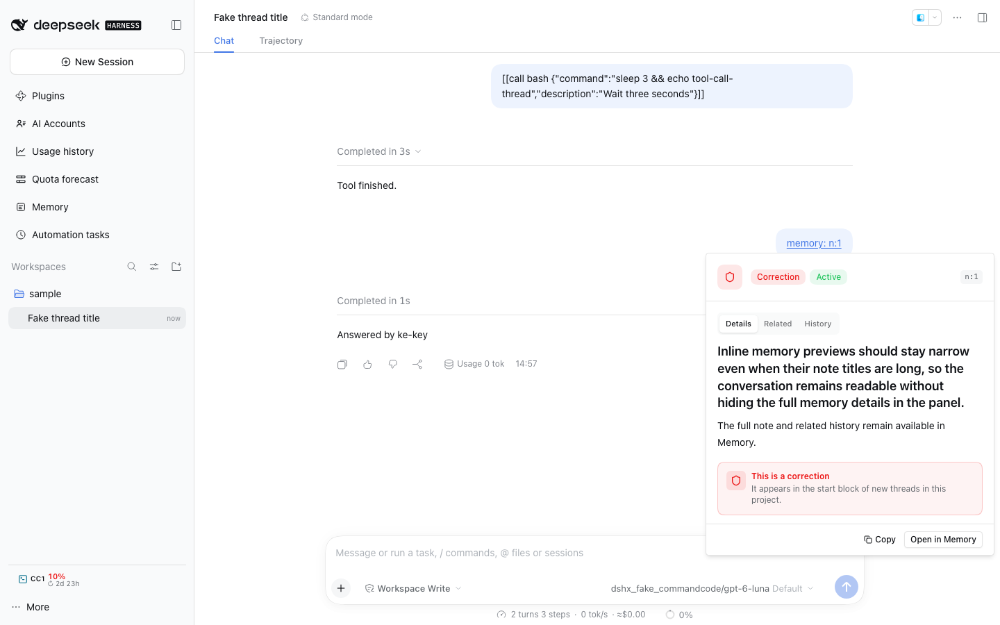
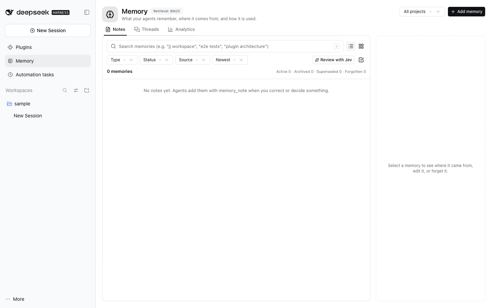

# @dshfiles/memory





Read [docs/findings.md](docs/findings.md) first: why memory exists, its design, and how it compares with native DSH.
For the plain-language version — what a digest is, when one is written, what the panel's **Digest** button does, and
what it costs — see [docs/digests.md](docs/digests.md).

Cross-thread, cross-project memory for DSH that leaves the live context and the provider's KV cache alone.

- **No capture store.** DSH's own session logs are the source of truth. When a thread has been idle for `idleMs`
  (60 s), its log is read once through DSH's `sessionQuery` service and turned into a **digest** with
  `digestSession` from `@dshfiles/dshx/platform/session-digest`: the user's requests in order, their corrections and
  decisions verbatim, goal, todos, jj revision descriptions, files changed and the final answer. No model call is made
  unless the thread left no trail of its own; then one cheap call uses the configured
  `cheapModels` route with reasoning `off` to write it. Blank and trivial threads get no digest; identical digests and notes are stored once.
- **One frozen start block.** At the first prompt assembly of every agent (subagents included), a byte-bounded block
  (`blockBytes`, 1,600) is appended to the end of the system prompt: a fixed instruction, notes, and thread pointers
  grouped by project and ranked by citations, then recency. It is frozen per thread (persisted, so a Host restart does
  not change it) and identical for every thread of a project until memory changes, so it sits in the cached prefix and
  is never re-emitted mid-thread. Jujutsu workspaces resolve to their shared store's owning checkout, so isolated
  threads in one repository keep the same project memory. Existing memory rows keep their prior project path; they are
  not migrated automatically.
- **Tools.** `memory_search` (digests, valid notes and indexed messages; FTS5 porter words plus trigram identifiers,
  BM25 fused by reciprocal rank, recency decay, project and note-type boosts), `memory_read` (a digest, a note, or a
  bounded raw excerpt read back from the session log), `memory_note` (add, update with a reason — the old row stays as
  superseded history — or forget with a reason), `find_threads` (the composed finder described below), and
  `related_threads` (explicit lineage first, inferred same-workspace/topic candidates second). Note types follow Claude
  Code: `user`, `feedback`, `project`, `reference`, with `scope`, `confidence` and the source thread and message.
- **An agent's own scope.** When `@dshfiles/agents` is installed and the thread was started by an agent with a
  `memoryScope`, the block also carries the notes filed under that scope (`agent:<handle>` by default), and only those
  threads see them, and a subagent inherits its spawning thread's scope through up to four parent hops. Memory keeps one
  store and one `notes.scope` column: the agents contract answers which agent owns the Session, and
  `startBlock({ cwd, scope })` previews it. A note with any other scope stays out of every block and
  remains searchable, so a scope is an agent's own without a second table. Absent agents bundle: project block only.
- **One registry.** The agent tools are `dshfiles-memory` API methods (`search`, `read`, `note`) opted into dshx's
  agent registry, so the agent, other Host plugins and Clients call the same handlers; `preview` serves the UI without
  recording a tool call, while `usage` and `citations` expose memory's statistics. `startBlock({ cwd, scope? })` previews
  the block a new thread in a folder would get (the Agent toolkit page shows it). Other plugins import the contract from
  `@dshfiles/memory/api`.
- **Citations as usage.** The block asks agents to cite memory they used as `memory: <id>`. A citation marks the tool
  call that returned the id as used and ranks the cited item higher in later blocks. In conversation replies, citations
  are clickable links that open a compact, scrollable inline preview of the note, digest or bounded message excerpt, with an
  **Open in Memory** button that takes the same item to the Memory page (notes open their detail, digests open their
  row). The whole `memory: <id>` token carries the link, and the preview uses the `preview` API method, which does not
  create a synthetic memory-tool usage record.
- **Memory page** (sidebar → Memory): three tabs.
  **Notes** is a searchable, filterable list (type, status, source, sort; list or card view) beside a detail pane with
  the note text, its source thread and message, metadata, related memories, superseded history, inline edit and
  forget, and a project selector plus **Add memory** dialog. Selection mode (Shift range, Cmd/Ctrl toggle, select-all
  over the visible valid notes) forgets every selected note after one count-named confirmation.
  **Threads** lists digested threads and Sessions memory has not digested yet, with digest source and citation
  counts; the detail pane has Digest / Memories / Citations / Timeline / Raw content views, a **Regenerate** action,
  and a **Write digest now** action for an undigested thread.
  **Analytics** shows stat cards with sparklines, digest activity, retrieval outcomes and cost charts, recall and
  correctness bars, recent events, and the most-cited memories, over a 7/14/30/90-day window (also through the
  `dshfiles-memory` API).

Message text is indexed with contentless FTS5 tables (the index only; the text stays in the session log). Credential
shapes, bearer tokens, `key=value` secrets and tokenized URLs are redacted before anything is indexed, digested,
noted or returned, and an excerpt never shows tool output that names a credential file.

Optional: TypeSafe's Jev (`jevEnabled`; key from `jevSecret`, a Secret Catalog reference, else `TYPESAFE_API_KEY`) flags user messages as durable signals at digest time and
gates whether a new thread gets thread pointers at all. Any failure falls back to the heuristics.

Out of scope: promoting facts into AGENTS.md or skills, reading `~/.agents`, mid-thread injection, thread handoff.

## Retrieval: BM25 by default, hybrid with your own embedder

`retrieval: 'bm25'` (default) ranks with FTS5 only. `retrieval: 'hybrid'` fuses BM25 with vector similarity by
reciprocal rank, but only when `embeddingProvider` loads; otherwise BM25 serves and the Memory panel's header says why.
Memory ships no model and no embedding dependency. A provider is any ES module whose default export returns
`{ model, embed(texts, kind) }` (`src/embedder.ts`): one unit-length `Float32Array` per text; `kind` is `query` or
`document`. Digests and notes are embedded in bounded batches after each digest, note and search; vectors are stored per
model, so switching models re-embeds. For example, with `@huggingface/transformers` installed where the module can
resolve it:

```js
// ~/.dsh/memory-embedder.mjs → embeddingProvider: "/Users/me/.dsh/memory-embedder.mjs"
import { pipeline } from '@huggingface/transformers'

export default async function createEmbedder() {
  const extract = await pipeline('feature-extraction', 'Xenova/bge-small-en-v1.5', { dtype: 'q8' })
  const prefix = { query: 'Represent this sentence for searching relevant passages: ', document: '' }
  return {
    model: 'bge-small-en-v1.5-q8',
    embed: async (texts, kind) => {
      const output = await extract(
        texts.map(text => prefix[kind] + text),
        { pooling: 'cls', normalize: true },
      )
      const size = output.dims.at(-1)
      return texts.map((_, row) => output.data.slice(row * size, (row + 1) * size))
    },
  }
}
```

The [benchmark](docs/benchmark.md#retrieval-bm25-vs-local-embeddings-vs-hybrid) is why BM25 is the default.

## Finding threads: one finder over titles, content and memory

`findThreads` (agent tool `find_threads`) answers "which conversation was that?" from four places in one ranked page:
exact and partial **titles** (read through `sessionQuery.readTitleSnapshots` for the newest 80 sessions, so an older
session still matches by digest title, identifier or indexed message), **session ids and cwd/workspace paths**,
**message text** through the supported `sessionQuery.searchSessions` backend, and memory's own **digests, notes and
message index**. Each hit carries `sources` (`session-title`, `session-metadata`, `session-content`, `memory-digest`,
`memory-message`, `memory-note`) and `evidence` (`exact-title`, `identifier`, `title-match`, `text-match`), deduped by
canonical session id with one merged row per Session. Ordering is score, then `updatedAt`, then session id, so a
repeated query returns the same page.

- **Scope is the caller's authorization.** Results stay inside the calling Session's project unless the
  `crossProject` setting is on; `project` narrows further and never widens. Sessions outside that scope are absent,
  not hidden.
- **Filters and bounds.** `project`, `availability` (`live` / `persisted`), `createdFrom` / `createdTo`, `limit` (1–20,
  default 8), and `includeNotes` (default off, so a Session search usually returns only Sessions). Snippets are bounded
  and redacted like every other memory read.
- **Cursors expire safely.** A cursor is an offset plus a corpus stamp (`count:newest-updatedAt`). If the corpus moved,
  the call fails with `stale-cursor` instead of paging over shifted results; the caller restarts the search.
- **Failure is labeled, never empty.** Content search is wrapped in a bounded retry (4 attempts, 75/200/500 ms) for the
  transient `SESSION_QUERY_PERSISTENCE_FAILED` the SQLite backend raises while the corpus is still moving. If it keeps
  failing, or the backend is configured with `openAt: "never"`, the page carries `degraded: [{ source, code, message,
attempts }]` and hits from the other three places; when nothing else matches, the call fails with the typed
  `search-unavailable` code and a message that says to retry or narrow the query. It never reports "no matches" for a
  search it could not run.
- **One attempt is time-boxed, and the index warms in the background.** The installed backend reconciles every stored
  log before it answers a content search, which takes minutes on a large history. An attempt that misses its deadline
  (1.5 s) is aborted, the page comes back from titles, workspace paths and memory labeled `SESSION_QUERY_TIMEOUT`, and
  that caller starts one background reconciliation per Host so later pages are complete. `contentDeadlineMs: 0` waits
  instead of degrading.
- **Related threads are a separate operation** (`relatedThreads`, tool `related_threads`): `explicit` holds real
  lineage (the session's `parentSessionId` and its children), `inferred` holds same-workspace and same-topic
  candidates, each labeled with the evidence that suggested it. Inferred precision is measured in the benchmark below.

```sh
pnpm bench:finder   # recall@3/@5, related precision, p50/p95 for session-only, memory-only and composed search
```

The benchmark runs the real SQLite session-query engine and the real store over 24 synthetic threads (16 topics plus
8 follow-ups) and exits non-zero if any mode stops finding its labeled session. Composed retrieval reaches recall 1.00
on every probe kind; related suggestions recover every labeled sibling at precision@5 0.67, which is why they stay an
opt-in second call.

## Per-project roll-up (designed, not built)

A roll-up would rewrite one short summary per project at most once a day, out of band, from what changed since the
last run: the previous summary plus the digests and notes added since its watermark, in one cheap call (reasoning
`off`), stored as a searchable item and never placed in the start block. It is not built because search does not need
it yet: on the recall set in [`docs/benchmark.md`](docs/benchmark.md), BM25 alone finds every exact identifier and
24 of 25 natural recall questions among 5,000 items. Its misses are paraphrases with no shared word, which a summary
does not fix either; local embeddings recover some of them (see the retrieval experiment).

## Settings (`dshfiles-memory`)

`enabled`, `crossProject` (true), `blockBytes` (1,600), `blockStaleDays` (90: never-cited threads older than this
leave the block), `idleMs` (60,000), `summarizerProvider` / `summarizerModel` / `summarizerEffort` (`off`),
`cheapModels`, `jevEnabled` (false), `jevThreshold` (0.5), `retrieval` (`bm25`; or `hybrid`), `embeddingProvider` (empty),
`retentionDays` (365; notes stay until forgotten).

## Develop

```sh
pnpm typecheck && pnpm test && pnpm build
fnm exec --using=22.23.3 node -e "import('./dist/index.js')"
```

`src/scale.test.ts` seeds 5,000 synthetic digests and notes and bounds search latency and block size. The historical
comparison with native DSH and the retired OptMem prototype is in [`docs/benchmark.md`](docs/benchmark.md).
