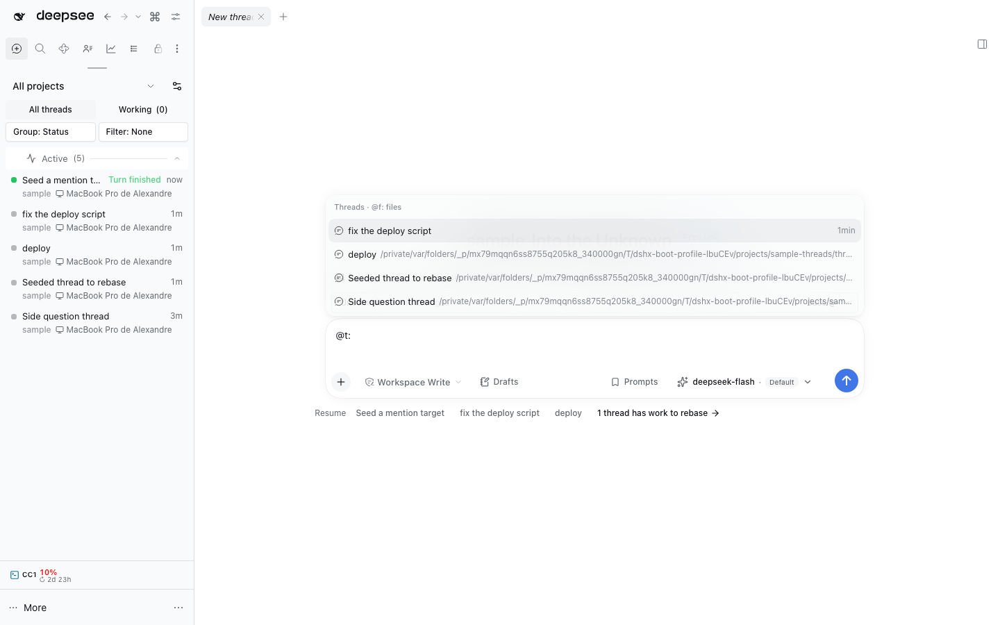

# @dshfiles/mentions

One `@` menu for files and threads. It replaces the native `ui-reference`
source (disabled in `cordis.patch.yml`), which lists every file before any
thread.

- **Ranking:** match quality on the thread title or file basename (exact or
  exact stem, prefix, substring, then a path substring or fuzzy match), then
  recency (a file counts as touched today, so only a thread from the last hour
  outranks it), then the same workspace, then the same project. Ties
  alternate between the Host's own file order and the thread order, so
  neither kind always wins. Blank threads are hidden; the menu shows 40 rows.
- **Scopes:** `@thread:` / `@t:` lists threads only, `@file:` / `@f:` files
  only, plain `@` both. The section heading names the scope and the other
  prefixes. A directory drill keeps the typed prefix.
- **Skills, MCP and backlog:** thread-sidebar's skill source, mcp-servers'
  MCP source and backlog's item source register their own `@` groups beside
  this one. `@skill:`, `@mcp:` and `@b:` / `@backlog:` narrow the menu to them
  (this source stays empty), and `@t:` / `@f:` empty theirs, so each scope
  lists one kind and nothing is listed twice.
- **Native chips:** candidates come from `remote.fileReferences.list` and
  `remote.sessionReferenceResolver.candidates`, and picks insert
  `source: "reference"` chips, so copy, paste, preview and send-time
  serialization stay native. A scoped lookup skips the other Host call.
- **Thread links:** a thread chip in the composer (through this source's
  `openReference`), the thread chip in a sent message and its "Referenced
  session · …" line open that thread. A plain click follows
  `@dshfiles/main-tabs`' `openMode`; Cmd/Ctrl-click asks it for a new tab
  through the `dshfiles:open-thread` event. Sent-message references are native
  inert text: the plugin marks them `role="link"` (focusable, Enter opens) and
  resolves a label to its session from the thread's own `session-reference`
  recall events, or from the `dsh-session:` id in the chip's title.
- **Timing:** each lookup records a `dshfiles-mentions:candidates`
  performance measure (`performance.getEntriesByName(...)` in the console).

The `@path` grammar and file address helpers are ported from
`@deepseek-ai/dsh-file-reference` and `@deepseek-ai/dsh-util-workspace-path`
(MIT): neither is a DSH Client module, so a plugin cannot import them.
