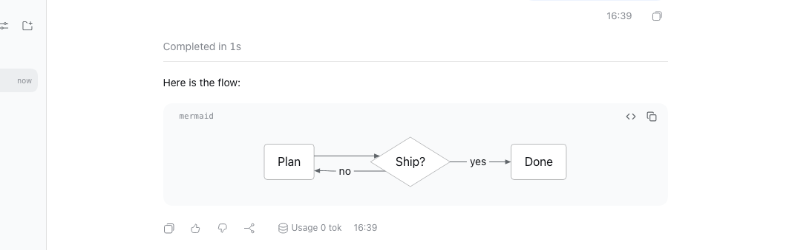

# @dshfiles/mermaid-diagrams



A ```` ```mermaid ```` fence renders as a diagram card in the conversation, the way
[t3code](https://github.com/pingdotgg/t3code) shows them: in assistant answers, reasoning, compaction summaries,
`ask_user_question` text and backlog item text (every Markdown surface that goes through Chat's code-fence registry).

- **While a fence is being written** it stays the native code card, so a half-written diagram never flashes an error.
  It becomes a diagram as soon as it is complete: when another block follows it, or when the message settles, so a
  long agent turn shows each diagram as it closes instead of at the end.
- **The card** keeps the code's height while pele loads and fades the diagram in. Its header has **Show code** /
  **Show diagram** (the highlighted source in the same card) and **Copy source**; clicking the diagram expands it full
  size in the image lightbox.
- **Math labels** (`$$x^2$$`) are typeset with KaTeX, loaded only for a diagram that has one.
- **Source pele cannot parse** shows the parse error above the source: fix the Mermaid, or ask the agent to correct it.
- **A renderer that cannot be downloaded** names the cause and offers **Retry**, which requests the module again under
  a new URL so a browser's cached failure is not reused; the source stays one click away.

Diagrams follow the DSH theme: pele reads its colors and fonts from `--pele-*` variables that `src/client.css` maps to
the Host `--dsw-*` tokens, so switching light/dark recolors a diagram without re-rendering it.

## Option chosen: build, with a ported approach

No marketplace plugin renders Mermaid in the transcript, and DSH's native Markdown has no fence hook. So:

- **`@dshfiles/chat` owns the seat.** It publishes the `CodeFences` registry (`@dshfiles/chat/code-fences`) and swaps
  each native code card whose language a renderer claims for that renderer, with the native card as fallback. See
  the [chat README](../chat/README.md#render-fenced-code-from-another-plugin). This plugin depends on Chat, never the
  reverse; without it Chat renders fences exactly as before.
- **Rendering follows t3code** (`apps/web/src/components/chat/MermaidDiagram.tsx`, `MarkdownMermaidCodeBlock.tsx`,
  MIT): [pele](https://github.com/obsidianmd/pele) instead of Mermaid.js (a fraction of the size, synchronous,
  themeable through CSS variables), the code until the fence is complete, a Diagram/Code toggle, DOMPurify over pele's
  SVG with links, images, `<style>` and `<foreignObject>` removed (a math diagram keeps KaTeX's MathML inside its
  `<foreignObject>`, and nothing else), and the KaTeX math resolver. The two sanitizer profiles and the math resolver
  are ported from t3code; see `NOTICE`.
- **The card is plain CSS, not the plugin-ui kit.** It mirrors the native code card it replaces (`CodeCard.module.css`
  in `dsh-client-ui-primitives`: background, radius, header type and its 24 px icon actions) so a diagram and the
  code blocks around it read as one family; kit buttons and `dshx:` utilities would draw a different card. Only the
  tooltips come from the kit.

## How the renderer loads

pele is ~270 KB gzipped and KaTeX ~150 KB, and a dshx Client build is one chunk every page downloads at boot, so
neither is in `client.js` (~240 KB, of which ~200 KB is the dshx runtime every owned client carries). The build copies
pele's ES module build and `katex.mjs` into `dist/renderer/`; the Host half registers
`/dshfiles-mermaid-diagrams/renderer/` on the web server whenever it has one, through dshx's shared
`StaticAssets.handler` (the route `@dshfiles/whiteboard` serves its editor with: listed extensions only, no symbolic
links, no `..`, ETags, gzip, hashed chunks immutable, a file-system fault answered 500 rather than 404). The Client
imports `lazy.js` from that route the first time a diagram shows; pele then fetches only the parsers of the diagram
types it meets.

| File                        | Role                                                                                                        |
| --------------------------- | ----------------------------------------------------------------------------------------------------------- |
| `src/client-entry.tsx`      | builds the page's loader and sanitizers and adds the `mermaid` renderer to Chat's `CodeFences` registry      |
| `src/mermaid-fence.tsx`     | the card: one reducer owns its state (view, attempt, status, copy confirmation, expanded image); the mount   |
| `src/renderer-loader.ts`    | imports pele and KaTeX from the Host route; resolves to a result value, keeps a success, retries a failure   |
| `src/sanitize.ts`           | the two DOMPurify profiles applied to pele's SVG                                                             |
| `src/client.css`            | the card (mirrors the native code card), the height placeholder, the fade-in and the `--pele-*` mapping      |
| `src/host.ts`               | registers the renderer route whenever the Host's web server is present                                      |
| `src/renderer-assets.ts`    | the route's options for `StaticAssets.handler`; one `mermaid-diagrams renderer-asset serve` span per request |
| `scripts/copy-renderer.mjs` | copies `pele/dist/esm`, `katex/dist/katex.mjs` and both licenses to `dist/renderer/` after `dshx build`       |

## Updating pele or KaTeX

Bump the exact version in `package.json`, `pnpm install`, `pnpm build`, and check a few diagram types (one with a
`$$…$$` label) in the browser. The route serves whatever `dist/renderer/` holds; a pele that no longer exports
`mountAsync` from `lazy.js` is reported as an out-of-date renderer with the rebuild instruction, and a KaTeX that
cannot load leaves math labels as readable TeX.

## Agent parity

This is presentation of text the agent already writes: there is no state to read or change, so it adds no agent tool.
Models write ```` ```mermaid ```` fences on their own; the diagram is what the user sees in place of the source.

## Limits

- Browser find (Ctrl+F) matches a drawn diagram's labels (pele draws them as SVG text) but not its Mermaid syntax;
  **Show code** shows the source. DSH has no in-app find to reveal hidden source, unlike t3code.
- The fence a streaming message is still writing stays code until another block follows it or the message settles:
  the native renderer does not say whether the last fence's closing line has arrived.

## Enable it

The bundle is opt-in: `profiles/web` does not list it (`scripts/verify-web-profile-contract.mjs` marks it so), because
it changes how every ```` ```mermaid ```` fence renders. To enable it in a profile, build it
(`pnpm exec turbo run build --filter=@dshfiles/mermaid-diagrams...`), add
`"@dshfiles/mermaid-diagrams": "link:<checkout>/plugins/@dshfiles/mermaid-diagrams"` to the profile's `dependencies`
and `"@dshfiles/mermaid-diagrams"` to `dsh.profile.bundles`, reinstall the profile and restart DSH. Without it, Chat
renders fences exactly as before.

## Verify

```sh
pnpm --dir plugins/@dshfiles/mermaid-diagrams test        # card states, loader URL, the asset route (span included)
pnpm --dir plugins/@dshfiles/chat test                    # the code-fence registry transform
pnpm --dir plugins/@dshfiles/mermaid-diagrams test:e2e    # tooling/dshx/e2e/features/mermaid-diagrams.feature
```

Reaching the live GUI needs a Host restart (new Host route and profile row); after that, client-only changes
hot-reload.
