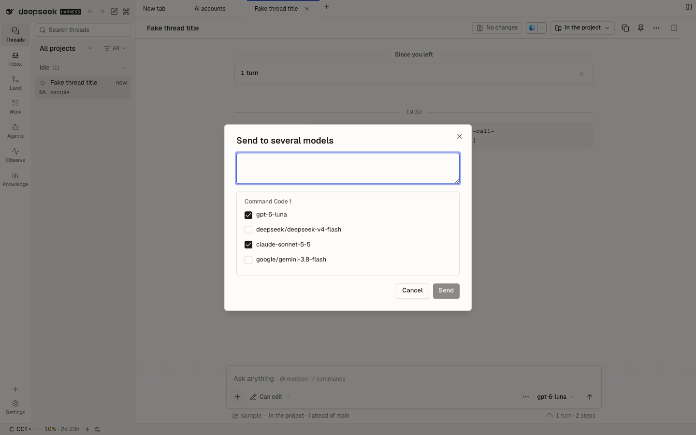
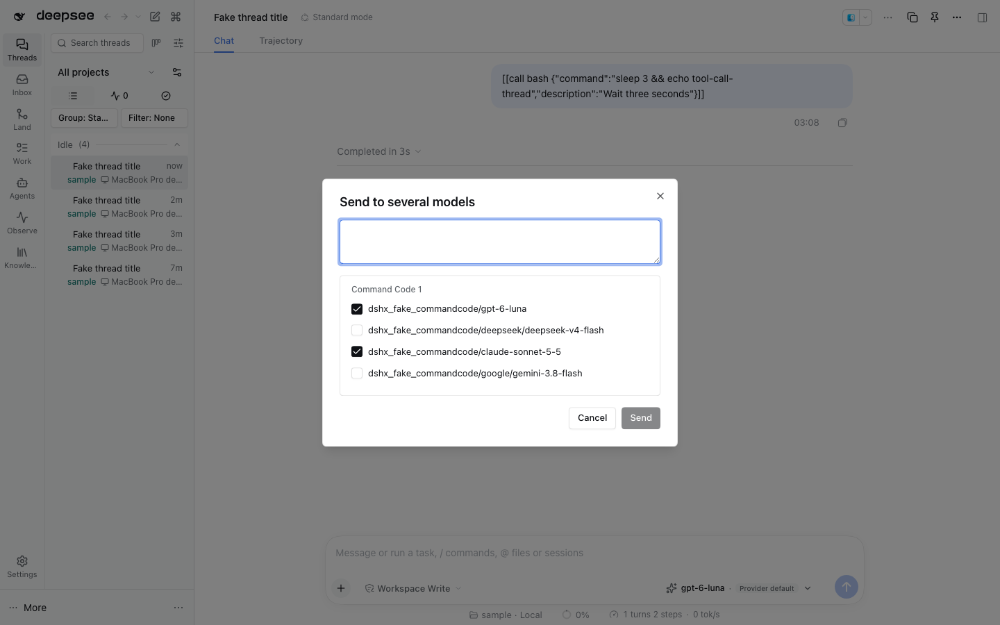

# @dshfiles/model-effort-picker


Replaces the composer model control with two panes. The list names every account-and-model route in one flat, dense
column: the model family's brand mark, the model name, the service that offers it subtly after the name, the account it
belongs to with that account's colour dot, the account's remaining quota, and a six-bar reasoning-effort glyph. The
details pane beside it follows the selected or inspected route with the accounts that offer the same model, a reasoning
slider, Fast mode, and the thread's fallback chain.

The composer trigger names just the model, and its account only off the default account for that model (see Account swap below). The main list always
shows the provider so two identical model names from different services stay distinguishable, while the account tag
keeps only the part that identifies the account (`OpenCode Go Alex` next to `OpenCode Go` becomes `Alex`, and
`GitHub Copilot 1` becomes `#1`). Remaining quota stays muted while healthy and only gains warning colour as it runs low; it names the same binding window the AI Accounts strip uses, not the first session window.

Hovering a truncated account tag or provider name shows the whole label. Hovering the effort glyph opens that model's
reasoning levels over the list and picks one directly.

## Fan out several models





Turn on **Select several** under the list (or shift-click a row, or long-press it on touch) to collect routes instead of
switching this thread's model: each row gains a primary ring, and the bar counts the selection ("2 selected") with
**Fan out…** and **Clear**. Its copy is localised (`dshfiles.modelPicker`, English and Chinese). Two through six routes are accepted (the Host
fan-out method's own bounds). **Fan out…** closes the picker and opens thread-sidebar's fan-out dialog with those
models already checked, where you type the prompt; the request crosses plugins as the bounded
`@dshfiles/thread-sidebar/fan-out-request` event, and a plain click still selects one model as before.

## Fallback chain

The details pane shows a minimal "No fallbacks" state with a small add action. Stored rungs are compact draggable rows
with their model mark, model name, service, account, remaining quota and a remove action; drag or Alt+Arrow reorders
them. A small control toggles whether the thread stays on a fallback or returns next turn.

## Account swap

When another provider route offers the selected model — a second Codex or Claude account from AI Accounts, say — the list still shows that model once (b:16yr): a route is model × account in the catalog, and the view groups the routes of one model and one service into a row. The row stands for the account a click would use (the thread's account when it offers the model, else the first in priority order) and shows only what is left on it, quiet unless 15% or less (amber) or spent (red). The detail panel's **Account** chips list every account offering the model with its own % left; choosing one moves the Session there through the same selection path, keeping the reasoning effort when the target advertises it. The chip names the account (its initials, the full name in the tooltip) only when the thread runs on an account other than the default one for that model (b:4qjm). Settings › Model effort picker can add the old swap button beside the picker (`accountSwap`, off by default) and limit its rotation (`accountSwapRoutes`). The `ai_accounts_switch_thread` agent tool is unchanged.

## Fast mode

The picker shows a Fast mode switch only for explicitly supported AI Accounts Codex models: on the inspected route's
header, and on a row's hover. AI Accounts stores the selection per Session in Host memory and uses pi-ai's supported
request-payload hook to send `service_tier: "priority"`, the legacy alias accepted by the Codex backend; native DSH
provider routes and unsupported models are unchanged. Fast mode resets when the Host restarts and may cost more
([OpenAI Fast mode](https://developers.openai.com/api/docs/guides/fast-mode.md)).

## Development

```sh
pnpm install
pnpm typecheck
pnpm test
pnpm build
```

The plugin owns the composer model slot; model catalogs, selection projection, availability checks, and writes remain owned by DSH’s `modelDirectories` service. Brand marks are vendored artwork from [`@lobehub/icons`](https://github.com/lobehub/lobe-icons) (MIT).
