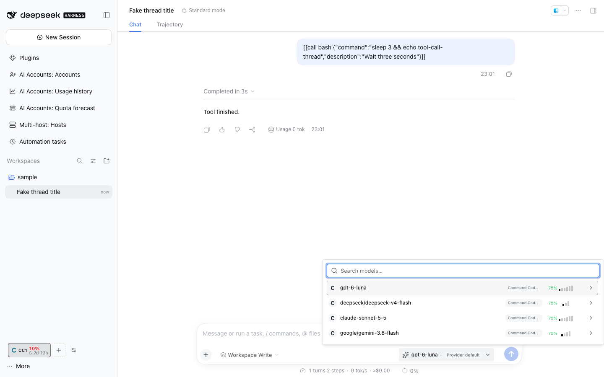

# @dshfiles/model-effort-picker




Replaces the composer model control with a compact, flat account-and-model list, quota labels, and an on-demand details view for account switching, reasoning effort, Fast mode, and fallbacks. Selections still write through DSH’s shared per-session model directory, so the native model popup stays in sync.

## Account swap

When another provider route offers the selected model — a second Codex or Claude account from AI Accounts, say — a swap button sits beside the picker. One click moves the Session to the next such route in catalog order, keeping the reasoning effort when the target advertises it. Settings › Model effort picker turns it off (`accountSwap`) or limits the rotation to a list of route ids (`accountSwapRoutes`; empty means every route that offers the model).

## Fast mode

The picker shows a Fast mode switch only for explicitly supported AI Accounts Codex models. AI Accounts stores the selection per Session in Host memory and uses pi-ai's supported request-payload hook to send `service_tier: "priority"`, the legacy alias accepted by the Codex backend; native DSH provider routes and unsupported models are unchanged. Fast mode resets when the Host restarts and may cost more ([OpenAI Fast mode](https://developers.openai.com/api/docs/guides/fast-mode.md)).

## Development

```sh
pnpm install
pnpm typecheck
pnpm test
pnpm build
```

The plugin owns the composer model slot; model catalogs, selection projection, availability checks, and writes remain owned by DSH’s `modelDirectories` service.
