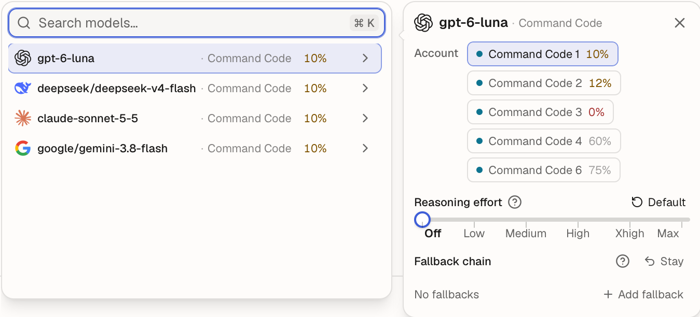
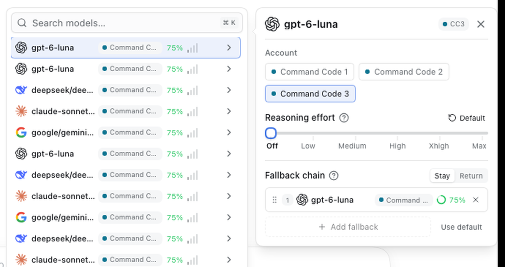
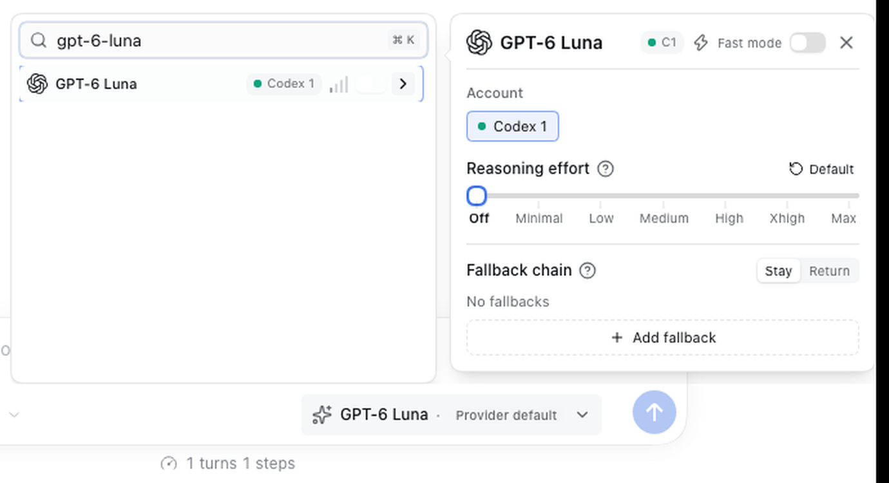

# @dshfiles/model-effort-picker







Replaces the composer model control with two panes. The list names every account-and-model route in one flat, dense
column: the model family's brand mark, the model name, the account it belongs to with that account's colour dot, the
account's remaining quota, and a four-bar reasoning-effort glyph. The details pane beside it follows the selected or
inspected route with the accounts that offer the same model, a reasoning slider, Fast mode, and the thread's fallback
chain.

The only addition to the reference layout is the remaining-quota percentage in the list; everything else — colours,
spacing, type sizes and the details panel — follows it. Selections still write through DSH's shared per-session model
directory, so the native model popup stays in sync.

Hovering a truncated account chip shows the account's whole name. Hovering the effort glyph opens that model's
reasoning levels over the list and picks one directly.

## Account swap

When another provider route offers the selected model — a second Codex or Claude account from AI Accounts, say — a swap button sits beside the picker. One click moves the Session to the next such route in catalog order, keeping the reasoning effort when the target advertises it. Settings › Model effort picker turns it off (`accountSwap`) or limits the rotation to a list of route ids (`accountSwapRoutes`; empty means every route that offers the model).

## Fast mode

The picker shows a Fast mode switch only for explicitly supported AI Accounts Codex models: on the inspected route's
header, and on a row's hover. AI Accounts stores the selection per Session in Host memory and uses pi-ai's supported
request-payload hook to send `service_tier: "priority"`, the legacy alias accepted by the Codex backend; native DSH
provider routes and unsupported models are unchanged. Fast mode resets when the Host restarts and may cost more
([OpenAI Fast mode](https://developers.openai.com/api/docs/guides/fast-mode.md)).

## Development

```sh
pnpm install
pnpm typecheck
pnpm test
pnpm build
```

The plugin owns the composer model slot; model catalogs, selection projection, availability checks, and writes remain owned by DSH’s `modelDirectories` service. Brand marks are vendored artwork from [`@lobehub/icons`](https://github.com/lobehub/lobe-icons) (MIT).
