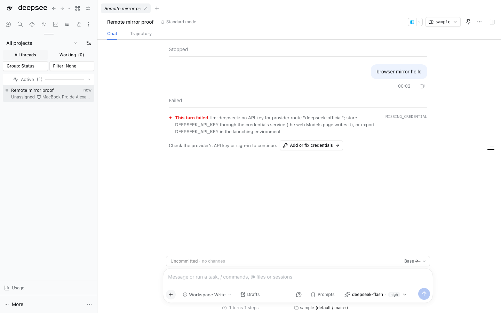
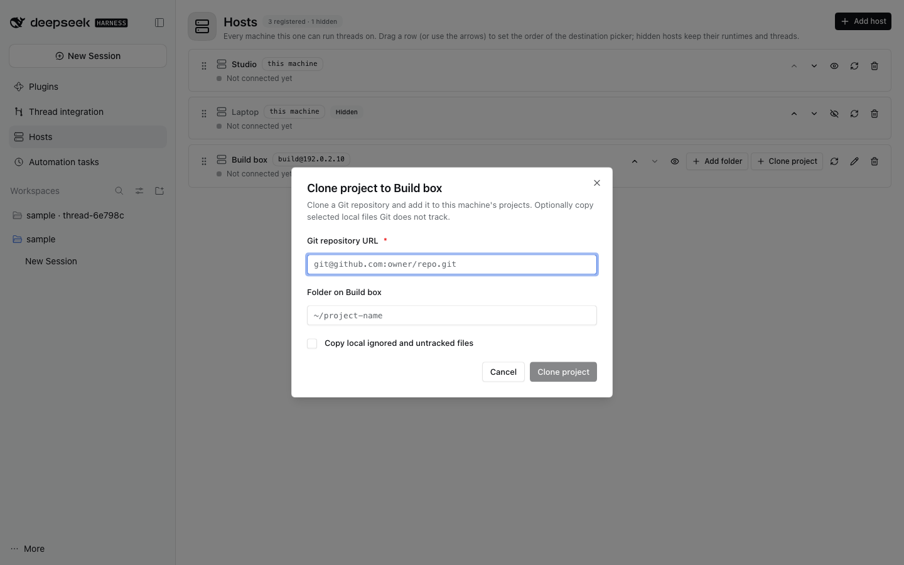

# @dshfiles/multi-host

Run new threads on other machines. Each machine runs its own stock DSH 0.2
runtime with this plugin installed; this machine reaches it over SSH and keeps
one tunnel open per host. Works on stock DSH 0.2.0-rc.2, no core patch.

Manage hosts on a dedicated page:

## Using it

The New thread bar (rendered by `@dshfiles/jj-integration`) starts with the
**host chip**:

- **Local ✓** — the default; nothing changes.
- **A host** — each registered host with a status dot (green: connected, with
  the round-trip in ms; grey: not connected yet; red: the last error).
  Opening the menu pings every host once.
- **Add host…** — choose an SSH destination from a searchable picker of
  `~/.ssh/config` aliases (following `Include`) and plain `known_hosts` names,
  or choose a custom destination for `user@host`. Give it a name, then use
  **Find** to list DSH homes under the remote user's home that publish a launch
  file and select the right one. **Test connection** shows each step (SSH login,
  DSH runtime, multi-host identity) with its time. **Add host** pins the
  runtime's identity and selects it.
- **Manage hosts…** — opens the dedicated **Hosts** page (also in the sidebar).
  Every registered host is listed in the destination picker's order: drag a
  row or use the up/down arrows to reorder, the eye hides a host from the
  picker without deleting it (its runtimes, threads and remote data stay), and
  reconnect, edit and remove stay on the row. **Add folder** registers an
  existing remote directory; **Clone project** clones an HTTPS or SSH Git URL
  into a remote path and registers it as a workspace. Clone can also preview
  and copy selected local ignored or untracked files; it stays opt-in, excludes
  `node_modules`, and caps the transfer at 128 files / 50 MB. Existing remote
  files are never overwritten; symlinked destination paths refuse the copy
  without undoing the clone. The Run on menu

  pre-fills the current project path; the Hosts page accepts a local path too.
  **Add host** keeps the dialog, with the SSH destination picker,
  **Find** and the stepwise **Test connection**. Removing keeps remote data and
  the local record of threads started there; they come back if the host is added
  again.

With a host chosen:

- The folder chip browses **that host's** folders (served by its multi-host,
  because stock headless runtimes refuse `directoryPicker.list`) and lists its
  projects (its jj-integration's projects, else its registered workspaces) and
  folders of earlier threads there.
- When the host runs `@dshfiles/jj-integration` and the folder is a jj
  repository, the bookmark and **workspace** chips come from the host; sending
  creates the isolated workspace there.
- Starting a remote thread opens an empty Session on that host in the same
  native chat and composer used for local threads; it does not create a local
  Session. The composer keeps its model/reasoning selector, file attachments,
  and `@` file references, with those operations routed to the Session's owner.
  Existing command, prompt, queue, plan, permission, todo, and jj/workspace
  surfaces remain subject to the capabilities available from the remote Host.
  If the runtime is unreachable, the native composer stays visible and keeps the
  draft; its send is refused until the owner is reachable. Interactive browser
  verification of the model picker and attachment picker is still pending.
  The ownership boundary and unsupported surfaces are described in
  [docs/remote-thread-architecture.md](docs/remote-thread-architecture.md).
- The started thread opens in the main area as a **normal thread of this client**:
  this Host mirrors the remote Session, so the native chat, its live transcript,
  and this machine's own composer (commands, references, attachments, queue,
  stop) work on it. **Host UI** still opens the host's own DSH in a new tab on a
  stable loopback origin for what the mirror cannot answer yet (approvals,
  terminals). If the host drops, the composer keeps its draft and the message is
  refused until the host is back.
- The **Remote threads** list shows every thread on every registered host,
  grouped by host and newest first: threads started from here keep their title,
  threads started on the host itself (its own UI or another machine) carry a
  muted **started on host** badge and are titled by their folder. A row opens the
  thread in this client like any other. Status is polled only while that list is
  open. An offline host shows one muted "unavailable" line and still lists the
  threads started here.
- While a remote turn waits, the open-thread view says what it waits on:
  **The agent ... is asking a question** when the last tool call is
  `ask_user_question` (or `ask_parent_question`), and **Waiting on <tool>**
  when any other call has stayed open for more than a minute, since the log
  cannot tell a slow command from a pending approval. Both offer **Host UI**;
  answering and approving stay in the host's own DSH.
- The thread sidebar shows a **Remote** section: every thread started from
  here, badged with its host and whether its connection is open. A row opens the
  mirrored Session; a brand-new thread appears in the sidebar as soon as the host
  reports it.

## Setting up a remote host

1. SSH from this machine must work in BatchMode (agent or key) and the host
   key must already be in `known_hosts`; unknown or changed keys are refused.
2. On the host, run DSH 0.2 on loopback with a profile that includes
   `@dshfiles/multi-host` (and `@dshfiles/jj-integration` for bookmarks and
   isolation), e.g. a systemd user service with linger:
   `dsh --profile <name> --host 127.0.0.1 --port 0 --no-open`.
3. The runtime writes `$DSH_HOME/plugins/multi-host/launch.json` (0600, in a
   0700 directory) with its tokenized loopback URL and removes it when it
   exits. A DSH started through the nixfiles `dsh-web` supervisor also records
   `$DSH_HOME/runtime/web-url`, which is read as a fallback. The current
   supervisor still needs to enforce private permissions on pre-existing paths
   and redact launch URLs from service logs; do not rely on that fallback for a
   durable deployment until its owner fixes and verifies both.
4. Add the host from the chip. Nothing is installed on the host by this
   plugin; provisioning stays with whoever manages that machine.

## Provisioning and remote administration

The same plugin is the agent's hands on that machine. Each verb is one dshx
method with a `multi_host_*` tool:

- `multi_host_exec` — one bounded command (120 s, 128 KB of output) with its
  exit code and both streams, for a machine that is not set up yet.
- `multi_host_doctor` — read-only facts plus diagnostics: a Nix Node build DSH
  cannot boot, an fnm-managed official Node that is available, a profile pinning
  a core version the runtime does not run, a missing launch file, a moving
  checkout with conflicts.
- `multi_host_provision` — the whole setup as ordered, state-checked steps:
  `node`, `checkout`, `install`, `build`, `cli`, `profile`, `runtime`.
  `dryRun: true` returns the plan and commands without touching the machine;
  `confirm: 'next'` (default) runs exactly one step per call, so every step is
  its own opt-in; `confirm: 'all'` runs the named steps in order. A step already
  satisfied from the machine's own facts is skipped, never repeated, and a step
  needing something no plugin may install (fnm on a machine without it) comes
  back `blocked` with the reason.
- `multi_host_runtime_status` / `multi_host_runtime_control` /
  `multi_host_runtime_logs` — whether the headless runtime is up, start it with
  an official Node build and a free loopback port, stop it (refusing a pid that
  is not that machine's DSH web), read its bounded log tail.
- `multi_host_checkout_sync` — fetch and rebase one checkout onto
  `<bookmark>@origin`, keeping that machine's edits; `apply: false` only reports
  the commands.

Provisioning never installs a package manager or edits the machine's own setup:
a missing fnm or a stale nixfiles is reported, not patched. It also never
rewrites another machine's checkout without `apply`.

## How it works

- **Directory** (`plugins/multi-host/directory.json`, 0600): hosts
  `{id, name, sshTarget}` and runtimes `{remoteHome, pinned identity, stable
origin port, lastSeen}`. Launch tokens are not stored; they are read over SSH
  at connect time and exchanged for an HttpOnly cookie held in memory.
- **Connection pool**: one gateway per runtime (`ssh -N -L` to the remote
  loopback port, or a loopback forward for another DSH on this machine), keyed
  by a generation id, closed after 5 idle minutes or when ssh exits. A read
  that fails because the connection dropped retries once on a fresh one; a
  mutation never replays and reports `unknown-mutation-outcome` instead.
- **Identity**: every new connection checks the runtime id, profile, home leaf
  and protocol pinned at registration; a different runtime behind the same
  address is refused.
- **Threads** (`plugins/multi-host/threads.json`): `{runtimeId, sessionId, cwd,
title}` for threads started here, so the sidebar and view can list them.
- **APIs**: `multi-host` v1 is owned by this package, so other plugins' clients
  call it (`@dshfiles/multi-host/destination` exports the contract and the UI
  pieces). Remote plugin calls are allowlisted to jj-integration's
  `projects`, `destination`, `provision` and `noFolder`; native calls to the
  session list/search/create/prompt/page/cancel/rename/fork and archive
  methods.

## Compared with bb and t3code

|                                   | bb (desktop build)                                      | t3code nightly                                             | multi-host                                                         |
| --------------------------------- | ------------------------------------------------------- | ---------------------------------------------------------- | ------------------------------------------------------------------ |
| Transport                         | enrolled daemon, WebSocket to server                    | `ssh -L` to `t3 serve`                                     | `ssh -L` to `dsh web` (BatchMode, strict host keys)                |
| Add host                          | enroll key + `curl \| sh` command, poll until connected | Settings → Connections, ssh config/known_hosts suggestions | chip → Add host…, same suggestions, Find + stepwise Test           |
| Provision remote server           | install script                                          | release archive, checksum, lock, `nohup serve`             | not done: the host's DSH is managed separately                     |
| Persistent connection / reconnect | heartbeat 5 s, backoff 1–30 s                           | supervisor, backoff 2 s–5 min                              | pooled tunnel, lazy reconnect, ping on menu open, manual Reconnect |
| Remote folders / branches         | `host.browse_directory`, `list_branch_options`          | env `filesystem.browse`, `vcs.listRefs`                    | host's multi-host listing, host's jj-integration                   |
| Run and follow a thread           | RPC + event upload                                      | per-environment WebSocket                                  | create + prompt over the native API, transcript polled             |
| Sidebar                           | "By machine" grouping                                   | machine icon on foreign threads                            | Remote section with host badges                                    |
| Offline send                      | queued                                                  | blocked with toast                                         | blocked with Reconnect                                             |
| Credentials                       | hostKey file 0600                                       | system ssh + askpass, safeStorage                          | system ssh agent/keys only; no password prompt                     |

## Limits

- A remote thread is a Session of another runtime, mirrored into this Host:
  `session/list`, `follow`, `page`, `prompt`, `cancel` and `updateQueue` forward
  to the runtime that owns it, so the native chat and composer work. Model
  catalogs, attachments, `@` references, approvals and terminals still resolve
  on this machine or stay in the host's own DSH; the remaining slices are listed
  in [docs/remote-thread-architecture.md](docs/remote-thread-architecture.md).
- The agent preset chip of the New thread row does not apply to remote
  threads; the model is picked in the remote composer.
- No password or keyboard-interactive SSH (BatchMode only). Provisioning runs
  over that key only and leaves fnm, Home Manager and other machine setup to
  whoever manages the machine.
- The sidebar's Remote section still lists only threads started from this
  machine; threads created directly on the host appear in the Remote threads
  list, not the sidebar.
- The remote transcript is polled (1.5 s while a turn runs, 8 s idle), not
  streamed; the conversation is still written and read on the host.
- DSH writes no question-request or approval-request event, so a pending
  question is only visible as an open `tool/call`. That is why a generic tool
  wait is announced after a minute rather than immediately, and why answering
  or approving always happens in the host's own DSH.
- No session handoff between machines, and no answer/approve action from here.
- LSP is not advertised by remote runtimes (unchanged from earlier
  validation).

## Checks

`pnpm build`, `pnpm test`, `pnpm typecheck` from this package. The live SSH
suite runs only when `MULTI_HOST_SSH_TARGET` and `MULTI_HOST_SSH_HOME` point at
a host running DSH with this plugin; the remote-administration suite runs
read-only checks (doctor, exec, runtime status and logs, a provisioning dry-run,
a checkout-sync dry-run) when `MULTI_HOST_SSH_TARGET` is set.

The manual [SSH smoke](../../../tooling/dshx/scripts/smoke-multi-host-ssh.mjs)
creates remote sessions/files and restarts its selected user service. It has no
host defaults and requires `MH_DISPOSABLE_TARGET=1`,
`MH_ALLOW_REMOTE_MUTATIONS=1`, `MH_SSH_TARGET`, private `MH_SSH_KEY`, a
`MH_KNOWN_HOSTS` file not writable by group/other, `MH_UNIT`, `MH_WS`, and
`MH_REMOTE_HOME`; optional `MH_SSH_PORT` is a TCP port from 1 to 65535 and
defaults to 22. It rejects unknown host keys and reads launch metadata from
files, never the journal. It ignores per-user SSH config, so `MH_SSH_TARGET`
must be a literal host/IP that matches the supplied known_hosts entry. Run it
only against a disposable Linux service.
Tests cover fail-closed configuration, individual opt-ins, port bounds,
known_hosts permissions, shell-safe paths, and launch-URL redaction without
starting DSH. A separate test validates the strict SSH options against an
ephemeral high-port loopback-only sshd, always stopping its owned process group;
it does not contact a remote host or prove DSH lifecycle behavior. Runtime evidence is in
[docs/validation.md](docs/validation.md); why runtimes are federated rather
than proxied, and the rules that follow, are in [docs/design.md](docs/design.md).
Durable supervision of a remote host is still open:
[plans/multi-host](../../../plans/multi-host/README.md).
