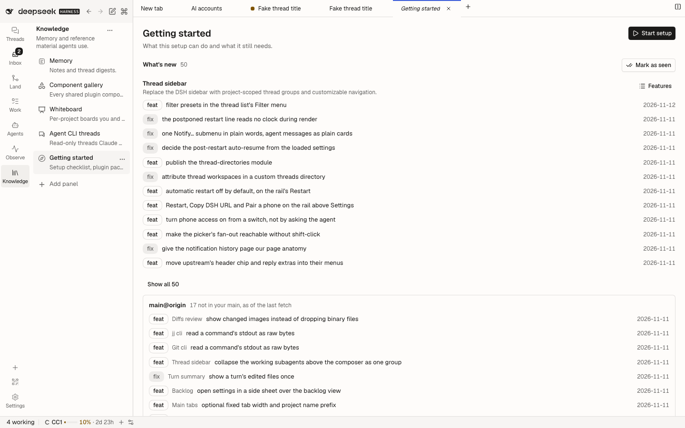
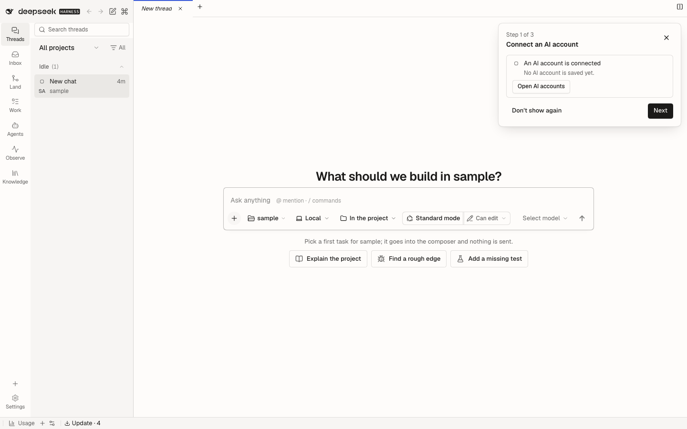
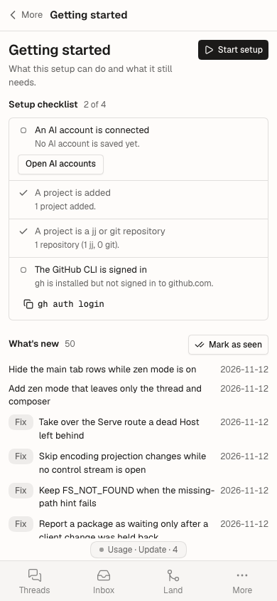
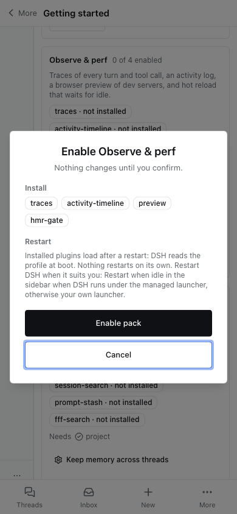
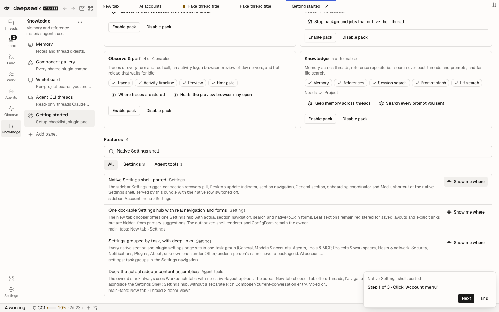
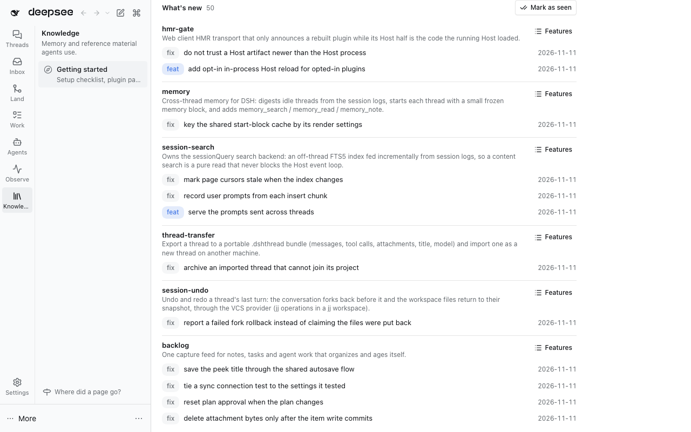
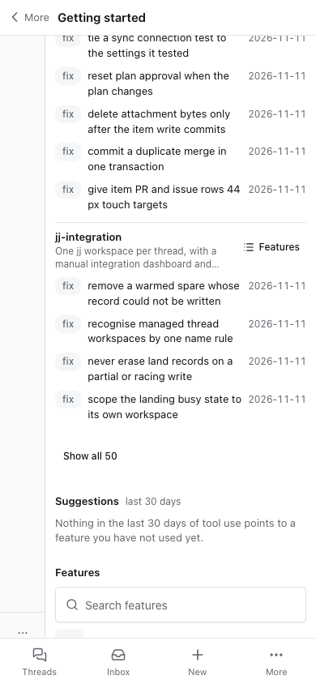
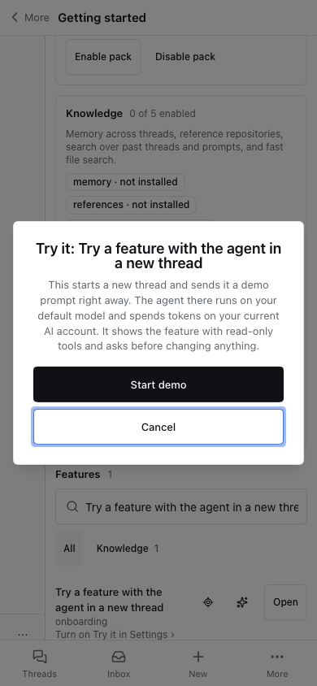

# @dshfiles/onboarding

Getting started for anyone adopting dshfiles: the whole setup, one plugin, a pack of plugins or one feature. It never
blocks the app, makes no model request, and changes the profile only when you confirm a pack change.

## Use

1. **Knowledge › Getting started** — also **Onboarding: Getting started** in the command palette and in the New tab
   view chooser.
   1. **Setup checklist**, read live from the Host on each open: a model provider is set up, a project is added, a
      project is a jj or git repository, the GitHub CLI is signed in. Each open item has its fix: open AI accounts,
      open Settings › Projects, or copy `gh auth login`. The AI account item counts AI accounts' connected accounts
      (on, signed in, configured) when that plugin is installed, and says it fell back to model provider routes when it
      is not; it reads the saved accounts only, never a provider or quota.
   2. **Packs**: eight named plugin sets (Core, Versioning workflow, GitHub & review, Backlog & planning, Accounts &
      cost, Agents & orchestration, Observe & perf, Knowledge) with each plugin **enabled**, **disabled** or **not
      installed**, the checklist items each pack needs, and a button per key setting. A plugin may sit in several packs.
      Every pack but Core has **Enable pack** and **Disable pack** (see _Pack changes_).
   3. **Features**: every feature the owned catalogs declare, curated first, grouped by destination chips. Type to
      search every feature (each word must match); `/` focuses the search, Escape clears it. **Open** appears only when
      the feature's page, command or Settings place is registered in this profile. **Show me where** appears when the
      feature's first `reach` step can be replayed here (see _Show me where_).
2. **Setup wizard** — while no thread is open, a card at the top right walks **Account → Project → First task**.
   1. Account and Project tick from the same checklist and link to the pages that own the setup; Project also opens
      the `jj-integration` **Isolate new threads** setting.
   2. First task offers three starter prompts; **Insert prompt** puts one in the composer (or a new thread draft when
      no composer is on screen) and never sends it.
   3. Skip, Back and Next on every step; Escape skips. The outcome is kept per browser. **Onboarding: Show the setup
      wizard** or **Start setup** on the page replays it.

## Pack changes

1. **Preview.** Enable pack or Disable pack opens one dialog naming the packages to install, the rows to enable or
   disable, the rows already fine, the plugins another fully enabled pack keeps on, rows that cannot change here, the
   pack's prerequisites and whether a restart follows. Nothing changes before **Enable pack** / **Disable pack** in the
   dialog; Cancel or Escape changes nothing; a satisfied pack says **Up to date** and offers only Close.
2. **Apply.** One plugin per Host call, with progress and **Stop after this plugin** (the running plugin finishes so its
   result is known; the rest read _not started_).
   1. Existing rows switch through the plugin manager. Its verdict is shown as given: applied to the running DSH,
      waits for a restart (with its reason, e.g. `no-hmr`), or overridden by a higher profile layer.
   2. Missing owned bundles install with `dshx add @dshfiles/<plugin> --profile <active profile> --json` from the
      dshfiles checkout this profile links Getting started from (read from the plugin manager's bundle record, never
      assumed). A profile without that checkout, or with an unbuilt dshx CLI, gets the exact command to copy and
      [the install docs](../../../docs/profile-installs.md) instead.
3. **Verdict.** Done, Saved (waits for a restart), Partly done, Not changed, Install by hand or Cancelled, with what is
   installed now and the next action. A partial run never reads as success and nothing is rolled back.
4. **Restart.** Nothing restarts DSH. Installs load at the next start: **Restart when idle** in the sidebar when DSH runs
   under the managed launcher, otherwise your own launcher.
5. **Reverse.** Disable pack switches the pack's running rows off (never Core's, never a row another fully enabled pack
   needs) and uninstalls nothing; Enable pack switches them back.

## Outside the app

1. **Compose a profile from packs.** `dshx init --profile <name> [--packs core,versioning,…]` composes a DSH profile
   from the same packs: a multi-select in a terminal (Core checked and locked), or the ids you pass. It links the packs'
   plugins with one `profile-sync --bundle` run (the `dshx add` path), creates a missing profile, refuses a profile
   composed differently unless `--extend`, previews with `--dry-run` and never restarts DSH. See
   [the CLI reference](../../../tooling/dshx/docs/cli-reference.md#dshx-init-compose-a-profile-from-packs).
2. **A page per pack.** [`docs/packs`](../../../docs/packs/README.md) holds one generated page per pack: its plugins,
   prerequisites, key settings, catalog features (curated first), how to enable it and its restart need.
   `node scripts/pack-docs.ts` regenerates them from `src/packs.ts` and `src/generated/feature-catalog.ts`;
   `pnpm check:pack-docs` (part of `check:green`) fails on a stale page, so regenerate after changing either.

## What's new

1. **List.** Getting started's **What's new** lists each `feat(<plugin>): …` and `fix(<plugin>): …` change whose scope
   names an owned plugin directory (a title scoping two plugins counts for each), grouped by plugin with its catalog
   description, newest plugin first, at most 50 changes (12 until **Show all**), each with its date. `chore`, `docs`,
   `test`, `refactor` and `perf` stay out: they rarely change what a user sees. **Features** narrows the feature search
   to that plugin.
2. **Since your last visit.** A change reads **New** when it landed after the instant you last pressed **Mark as seen**
   (kept per browser, `dshfiles.onboarding.whats-new.v1`). Opening the page never moves it, and before the first press
   nothing reads New.
3. **Upstream since your fork point.** For each remote whose bookmark (git: branch) of the local trunk's name points
   elsewhere — `main@upstream` against `main`, whatever the remote is called — the changes there not yet in local history.
   The trunk is git's checked-out branch, or jj's first local `main`, `master` or `trunk`. Nothing is fetched, so the list
   is as of the last fetch; the card offers `jj git fetch --remote <name>` (or `git fetch <name>`) to copy.
4. **Source.** Read on the Host at request time from the dshfiles checkout this profile links Getting started from (the
   same lookup as pack installs): `jj --ignore-working-copy bookmark list` and `jj log`, or else git (`for-each-ref`,
   `remote`, `log`) when the checkout has no `.jj` or jj is not on DSH's PATH. Five seconds per command, cached 60 s (5 s
   after a failure). No build-time list: any commit would make one stale.
5. **No history here.** A registry install (no linked checkout) says so and links the
   [repository commits](https://github.com/astahmer/dshfiles/commits/main); a failed read names the command to run in the
   checkout, with Try again.

## Suggestions

Off by default (`suggestions`): while off, the section offers **Turn on in Settings** in one line and nothing is read.

1. **What.** Catalogued features you have not used yet whose usage pattern suggests value, from the last 30 days of
   local tool use. Each names the counts that triggered it, one sentence why, **Show me where** (when walkable) and
   **Find in features** (its gallery row).
2. **Rules** (`src/suggestions-model.ts`, in priority order; a test fails when a feature leaves the catalog):

   | Feature                                    | Signal                                                 | Threshold | Not when                                              |
   | ------------------------------------------ | ------------------------------------------------------ | --------- | ----------------------------------------------------- |
   | `jj-integration#thread-destination`        | `jj` shell commands                                    | 20        | a `jj_thread_*` / `jj_workspace_setup` call           |
   | `jujutsu#revision-graph`                   | `jj` shell commands                                    | 50        | a Jujutsu panel read (`jj_load`, …)                   |
   | `agent-plan#compaction-meter`              | model requests in the longest of the costliest threads | 150       | any compaction request or `compaction_threshold` call |
   | `pull-requests#github-pull-request-create` | `gh` shell commands                                    | 10        | a `pull_request*` call                                |
   | `backlog#capture-and-triage`               | `todo_write` calls                                     | 30        | a `backlog_*` call                                    |
   | `traces#trace-explorer`                    | failed tool calls                                      | 25        | a `traces_*` call                                     |
   | `memory#memory-tools`                      | thread turns                                           | 200       | a `memory_*` / `find_threads` call                    |

   Repeated prompts (for the prompt stash) are not suggested: no aggregate of prompt text leaves Usage, by design.

3. **Quiet.** At most one new suggestion per local day is shown prominently; it stays while it applies. **Dismiss**
   hides one for good, **Restore N dismissed** brings them back, **Show all suggestions** lists the rest. Kept per
   browser (`dshfiles.onboarding.suggestions.featured.v1`, `dshfiles.onboarding.suggestions.dismissed.v1`).
4. **Source.** The Usage plugin's published API (`dshfiles-usage/activity` and `/charts`), called in process on the
   Host, at most once per 10 minutes (5 s after a failure or while Usage is absent). Only aggregate counts are kept:
   tool names, each shell command's executable (never its arguments or subcommand), request counts per purpose and
   per thread; no prompt, title, path or command line reaches the page or the agent. No network or model request.
5. **Without Usage.** The section says Usage is not running and to enable it (Settings › Plugins, Observe & perf pack),
   with Try again. A tool used rarely (outside the 100 most used) can read as unused; Dismiss hides its suggestion.

## Try it

Off by default (`tryIt`), because each demo spends model tokens. While off, no Try it control renders: a line on
every row would repeat the same offer, and the feature's own gallery row (**Try a feature with the agent in a new
thread**) opens the setting.

1. **Where.** Every feature row, and every pack card with at least one enabled plugin, gets **Try it**.
2. **Confirm.** A dialog says it starts a new thread and sends a demo prompt at once, which runs on your default model
   and spends tokens on your current AI account. Nothing is sent before **Start demo**; Cancel, Escape and the overlay
   close it with nothing sent and return focus to the button.
3. **Prompt.** Built on the Host only from the generated catalog (title, summary, the `onboarding` first action and
   done-when, the replayable `reach` steps) or the pack definition and each plugin's description
   (`src/try-it-model.ts`); the request names a key, never text. It tells the agent to check what is installed with
   `onboarding_overview` and `onboarding_reach`, show rather than change, and ask before any write.
4. **Send.** The Host starts the thread through Thread actions (`@dshfiles/thread-sidebar`'s `thread-actions` API,
   the path behind `thread_create`): create, title `Try it · <feature>`, first message queued; then the page opens
   it. A page click runs in the Host's default directory; the agent tool runs in the calling thread's directory.
5. **Recovery.** Without thread-sidebar the dialog says to enable it (Settings › Plugins, Core pack) and restart. A
   refused first message keeps the dialog open with **Open thread**; send it again there or archive the thread. Stop
   or archive a demo thread to end it: the tokens it spent are not refundable.

## Show me where

1. **Walk.** A non-modal card (feature title, `Step 2 of 5 · Click "Settings"`, **Next**, **End**) and a ring around the
   next control. The ring is fixed and ignores the pointer; neither moves the page. Both sit at z-index 999, under Host
   modals, unless the control lives inside a higher layer (a menu or dialog), then just above it. The card takes the
   half of the screen the control is not in and wraps at 390 px.
2. **Steps.** Read on demand from `onboarding/reach` (the generated catalog never ships in the browser bundle). Controls
   resolve as the `reach` grammar writes them: ARIA role and accessible name (`aria-labelledby`, `aria-label`, a
   `<label>`, content, `alt`, `title`; implicit roles for native controls), `text`, `label` or `title`. Whitespace
   collapses and case is ignored; an exact name wins, and a substring counts only for a name ending in `*` (as the
   grammar writes it), so `button "Memory"` never rings `Keep memory across threads`; the first visible match wins. Elements other
   plugins render count; elements hidden from the accessibility tree do not for role steps.
3. **Phones.** Below 640 px (`(max-width: 639.98px)`, the breakpoint where thread-sidebar draws its bottom tab bar and
   settings-shell its **Sections** combobox) the walk follows the feature's `reachNarrow` steps: **More**, then the
   destination's row, instead of a rail tab; **Sections** instead of a Settings section button; **Threads** → **Search
   threads** instead of the palette button. A feature without `reachNarrow` walks `reach` there too. Crossing the
   breakpoint (a rotation) restarts the walk on the other steps.
4. **Never acts.** It never clicks, types, hovers or presses. A step advances on evidence: `click` when that control is
   clicked, `hover` when the pointer enters it, `fill` when its value changes, `press` when the key is pressed, `expect`
   when its target shows. **Next** always advances; on the last step it ends the walk.
5. **Stops honestly.** `seed`, `attach`, `rightclick`, `shiftclick` and names holding a scratch backlog ordinal
   (`b:#1`) are E2E-only: the walk stops there, says why, links the plugin README and keeps the ring on the last
   control. A row whose first step is one of these has no button.
6. **Not on screen.** After 10 s without the target the card names the destination and current surface and offers
   **Open** when the row's route is registered, otherwise says to go there; it keeps looking.
7. **Ends.** End, Escape (unless a menu or dialog took that Escape first), finishing, or another Show me where. One
   walk at a time; every listener, observer and timer is released. Nothing is stored, sent or spent.

## Settings (`dshfiles-onboarding`)

All apply live; none needs a restart.

| Key           | Default | Effect                                                                                                |
| ------------- | ------- | ----------------------------------------------------------------------------------------------------- |
| `wizard`      | `true`  | Show the setup wizard while no thread is open. The palette command still replays it when off.         |
| `checklist`   | `true`  | Show the checklist; off skips every Host check, the GitHub one included.                              |
| `githubCheck` | `true`  | Run `gh auth status --hostname github.com` on the Host (5 s timeout, cached 60 s); off reports `off`. |
| `packs`       | `true`  | Show the packs section.                                                                               |
| `curatedOnly` | `true`  | List only curated features until you search.                                                          |
| `whatsNew`    | `true`  | Show What's new; off hides it and reads no history, for the page and `onboarding_whats_new` alike.    |
| `suggestions` | `false` | Suggest unused features from local tool use (Usage plugin counts, 10 min cache); off reads nothing.   |
| `tryIt`       | `false` | Offer Try it, a demo thread that spends tokens once you confirm; off hides it and the tool refuses.   |

## Agent tools

1. `onboarding_overview` (read-only) returns the same checklist, packs and feature rows the page shows, from the same
   API method (`onboarding/overview`). It takes `query`, `destination`, `curatedOnly` and `limit`, and
   `preview: { pack, action }` adds the same pack preview the dialog shows.
2. `onboarding_pack_apply` (`onboarding/applyPack`) applies one pack change and returns the preview, each plugin's result
   and the verdict the dialog shows. It runs only when the user asked: `confirm: true` has no default, so a bare request
   changes nothing. `plugins` narrows it to some plugins of the plan.
3. `onboarding_reach` (read-only, `onboarding/reach`) answers "how do I get to X" with the steps Show me where walks:
   each action, locator and name, the steps this app cannot replay and why, the destination, Open route and docs. A
   feature with `reachNarrow` lists both walks, labelled desktop (640 px or wider) and phone. Find `key` with
   `onboarding_overview`.
4. `onboarding_whats_new` (read-only, `onboarding/whatsNew`) returns the same changes and upstream lists the page shows,
   with `since` (ISO 8601), `plugin` and `limit` (default 50). Marking changes seen is per browser and has no tool.
5. `onboarding_suggestions` (read-only, `onboarding/suggestions`) returns the same suggestions, with the counts and
   feature row of each. While the `suggestions` setting is off it refuses with `suggestions-off` and reads nothing.
   Dismissing a suggestion is per browser and has no tool.
6. `onboarding_try_it` (write, `onboarding/tryIt`) starts the same demo thread Try it starts, for one `feature` key or
   one `pack`, and returns its thread id. It runs only when the user asked: `confirm: true` has no default, and it
   refuses with `try-it-off` while the `tryIt` setting is off. Stop or archive the thread to end the demo.
7. Opening a page, replaying the wizard and walking Show me where are presentation and have no tool: the Agent gives
   the user the steps from `onboarding_reach`, and the user walks them.

## Data

1. `src/generated/feature-catalog.ts` is generated at build time by `scripts/generate-catalog.ts` from every
   `plugins/@dshfiles/*/package.json` description and `dshx.features.json`, validated with the dshx feature schema.
   `pnpm --dir plugins/@dshfiles/onboarding generate` regenerates it; a test fails while it is stale.
2. A feature's optional `onboarding` block in `dshx.features.json` (`prerequisites`, `firstAction`, `doneWhen`, one
   `open` route) wins over `src/curation.ts`, which holds the curated bundles and their routes until every UI plugin
   ships a block.
3. `src/packs.ts` defines the packs once; a test fails when a pack names a plugin directory or a setting that does not
   exist.
4. Nothing is stored on the Host. The wizard outcome and What's new's last visit live in browser storage
   (`dshfiles.onboarding.wizard.v1`, `dshfiles.onboarding.whats-new.v1`, `dshfiles.onboarding.suggestions.*.v1`).

## Limits

1. The model-provider item counts registered provider routes; whether each holds a working credential is shown in AI
   accounts, not here.
2. Plugin states come from the Host's plugin manager; a Host without one reports them as unknown and hides the pack
   buttons.
3. Whether DSH runs under the managed launcher is not read here, so the restart guidance names both ways.
4. Show me where cannot follow a right-click or shift-click, nor create the sample data a `seed` step stands for.

## Telemetry

`onboarding/overview`, `onboarding/reach` and `onboarding/applyPack` get the automatic `api-dispatch` spans, and their
tools the `agent-tool` span. The Show me where overlay is client-only and opens no span. The GitHub check opens one `onboarding gh auth` span per run with its status and never reads gh's output. A pack
preview opens `onboarding pack preview`, an apply `onboarding pack apply`, and each install one `onboarding dshx add`
span with the plugin and exit code. Each uncached What's new read opens one `onboarding history read` span with the VCS,
its state and the entry and upstream counts; `onboarding/whatsNew` and its tool get the automatic spans. Each uncached
Suggestions read opens one `onboarding suggestions read` span with its state and suggestion count (the two Usage calls
are its children); `onboarding/suggestions` and its tool get the automatic spans. `onboarding/tryIt` and its tool get
the automatic spans; the thread it starts is Thread actions' `thread actions create` span.
