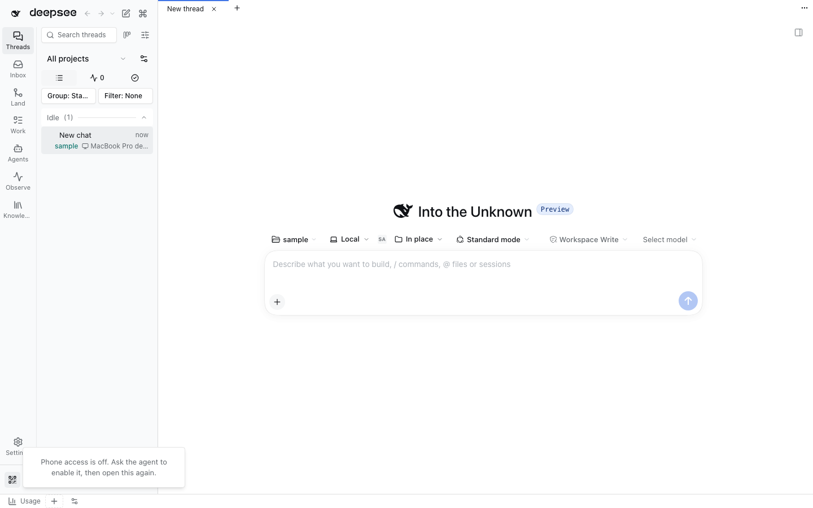
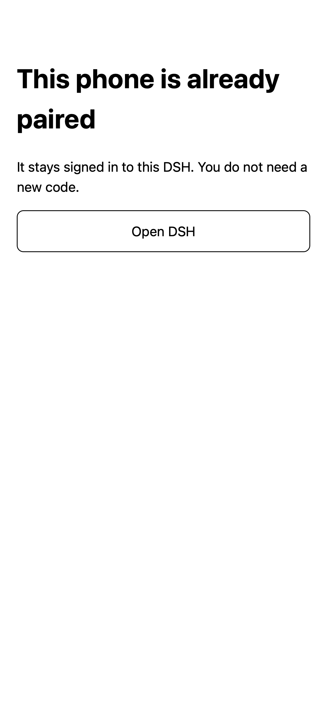

# Phone pairing

Public, password-less phone access to DSH: at startup the Host provisions an HTTPS
tunnel, prints one QR (or a 6-digit code), and the phone keeps a persistent cookie.
Devices live in `$DSH_HOME/plugins/phone-pairing/devices.json` as SHA-256 hashes.

## Flow

1. Phone access is **off by default**. Enable it with the `phone_pairing_enable` agent tool, or by writing
   `{"enabled":true}` to `$DSH_HOME/plugins/phone-pairing/settings.json` and restarting DSH. The choice
   persists, so nothing is published on a later start unless it stays enabled.
   The provider is auto-picked: **Tailscale first** (tailnet-only Serve, no public
   URL), then a public `cloudflared` quick tunnel for machines without it. Set
   `"provider"` explicitly to override (`tailscale-funnel`, `tailscale-serve`,
   `cloudflared`, `manual` + `"origin"`).
2. **Shared with Phone access QR.** When `@dshfiles/phone-access` is loaded and its proxy listens on a public
   origin, the gateway binds an OS-assigned loopback port. Through phone-access's edge API it claims `/pair` and its
   device cookie on that origin. Codes open the same `https://<machine>.<tailnet>.ts.net` the phone already uses. No
   tunnel starts, and turning phone access off only releases the claim: no `tailscale` command runs either way.
3. **Its own route** otherwise (phone-access absent, not listening, or a manual `"origin"`). The gateway listens on
   `gatewayPort` (default 3443) **before** any tunnel starts. A busy port leaves phone access off and starts no
   tunnel; `phone_pairing_status` names who holds the port, the `lsof -nP -iTCP:<port> -sTCP:LISTEN` command and a
   free port beside it, which `phone_pairing_enable` takes as `port` (`settings.json` remembers it). With Tailscale,
   it reads `tailscale serve status --json` first and takes only an HTTPS port nothing serves yet: 443, then 8443,
   then 9443 or 10443 for Serve; Funnel accepts only 443, 8443 and 10000. On off, it turns off that one port, and
   only while the port still points at its gateway. Another route, such as Phone access QR's `https=443`, is never
   replaced or removed. Otherwise an installed `cloudflared` quick tunnel is used; with neither, it prints install
   hints and stays off.
4. The terminal shows a QR (`https://<origin>/pair#id=…&secret=…`) and a 6-digit code. The DSH sidebar footer has the
   same QR behind **Show pairing QR code**, so a code can be minted without the terminal; the popover mints one fresh
   single-use offer each time it opens and shows how to turn phone access on while it is off. More than eight pending
   offers replace the oldest one instead of failing.
5. The phone scans, or opens `/pair` and types the code shown on the computer. Redemption is single use, expires
   after `offerTtlSeconds`, and is rate limited per minute. A refused code says why: used, expired, replaced by a
   newer code, wrong, too many tries, or too many devices. It also says what to do next. A phone that already paired
   gets "This phone is already paired" with **Open DSH** and spends no code.
6. The redeem answers JSON (`{ paired: true }`, never a redirect) and sets `__Host-dsh_phone` (HttpOnly,
   SameSite=Strict, Secure on HTTPS). The page then opens DSH. A page load with a cookie DSH no longer accepts
   (revoked or expired) gets **Pair this phone again**, not a bare 401.

   

7. Every later request is proxied to the native listener, which needs its own
   authority-bound cookie: the plugin exchanges the process launch URL for it and
   rewrites `Host`/`Origin` to `127.0.0.1:<native port>`. The native listener stays
   loopback-only and is never exposed.

## Requirements and limitations

1. `tailscale funnel` publishes the sign-in page to the internet. Anyone with a valid
   one-time secret or code, guessed within the rate limit, gets a device. Treat the QR
   like a password and revoke devices you no longer hold.
2. The Funnel/quick-tunnel URL is stable for Tailscale, random for cloudflared; a new
   cloudflared URL means the old phone cookie must be re-paired at the new origin.
3. Device credentials are hashes on disk; cookies are bearer tokens, so a stolen cookie
   is a paired device until revoked.
4. No agent tools yet (list/revoke), and the pairing page has no per-device name.
5. Verified by unit tests plus one end-to-end run of the gateway against a scratch
   DSH (code pairing, cookie, authenticated page, unpaired 401). No live pairing run.
6. Agent tools: `phone_pairing_status`, `phone_pairing_enable`, `phone_pairing_disable`,
   `phone_pairing_code` and `phone_pairing_revoke` (with `confirm: true`). Revocation
   closes that device's open sockets; enabling and disabling apply immediately, without
   a restart.
7. One-click install of a missing provider is not wired yet: `resolveProvider` reports
   the per-platform command, and nothing runs it.
8. A tailnet-only Tailscale endpoint needs the Tailscale app on the phone; the
   cloudflared fallback needs no app but publishes the pairing page.
