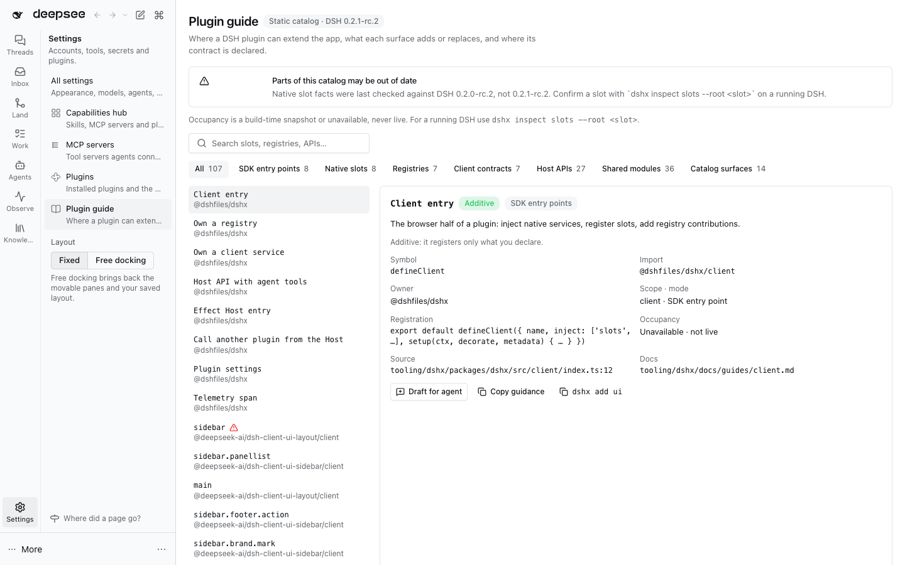

# @dshfiles/plugin-guide

A developer page for plugin authors: where a DSH plugin may extend the app, what each surface adds or replaces, and
where its contract is declared. Open **Settings › Plugin guide**.

## The catalog

`scripts/generate-catalog.ts` runs before every `dshx build` (and as `pnpm generate`) and writes
`src/generated/guide-catalog.ts` from declarations that are already public. It never reads a running Host.

| Kind                                    | Source                                                                                                                                      |
| --------------------------------------- | ------------------------------------------------------------------------------------------------------------------------------------------- |
| SDK entry points                        | A short allowlist (`defineClient`, `defineRegistry`, `defineApi`, `DshxPlugin`, …), each checked against the dshx index it is imported from |
| Native slots                            | create-dshx's offline slot reference, the one `dshx inspect slots --explain` reads                                                          |
| Registries, client contracts, Host APIs | `defineRegistry` / `defineContract` / `defineApi` exported by each owned plugin's `dshx.config.ts` `modules`                                |
| Shared modules                          | The other `modules` entries, with their exports                                                                                             |
| Catalog surfaces                        | `DSHX_PRESENTATION_SURFACES` and how many `dshx.features.json` features use each                                                            |

Each entry has its import, owner, scope, mode, registration shape, risk, occupancy, source file (with line) and docs.
Risk is one of `additive`, `id-reuse-replaces` (adding is safe, reusing a shipped id replaces it), `replaces` (a
single-occupant slot) and `shell-owned` (`root`, `sidebar`: replacing removes shipped shell UI and its inner seats),
shown as a high-risk badge.

Occupancy is `static` (the shipped composition the slot reference records) or `unavailable`, never `live`: Cordis
Inspect is a development provider, not a plugin API, and the plugin never calls it. For a running DSH use
`dshx inspect slots --root <slot>`.

Freshness: generation fails when a module file, an SDK export or a docs link disappears, and `src/catalog.test.ts`
fails with the regenerate command when the checked-in catalog is stale or was generated for another DSH version. At
runtime the page shows a banner when the running DSH differs from the catalog's, or when the slot facts were checked
against another release (today they were checked against 0.2.0-rc.2).

## Actions

- **Draft for agent** opens a new thread with the entry's bounded guidance (≤ 4,000 characters) in the composer. It is
  never sent from here.
- **Copy guidance** and the entry's check command (`dshx inspect slots --explain --root <slot>`, `features:check`,
  `dshx add ui`) go to the clipboard.

## Agent tool

`plugin_guide_search` (read-only) searches the same catalog by words and kind and returns one line per entry with its
import, risk, source and docs, plus the freshness note.

## Decisions

| Date       | Decision                                                           | Why                                                                                       |
| ---------- | ------------------------------------------------------------------ | ----------------------------------------------------------------------------------------- |
| 2026-10-16 | Useful for DSH plugin developers; a developer-only page            | DSH has CLI discovery but no visual map.                                                  |
| 2026-11-05 | A static generated map is enough for V1                            | Live occupancy has no supported plugin API; the static map covers the authoring question. |
| 2026-11-05 | Owned (`@dshfiles/*`) public modules only, no third-party examples | Only contracts this repository publishes and tests are listed as supported.               |

Live occupancy stays a separate phase: it needs a Host-owned typed read API with version, freshness and bounded
occupant metadata, designed and approved before it is built.
