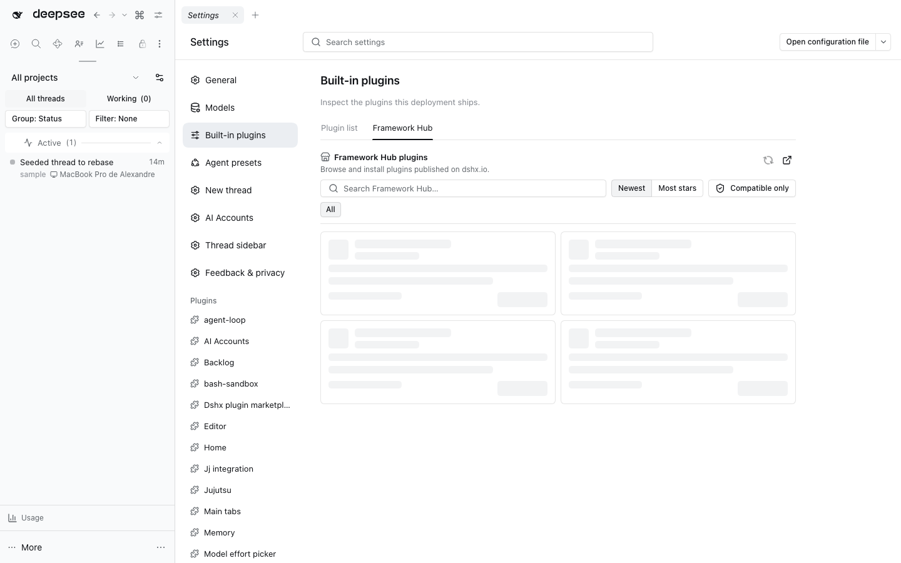

# DSHX Plugin Marketplace



`@dshfiles/plugin-marketplace` started as upstream DSHX's self-hosting reference plugin and now lives with our other owned bundles; its MIT license is kept in `LICENSE`. It adds a **Settings → Built-in plugins → Framework Hub** tab to a DSH Web Profile and reads Framework Hub's installable marketplace catalog.

The package exercises the complete plugin authoring path produced by `create-dshx`: `defineHost`, `defineSettings`, `defineApi`, `defineClient`, `defineLocale`, `defineSlot`, Standard Schema validation, and `useApiQuery`. It is built and installed as an ordinary DSH bundle; no Harness or DSHX core patch is required.

## Develop and build

From `plugins/`:

```sh
pnpm install
pnpm --filter @dshfiles/plugin-marketplace check
pnpm --filter @dshfiles/plugin-marketplace typecheck
pnpm --filter @dshfiles/plugin-marketplace test
pnpm --filter @dshfiles/plugin-marketplace build
```

Run `pnpm --filter @dshfiles/plugin-marketplace dev` to start the real DSH development Profile. Client changes use official HMR; Host changes rebuild and restart the Host process. Add `-- --port 0` when the default Web port is occupied.

## Install

It is a local bundle, so it is linked into a profile like every other package
under `plugins/@dshfiles` (see the repository AGENTS.md, "`pnpm add <path>` is
blocked; `pnpm install` is not"). Installed plugins become active after the
Profile is restarted.

## Framework Hub configuration

The settings namespace is `dshx-plugin-marketplace`:

```yaml
dshx-plugin-marketplace:
  hubBaseUrl: https://dshx.io
  defaultSort: latest # or stars
  hideIncompatible: false
```

The default points at upstream's public hub. Values update live; `defaultSort` and `hideIncompatible` only set the initial state of the tab's own controls. Production endpoints must use HTTPS; loopback HTTP is accepted only for local development and smoke tests.

The Host reads `GET /api/marketplace/plugins` (forwarding `q`, `sort`, `category`, `cursor`) and `GET /api/marketplace/plugins/:slug`. Those endpoints are separate from Hub's discovery/SEO catalog. An install always re-fetches the exact detail and accepts only one active primary target whose package and version match the published catalog entry. The client does not submit a package name, version, or command.

## Security boundary

- The browser submits only a Hub slug. The Host fetches the plugin detail again and accepts exactly one active primary install target.
- Compatibility is checked against the running DSH version before installation.
- The DSH CLI is invoked with a fixed argument array, without a shell, with cancellation, a five-minute timeout, and one install task per Profile process.
- Host responses are validated before display. Local paths and raw terminal output remain in Host logs.
- Community plugins display an additional third-party code warning before installation.

This version contains server-side search, newest/most-stars sorting, categories, a compatible-only filter, compact cards (author, stars, update date), pagination, installation, and restart guidance. It does not contain details, uninstall, update, hot loading, or automatic restart. Installation works only from a loopback DSH Web session because the typed Host API is intentionally loopback-only.
