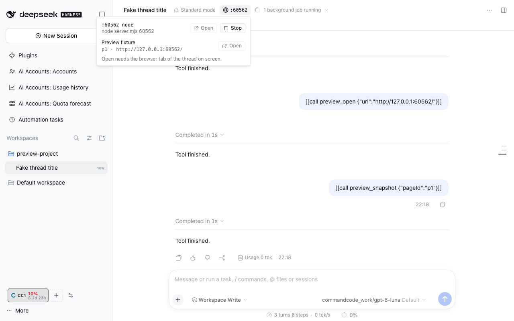

# DSH preview



Two things a thread needs while it builds a web app:

- **Agent preview browser.** Agent tools drive a headless Chromium on the DSH Host, one isolated browser context per
  thread.
- **Thread dev servers.** The thread header lists the TCP ports the thread's processes listen on, with **Open** (in the
  browser tab beside the thread) and **Stop**.

## Agent tools

| Tool                             | What it does                                                                                                                                                                        |
| -------------------------------- | ----------------------------------------------------------------------------------------------------------------------------------------------------------------------------------- |
| `preview_open`                   | Open a URL in a new page of this thread's preview browser; `reveal: true` also shows it in the user's browser tab. Returns the page id (`p1`, …), final URL, title and HTTP status. |
| `preview_navigate`               | Load another URL in a page, or `back` / `forward` / `reload`.                                                                                                                       |
| `preview_snapshot`               | Bounded accessibility snapshot (default 20 000 characters) with `[ref=e12]` marks for click and type. Read-only.                                                                    |
| `preview_screenshot`             | JPEG of the viewport, or of the whole page with `fullPage`. Read-only.                                                                                                              |
| `preview_click` / `preview_type` | Act on one element by `ref` from the latest snapshot, or by Playwright `selector`.                                                                                                  |
| `preview_evaluate`               | Run a JavaScript expression in the page, result capped at 8 000 characters. Refused until the user enables `allowEvaluate`.                                                         |
| `preview_reveal`                 | Show a page's URL in the user's browser tab.                                                                                                                                        |
| `preview_close`                  | Close one page, or every page of the thread with `all: true`.                                                                                                                       |
| `preview_list`                   | The thread's open pages. Read-only.                                                                                                                                                 |
| `thread_dev_servers`             | Listening ports a thread started, with pid, command and URL. Read-only.                                                                                                             |
| `thread_dev_server_stop`         | Stop one listed server; requires `confirm: true`.                                                                                                                                   |

An agent acts only on its own thread's pages and servers; it may read another thread's dev servers.

## Settings (`dshfiles-preview`)

| Setting             | Default                                        |                                                                       |
| ------------------- | ---------------------------------------------- | --------------------------------------------------------------------- |
| `allowedHosts`      | `localhost`, `127.0.0.1`, `::1`, `*.localhost` | Hosts a top-level navigation may reach.                               |
| `allowAnyHost`      | off                                            | Any http(s) host.                                                     |
| `allowEvaluate`     | off                                            | Offer `preview_evaluate`.                                             |
| `chromiumPath`      | empty                                          | Chrome/Chromium executable; empty uses the Playwright headless shell. |
| `idleMinutes`       | 15                                             | Close a thread's pages after this long without a preview call.        |
| `maxPagesPerThread` | 4                                              |                                                                       |

## How it works

```
preview_* tool ─► previewApi (dshx, agent tool) ─► PreviewBrowsers
                                                   ├─ chromium.launch (one per Host, pipe transport, headless)
                                                   └─ newContext per thread (no downloads, no service workers)
                                                       └─ route guard: top-level navigations checked against allowedHosts

thread header chip ─► previewApi.devServers ─► lsof/ss + ps + cwd probe (3 s cache) ─► attributeDevServers
                                                live jobs (ctx.jobs) ┘                  sessionController.list ┘
```

- **Attribution.** A listening process that descends from a Host child matched to a live job belongs to the job's
  thread. Otherwise it belongs to the thread whose working directory is the deepest one containing the process's
  working directory; threads sharing a checkout all see it. The Host and the processes that launched it are never
  listed; sockets no thread accounts for are left out.
- **Stop** re-reads the process table and matches pid and start time, so a recycled pid is refused. A job-owned server
  stops through the job registry (its thread records the kill); any other gets SIGTERM, then SIGKILL after 3 s if the
  same process is still alive.
- **Cleanup.** A thread's browser context closes when the thread is disposed or idles for `idleMinutes`; unloading the
  plugin closes Chromium.
- **Reveal.** `preview_open` with `reveal` or `preview_reveal` publishes a `pagesChanged` event; the header chip of
  that thread opens the URL through the `Browser` contract (`@dshfiles/chat`).

## Security

- Navigation is limited to loopback hosts by default; only top-level navigations are checked, so a page may still load
  subresources from elsewhere. Credentials in URLs and non-web schemes are refused.
- Each thread gets a fresh, cookie-less context: the preview browser never sees the user's browser profile.
- Snapshot, evaluate and screenshot content is untrusted page data, and the tool descriptions say so.
- `preview_evaluate` is off by default. Turning it on lets the agent run arbitrary JavaScript in pages on the allowed
  hosts, including your local dev servers' origins.
- The DSH Web GUI itself is on loopback too. A fresh context holds no DSH session cookie, so it gets the login page,
  but avoid pasting a tokenized DSH URL into a preview tool.

## Install the browser

The Host uses `playwright-core` 1.56.1, which looks for its headless shell in the Playwright cache. When it is missing
the first preview call says so; install it with `pnpm --dir plugins/@dshfiles/preview exec playwright-core install
chromium-headless-shell`, or set `chromiumPath`.
