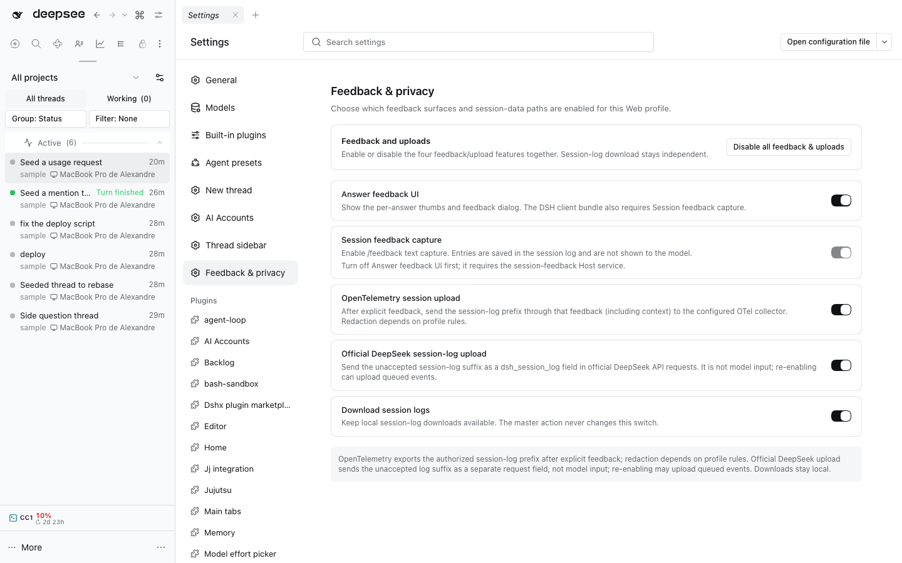

# Feedback & privacy controls



This Web Settings section controls feedback and session-log sharing one feature at a time. The checked-in Web profile starts with the answer-feedback UI, session feedback capture, and both upload paths off; local session-log downloads stay on.

These controls live in one dedicated bundle because DSH exposes them as separate Loader rows with distinct data flows. Keeping each switch explicit preserves the answer-UI/session-feedback dependency and separates uploads from local downloads.

## Controls

- **Answer feedback UI** enables the per-answer thumbs and feedback dialog. DSH’s client bundle requires the `sessionFeedback` Host Remote, so enable **Session feedback capture** first. Turn the answer UI off before disabling session capture.
- **Session feedback capture** enables the `/feedback <text>` command and its Host Remote. Entries are appended to the session log and are not shown to the model.
- **OpenTelemetry session upload** enables the configured OTel exporter. In `FEEDBACK_ONLY` mode, explicit feedback releases the session-log prefix through that feedback, including context. Redaction depends on profile rules.
- **Official DeepSeek session-log upload** enables the `dsh_session_log` field on official API requests. The field is separate from model input. Re-enabling can upload any still-unaccepted log suffix, including events recorded while this uploader was off.
- **Download session logs** controls local exports. The master button never changes it.

The checked-in Web seed hides the built-in General-page session-log setting so it does not offer a second session-log control alongside these explicit switches.

Uploads can include session content. Turning on the master button enables the answer-feedback UI, session-feedback capture, OTel exporter, and official DeepSeek session-log upload together; a confirmation explains the effect. Turning it off disables those four feedback/upload controls and leaves downloads unchanged.

## Persistence

Switches append narrowly marked `disabled` overrides to the active profile’s `cordis.patch.yml`. Other patch content and plugin configuration stay intact. Writes are atomic and serialized with DSH profile HMR; without HMR, the page reports that a restart is needed. The checked-in Web seed’s initial defaults apply on its next normal profile sync/restart; this plugin never syncs or restarts a profile itself.

## Verification

From the repository root:

```sh
fnm exec --using=22.23.3 pnpm --dir plugins/@dshfiles/privacy-controls run check
fnm exec --using=22.23.3 pnpm --dir plugins/@dshfiles/privacy-controls run test
fnm exec --using=22.23.3 pnpm --dir plugins/@dshfiles/privacy-controls run build
fnm exec --using=22.23.3 node -e "import('./plugins/@dshfiles/privacy-controls/dist/index.js')"
fnm exec --using=22.23.3 pnpm check:e2e --grep 'Change feedback and upload switches'
fnm exec --using=22.23.3 pnpm check:e2e --grep 'share one stylesheet'
```

The E2E runner uses isolated profiles; do not sync or restart the live Web profile for verification.
