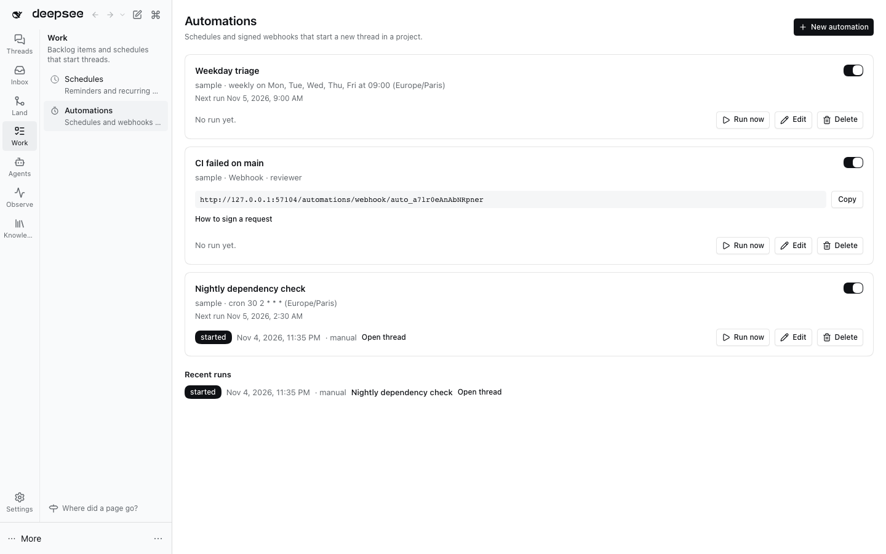

# @dshfiles/project-automations



Per-project automations: a schedule or a signed webhook starts a **new thread** in a project with a prompt, an agent
preset and a model. Open **Work › Automations** to create, edit, pause, resume, run now and delete them, and to read
their recent runs.

DSH's own Schedule bundle covers a different need: reminders delivered into one existing thread. This plugin is the
project-level counterpart (plan row B5 in `plans/t3code-parity.md`).

## What it does

| Trigger  | When it runs                                                                                   |
| -------- | ---------------------------------------------------------------------------------------------- |
| Schedule | `cron` (five fields), `daily` at a time, `weekly` on chosen weekdays, or every N minutes (≥ 1) |
| Webhook  | A `POST /automations/webhook/<id>` on the DSH web server signed with the automation's secret   |

Each run calls the session controller's `sessions.create` with the automation's project, title, prompt, agent preset
and model, exactly as the New thread button does. The run history keeps the last 25 runs of each automation: trigger,
outcome (`started`, `failed`, `rejected`), the thread it started and, for a failure, what to do next.

### Schedules

- Timing comes from DSH's own Schedule domain (`@deepseek-ai/dsh-schedule`), so an automation and a session reminder
  agree on every instant. Every daily, weekly and cron rule names an explicit IANA time zone.
- A local time that does not exist (the spring-forward hour) is skipped; a repeated local time (the fall-back hour)
  runs once, at the earlier instant.
- The Host must be running at the target time. A Host that was down across several targets runs **once**, for the
  latest missed occurrence, then continues from the next target. A resumed automation starts from its next target
  after now; runs missed while it was paused are not made up.
- Automations live in plugin storage and survive Host restarts. The next target is committed before the thread
  starts, so a crash never runs the same occurrence twice (it may skip it).

### Webhooks

The sender signs every request:

```
x-dsh-timestamp: <Unix time in seconds>
x-dsh-signature: sha256=<hex HMAC-SHA256(secret, "<timestamp>.<raw body>")>
```

```sh
body='{"ref":"main"}'
ts=$(date +%s)
sig=$(printf '%s.%s' "$ts" "$body" | openssl dgst -sha256 -hmac "$WEBHOOK_SECRET" | sed 's/^.* //')
curl -X POST -H 'content-type: application/json' -H "x-dsh-timestamp: $ts" -H "x-dsh-signature: sha256=$sig" \
  --data "$body" 'https://<dsh-host>/automations/webhook/<id>'
```

- The secret is stored as a `secret:ALIAS` reference (a global Secret Catalog alias) and resolved on the Host for
  each request; the value never reaches storage, the browser, a run record, a span or a log.
- Refused: a missing or wrong signature, a timestamp more than 5 minutes from the Host clock, the same signed request
  twice inside that window, more requests per minute than the automation allows (1–120, default 10) or than 120 across
  all webhooks, a body over 256 KiB, a paused automation. Refusals after the automation is found are recorded as
  `rejected` runs with the reason.
- The prompt may read the request with `{{body.path.to.field}}` (own properties, at most 8 levels, array indexes
  allowed) and `{{headers.name}}`. Credential headers (`authorization`, cookies, signatures, anything named token,
  secret or api-key) are refused when the automation is saved. Values are filled once (a value reading `{{...}}` stays
  text), stripped of control characters and clipped to 2,000 characters; the prompt ends with a note telling the agent
  that inserted values are untrusted data. Nothing in the payload is ever executed.
- Limits held in memory (the replay window, the rate counters) reset on a Host restart: a request captured less than
  5 minutes before a restart could be accepted once more after it.
- The route answers wherever the DSH web server listens. GitHub's own `X-Hub-Signature-256` scheme (no timestamp) is
  not accepted; relay from a workflow step that signs with the scheme above.

## Agent tools

Every page verb is also a tool, bound to the same API method:

| Tool                     | Does                                                                |
| ------------------------ | ------------------------------------------------------------------- |
| `automation_list`        | Every automation with trigger, next run, webhook URL and last run   |
| `automation_runs`        | Recent runs, newest first                                           |
| `automation_projects`    | Registered projects and the `projectId` a save takes                |
| `automation_save`        | Create (no `id`) or replace an automation (only when asked)         |
| `automation_set_enabled` | Pause or resume (only when asked)                                   |
| `automation_run_now`     | Start one run now (only when asked)                                 |
| `automation_delete`      | Delete with its history; requires `confirm: true` (only when asked) |

## Telemetry

One `automation run` span per run (`dshx.automation.id`, `.trigger`, `.outcome`) and one `automation webhook` server
span per request (`dshx.automation.webhook.outcome`). API calls and tools get the automatic `api-dispatch` and
`agent-tool` spans.

## Install

Add `@dshfiles/project-automations` next to `@dshfiles/session-controller` (required to start threads) and
`@dshfiles/secret-catalog` (required for webhooks) in the profile, then restart DSH.

## Develop

```sh
pnpm --dir plugins/@dshfiles/project-automations typecheck
pnpm --dir plugins/@dshfiles/project-automations test
pnpm --dir plugins/@dshfiles/project-automations build
pnpm --dir plugins/@dshfiles/project-automations test:e2e
```
