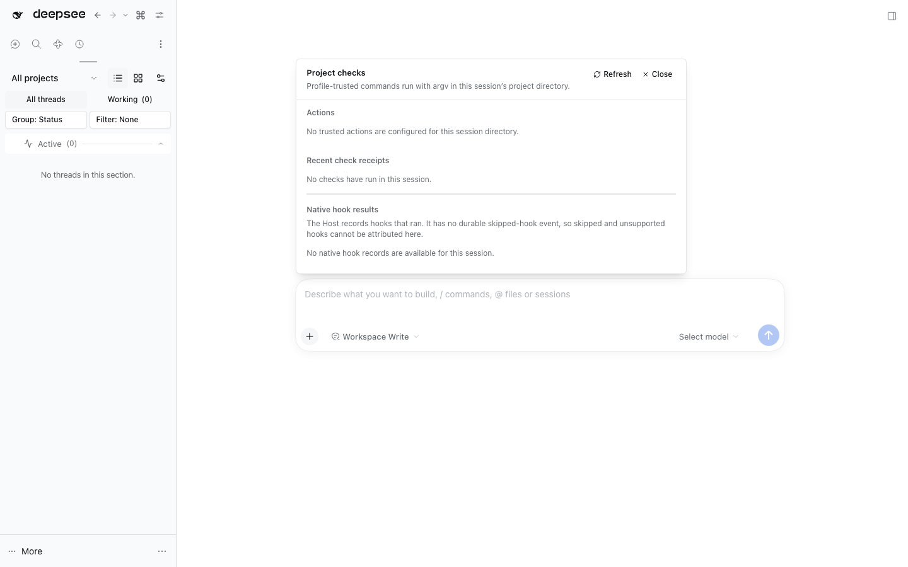

# Project Checks



Project Checks adds a session-scoped action in the native composer command menu. It runs profile-trusted, named commands in the active session's directory, stores bounded authoritative receipts in DSH storage, can verify configured actions before a turn closes, shows native hook invocation/result records, and optionally publishes safe summaries to Activity Timeline.

## Configure trusted actions

Actions belong in the profile's `cordis.patch.yml`, never in project-controlled configuration. Add this top-level patch row alongside the other entries and use absolute paths for roots:

```yaml
- id: dshfiles-project-checks
  config:
    actions:
      - id: test
        label: Test
        description: Run the project test suite.
        command: pnpm
        args: [test]
        root: /absolute/path/to/project
        timeoutMs: 180000
        verifyBeforeComplete: true
      - id: typecheck
        label: Typecheck
        command: pnpm
        args: [typecheck]
        root: /absolute/path/to/project
        timeoutMs: 120000
```

An action also accepts an `execution` policy: `target` `local` (default), `remote` or `auto`, an optional `remote` pin, and `onRemoteFailure` `local` (run it on this machine and record why) or `fail`. A peer is configured once with a bare snapshot repository, a checker workspace, a toolchain prefix and an install command; the run then publishes the working-copy revision, materializes it there, runs the action, and verifies the peer stayed on that exact revision. See [remote project checks](../../../docs/remote-project-checks.md) for the config reference, peer setup and failure codes.

The process uses direct argv, the session directory as `cwd`, and DSH's scrubbed child environment. It does not evaluate shell text, read repository command config, forward credentials, or display raw command output. A session must resolve inside the configured root. One-shot actions have a 1–300 second timeout. Long-running development servers remain in DSH's owner-scoped terminal.

Actions marked `verifyBeforeComplete` run at the native awaited `agent/turn-stopping` event. Failed checks steer the same turn once, then the configured attempt limit (maximum two) stops that turn with a failure. Cancellation aborts and cleans up the subprocess. Receipts record before/after working-copy revisions when available; old receipts remain readable. Current source freshness is recalculated from the working copy when the Project Checks API is queried. Receipt configuration equivalence is always `unknown`; durable task rows separately retain only a SHA-256 action fingerprint, never command/argv.

## Durable task tools

The Host API exposes `project_checks_dispatch`, `project_checks_tasks`, `project_checks_cancel`, and `project_checks_retry` alongside the existing inline `project_checks_run`. Durable dispatch is opt-in and local-only; it persists a version-1 task input and queued state before execution, serializes work to one local subprocess at a time, and exposes bounded status/progress without command output or working paths. Use a UUID idempotency key and reuse it after a lost response. History is capped at 1,000 records; only old succeeded, failed, cancelled and timed-out rows are pruned, while queued, blocked and unknown work is retained.

Every action defaults to `replayPolicy: manual`. Set `replayPolicy: read-only` in the trusted profile only after auditing the exact executable and arguments as safe to repeat. The setting is an operator assertion, not inferred from an action name. After restart, queued tasks can run; interrupted attempts are reconciled against their attempt-specific receipt, otherwise they stay `unknown` unless that explicit read-only policy permits replay. Retrying any failed/cancelled/timed-out/unknown task requires `confirmPossibleDuplicate: true`; this acknowledges that an external effect may already have happened. Cancellation reports `cancelled` only after the managed process group is observed to exit; that does not undo effects that happened before cancellation. Unconfirmed process cleanup remains `unknown`.

The storage domain and runner are owned by the DSH Host process for the session. Same-process duplicate dispatches are serialized and return the saved task. Stock storage has no cross-process compare-and-swap, so the plugin does not promise atomic idempotency if independent Host processes share one storage home. Remote Project Checks, completion-verification hooks, and the existing inline run path do not use this durable workflow.

## Activity Timeline projection

Project Checks remains the receipt owner. After a receipt is persisted, it emits a strict `version: 1` summary over `dshfiles/activity/event`; the event allowlist includes the receipt/session/action IDs, safe label, status/failure category, timestamps/duration, exit code, manual/automatic mode, attempt/verification turn, and recorded before/after revisions. Command, argv, working paths, stdout/stderr, environment, credentials, prompts, and transcript content never enter the projection.

When Activity Timeline announces `dshfiles/activity/source-ready`, Project Checks answers `dshfiles/activity/backfill` with recent receipts from its own storage, bounded to the last seven days and at most 2,000 retained rows. Live emission and replay use the same receipt-derived event ID and correlation ID, so restart delivery is idempotent. Timeline is optional: missing or failed ingestion cannot fail or rerun an action, and receipts remain visible in this panel.

Failed and timed-out checks receive attention; cancellation stays `cancelled` with no failure category and is notable rather than a failed check. Automatic retries retain one receipt/event per attempt.

The Activity detail is historical; it does not certify the current working copy or configuration. Open its Session and refresh Project Checks to read current source freshness from the authoritative API. The bounded source receipt may have expired even while its historical Activity summary remains. See the [cross-plugin verification evidence guide](../../../docs/verification-evidence.md) for the archived/missing Session boundary, security review, and full verification commands.

The panel reads hook events from the native session query service. DSH 0.2 records `hook/invoked` and `hook/result`; it does not emit durable skipped/unsupported-hook events, so the panel states that gap instead of inventing per-hook skip records. Hook stderr content and raw subprocess output are not exposed.

## Verify

Run `pnpm --dir plugins/@dshfiles/project-checks typecheck` and `test`, then build through Turbo so `@dshfiles/shared-runtime` is built first. The scratch journeys are `pnpm check:e2e @dshfiles/project-checks` (including automatic retry/cancellation projection and receipt persistence with Activity Timeline absent) and `pnpm check:e2e @dshfiles/activity-timeline` (including manual projection, Session navigation, and restart backfill); neither touches the live profile.
