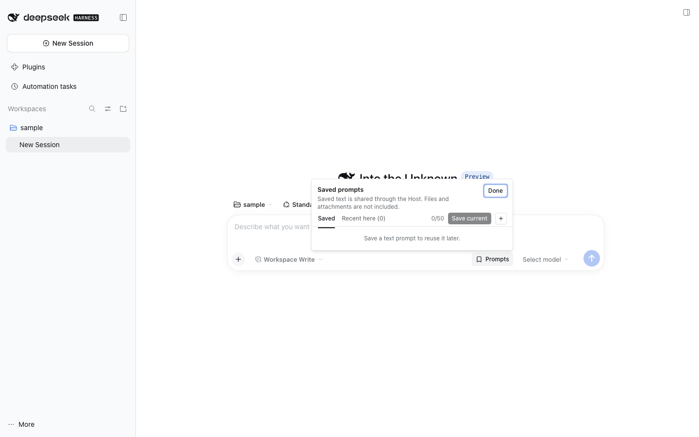

# Prompt Stash

Prompt Stash provides one composer action for reusable prompts. It uses DSH's revision-guarded insertion API and never submits a message. The Host owns the shared prompt library, so it is available in every browser.

## Prompts

The Prompts action manages up to 50 reusable text prompts, with up to 20,000 characters per prompt and 450,000 total prompt characters. Save current copies the plain-text composer draft into the library without changing or sending it; references, attachments, busy drafts, and oversized text are excluded. A label is optional; when omitted, the first line of the prompt text labels it. Edits are versioned and validated. Per-prompt revision ids detect concurrent edits from another browser tab; the local editor remains available and can be saved as a separate copy.

Its Recent tab reads up to 20 direct user-text messages from the loaded Chat snapshot, scanning no more than 1,000 nodes. Recent messages are not persisted. Unsupported content, references, and attachments are excluded.

## Composer drafts

Unsaved text remains owned by DSH's native per-thread composer. The plugin does not keep a second stash of in-progress drafts. Older saved-draft records and browser-local fallback data are left untouched; the plugin no longer reads or writes them.

## Draft attachments

DSH keeps a thread's composer text when you leave the thread, but its draft attachments live in the thread's session scope and are dropped once nothing holds that scope. While a composer holds attachments, Prompt Stash holds its session (reference source `composerDraftAttachments`), so leaving the thread and coming back, for example with the sidebar's Back, keeps the files and images with the text. Sending or removing them lets the session go. A page reload still loses them: DSH persists only the text ([Host gap](../../../plans/dsh-host-gaps.md)).
