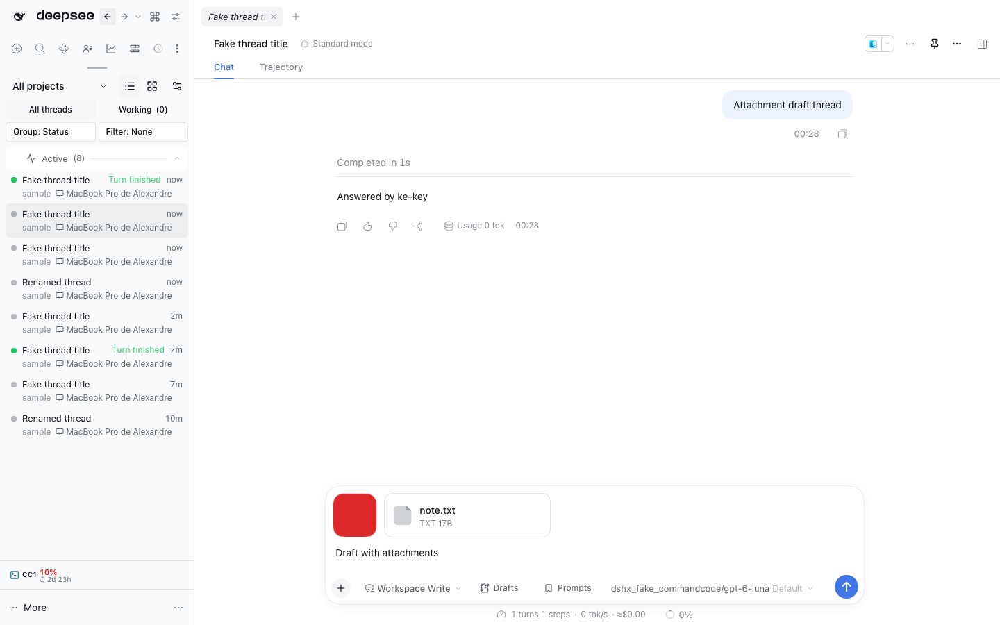

# Prompt Stash

Prompt Stash provides two composer actions. Both keep prompt text in this browser and use DSH's revision-guarded insertion API; neither submits a message. Prompt data stays in this browser and is not sent to the Host or synced across devices.

## Prompts

The Prompts action manages up to 50 reusable text prompts, with up to 20,000 characters per prompt and 450,000 total prompt characters. Save current copies the plain-text composer draft into the library without changing or sending it; references, attachments, busy drafts, and oversized text are excluded. A label is optional; when omitted, the first line of the prompt text labels it. Edits are versioned and validated. Per-prompt revision ids detect concurrent edits from another browser tab; the local editor remains available and can be saved as a separate copy.

Its Recent tab reads up to 20 direct user-text messages from the loaded Chat snapshot, scanning no more than 1,000 nodes. Recent messages are not persisted. Unsupported content, references, and attachments are excluded.

## Drafts

The Drafts action can save up to 20 snapshots of the current plain-text composer draft. Saving is disabled while the composer is busy, for empty text, when it has attachment ids or reference chips, or when the text exceeds 24,000 characters. The store is limited to 512 KiB. These snapshots remain in this browser's local storage.

Drafts also shows up to 50 text-only sent prompts from the loaded conversation; this history is not copied into local storage. Both actions capture the insertion position and reject insertion if the composer changed while the panel was open, preserving the current text and supported assets.

Neither action syncs prompt data between browsers or devices.

## Draft attachments

DSH keeps a thread's composer text when you leave the thread, but its draft attachments live in the thread's session scope and are dropped once nothing holds that scope. While a composer holds attachments, Prompt Stash holds its session (reference source `composerDraftAttachments`), so leaving the thread and coming back, for example with the sidebar's Back, keeps the files and images with the text. Sending or removing them lets the session go. A page reload still loses them: DSH persists only the text ([Host gap](../../../plans/dsh-host-gaps.md)).
