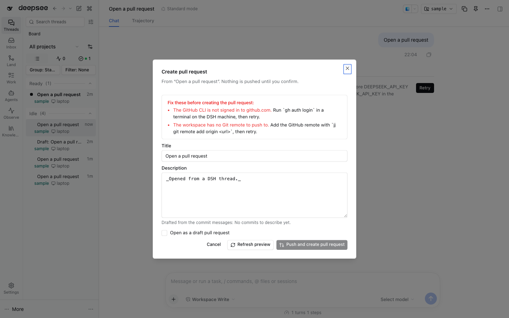

# Pull requests



GitHub integration that creates a pull request from a DSH thread, links it to the thread, watches it, and reports meaningful state changes through the thread sidebar. In the browser, the command palette's **Create pull request from this thread** opens a dialog: it previews the repository, bookmark, base and commits, shows a title and body drafted from the thread that you can edit, lists every blocker with its fix, and pushes and creates only when you confirm. The result links the pull request to the thread and starts watching it. The plugin exposes these Agent tools:

- `pull_request_link` — link by GitHub.com PR URL, or by number and repository `cwd`.
- `pull_request_unlink` — remove one link by URL or repository plus number.
- `pull_request_list` — list one thread's links, or all links with `all: true`; includes last known state and watch status.
- `pull_request_watch` / `pull_request_unwatch` — start or stop watching; watch creates the link if needed, unwatch keeps it.
- `pull_request_create_preview` — read-only preview of opening a PR from a thread's jj workspace: repository, base branch, bookmark, the commits above `<base>@<remote>`, a title and body drafted from the thread, an open PR that already uses the bookmark, and every blocking problem with its recovery.
- `pull_request_create` — after the preview, with `confirm: true` and the preview's `headCommitId`: sets the bookmark on that commit, runs `jj git push --remote <remote> --bookmark <name>`, then `gh pr create` (or reuses the open PR for the bookmark), and links and watches the PR on the thread.

## Creating a pull request from a thread

The preview changes nothing. It reads the thread (title, a bounded transcript and its last model route through the Host session query), runs `gh auth status`, `gh repo view` and `gh pr list --head`, and reads jj: the remote (`origin` first), the base branch (`gh`'s default branch at that remote), and the commits from `<base>@<remote>` to the working copy (an empty, undescribed working-copy commit is skipped). The bookmark is an existing local bookmark on the head commit, else `dsh/<thread-title-slug>`.

The title and body come from one model call on the thread's own route (or a passed `provider`/`model`). Without a model service, a route or a usable answer, the draft falls back to the commit messages and `generation.note` says why.

Create re-checks everything and refuses when the workspace head is no longer the previewed commit, so a confirmed preview is exactly what is pushed. Every blocker carries a recovery:

| Problem                                                        | Recovery offered                                                                     |
| -------------------------------------------------------------- | ------------------------------------------------------------------------------------ |
| gh missing / not signed in / no GitHub repository              | install gh, `gh auth login`, or add the GitHub remote                                |
| jj missing / not a jj workspace / no remote / base not fetched | install jj, run from a jj workspace, `jj git remote add`, `jj git fetch`             |
| no commits, undescribed or conflicted commits                  | commit the work, `jj describe` or `jj abandon` the empty one, `jj resolve`           |
| bookmark points elsewhere, push rejected                       | choose another name or `--allow-backwards`; fetch and rebase, or fix Git credentials |
| `gh pr create` failed after the push                           | the branch is pushed; retry, or open it on GitHub and `pull_request_link` it         |

`sessionId` defaults to the calling thread. URL links use the Agent's current `cwd` when available; number links require `cwd` so `gh repo view` can identify the repository. An empty stored `cwd` means no calling directory was available; polling still uses `--repo` explicitly.

## Runtime behavior and limits

- Uses the installed `gh` executable and its existing login. It never reads, prints, or stores an authentication token. Only GitHub.com PR URLs are accepted; GitHub Enterprise hosts are not supported.
- Watching polls immediately, then every two minutes. Multiple linked threads watching the same repository and PR share one `gh pr view` per poll. Links, last-known state, and rate-limit backoff persist in the Host `StorageDomain`.
- Polling requests `state,mergeable,mergeStateStatus,reviewDecision,statusCheckRollup,comments,reviews`. New comment/review messages contain only author and timestamp, not user-authored text.
- The `gh pr view` status rollup does not separately identify required versus optional checks. The “checks passed” transition is therefore conservative: GitHub must report `mergeStateStatus: CLEAN`, at least one status entry must be present, and every returned entry must be successful. It does not claim a separately enumerated branch-protection check set.
- Rate limiting applies persisted exponential backoff starting at two minutes and capped at one hour. Other CLI or schema failures retain the last known state and retry on a later cycle.
- On merge or close, watching stops and the plugin asks `thread-sidebar` to settle the linked thread. Auto-settle can skip running, waiting, blank, archived, pinned, opted-out, or descendant-active threads. If `thread-sidebar` is absent, pull-request state continues updating and the Host logs that message/settle integration was unavailable.

## Verification

From the repository root:

```bash
pnpm --dir plugins/@dshfiles/pull-requests test
pnpm --dir plugins/@dshfiles/pull-requests typecheck
pnpm --dir plugins/@dshfiles/pull-requests lint
pnpm exec turbo run build --filter=@dshfiles/pull-requests
node plugins/@dshfiles/pull-requests/scripts/host-import-check.mjs
```

`tests/create-host.spec.ts` creates a PR end to end against a real test Host, real jj and a temporary bare Git remote, with a shell-script `gh` on `PATH`, and checks the pushed branch, the `gh pr create` argv and the watched link. The Host API and durable storage path run against a real disposable test Host; schema and transition tests use fixed GitHub-shaped JSON and do not contact GitHub. The browser journey `tooling/dshx/e2e/features/pull-requests.feature` (`pnpm check:e2e pull-requests`) seeds a jj repository with a bare remote and a stub `gh` on the Host PATH, runs the palette command, confirms the dialog and checks the pushed branch and the created, polled pull request.
