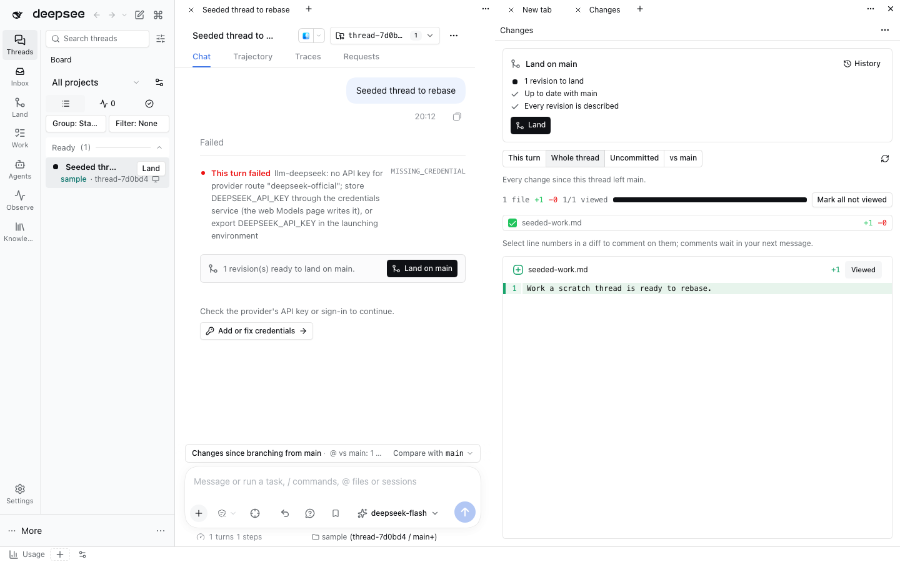
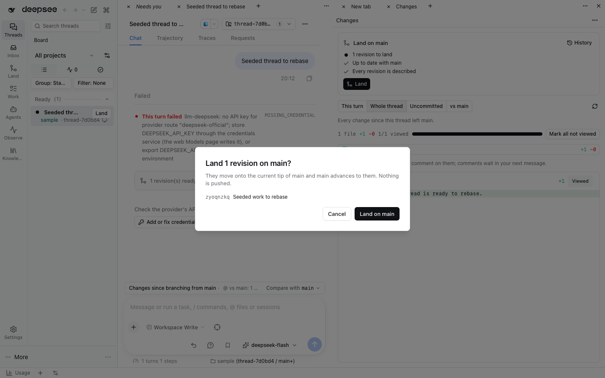
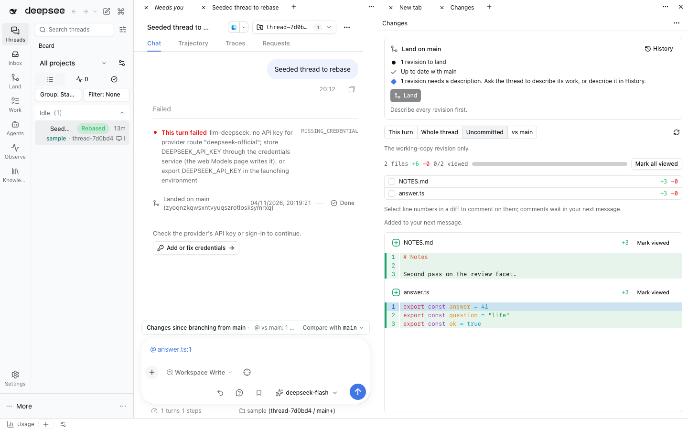
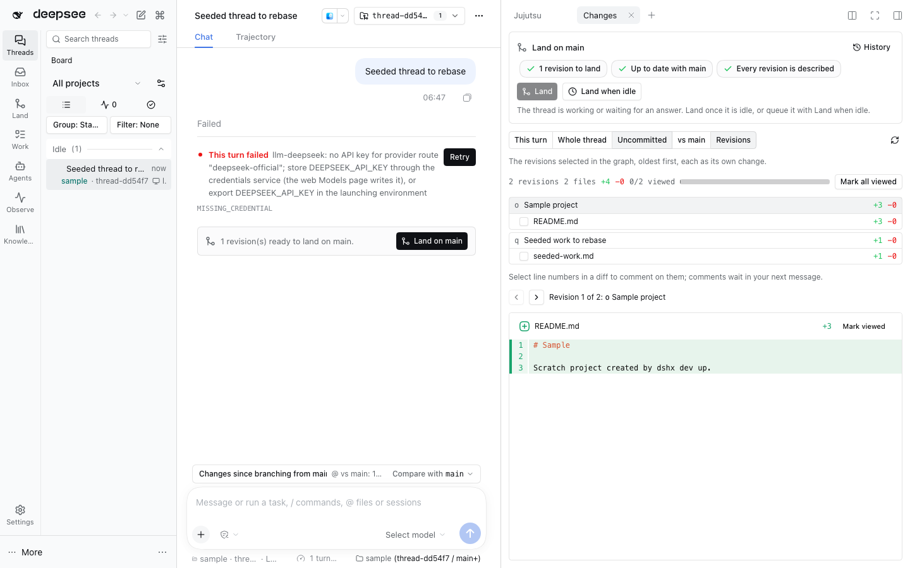
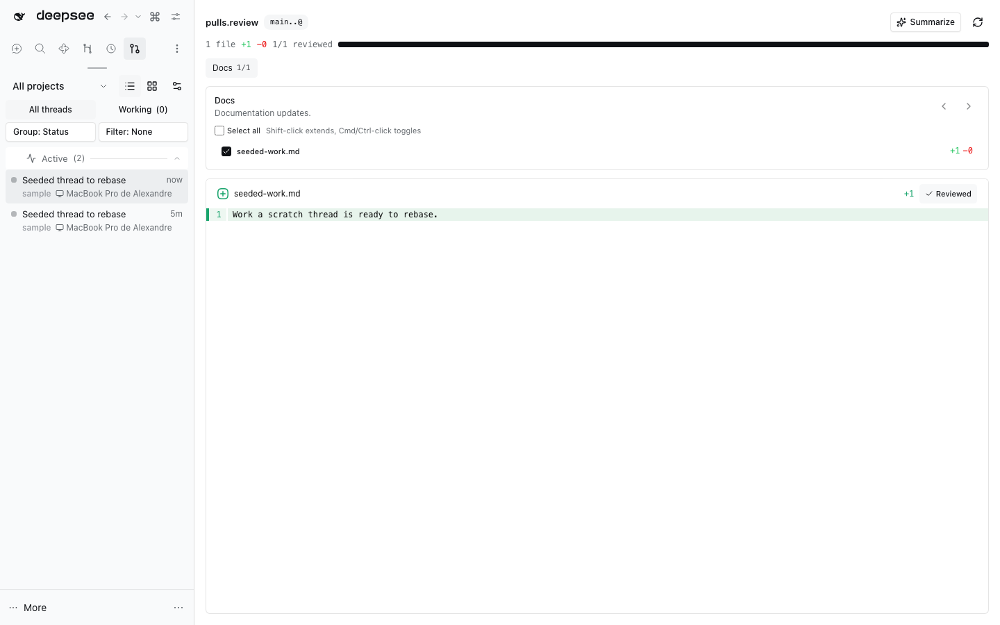
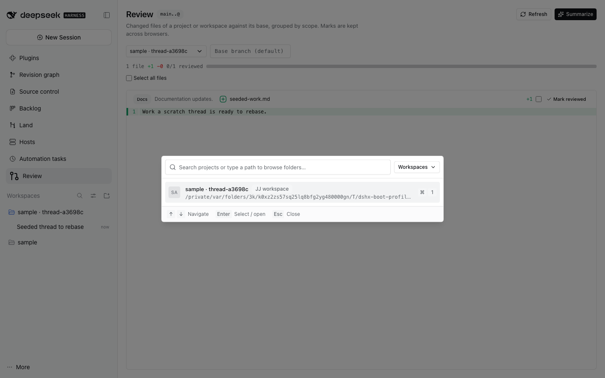

# pulls.review



This plugin owns the thread panel's **Changes** facet (review → land on one surface) and the
cross-project **Review** page.

## Changes facet

A right-pane tab that follows the thread on screen. It answers "what did this thread change, have I
read it, and can it land?" without leaving the thread:

- **Scopes**, each a pair of revisions: **This turn** (DSH's own turn-start/turn-end snapshot, the
  same data as the "Edited N files" card; works for any version control), **Whole thread**
  (`fork_point(<bookmark> | @)` to `@`, the thread's own work), **Uncommitted** (`@-` to `@`) and
  **vs main** (the target bookmark's tip to `@`, which also shows what the bookmark gained since).
  Revision scopes read `jj diff` on the Host; in a workspace that is not a Jujutsu repository they
  say so and This turn keeps working.
- **Files and viewed marks.** A file list with +/− counts, one diff view, and a viewed checkbox per
  file (list and diff header), plus Mark all viewed. Marks live in
  [diff-viewed](../diff-viewed/README.md)'s one store: per-turn marks are the same ones the native
  review tab's Viewed toggle writes; revision-scope marks are keyed by workspace, base and head
  commit, so a new revision starts unread.
- **Line comments.** Click or drag line numbers in a diff, write a comment and choose **Add to next
  message**: it becomes a line-comment chip in the thread's composer through the public dshx
  `Composer` contract (rich-composer sends it as `<comment path lines>`).
- **Land card** on top: the target bookmark, how far behind it the workspace is, conflicts,
  undescribed revisions and the thread's project-check receipts. **Land** previews the exact
  revisions in a confirm dialog and then calls jj-integration's `land` with all of its Host guards;
  it is disabled with the reason when revisions conflict or lack a description. A thread that is
  working or waiting offers **Land when idle** (jj-integration's queued land, with Undo). **History**
  opens the revision graph for rebase-only or describe work. After a land, the Inbox's Ready to land
  item resolves at once.





**Several revisions together.** Selecting revisions in the Jujutsu graph and choosing **Review
together** opens them as one review, the **Revisions** scope of this facet. Each revision stays its
own change: `jj diff` refuses a selection with gaps, and a net diff would lose which revision made
which line. So every revision is listed oldest first with its own files, **Previous** and **Next**
step through their diffs, a viewed mark belongs to one file of one revision (a file two revisions
touched is read twice; rewriting a revision starts it unread), and a line comment says which
revision it is on. A selection with gaps says so, and a revision that is gone or divergent is named
and left out. The graph reads a revision by its change id, so a review left open follows a rewrite.
When no thread on screen owns the repository, the same review opens on the Review page. Agents read
it with the `pulls_review_revisions` tool.



Ways in: the turn card (this plugin claims the native `dsh-resource://changes-review/…` address,
so the card opens Changes on that turn instead of a second review tab), the right pane's tab
chooser, the jujutsu composer bar ("Review workspace changes"), **Open in thread** on a Land row or
on the Review page, and the dshx `Changes` contract (`review({ workspacePath, sessionId })` opens the
thread and its facet; without `sessionId` it opens the Review page; `reviewRevisions` does the same
for a graph selection).

Why here and not in sidebar-right: this plugin already owns scoped review (Host diff reads and
pulls.review scopes) and the `Changes` contract, and it already depends on jj-integration's API, so
the Land card adds no new dependency direction. sidebar-right is a native fork that hosts tabs;
product features stay out of it.

## Review page

Review a project's or workspace's changes the way [pulls.review](https://pulls.review) does:
all changed-file diffs in one vertically scrollable view, grouped by scope and
with per-file review progress — inside DSH.



The searchable project picker keeps existing thread workspaces in their own scope:



Open the reusable **Review** view from navigation or the Workbench chooser.

## What it does

Choose any registered project or existing JJ thread workspace from the
searchable project picker. Workspaces have their own scope instead of crowding
projects. You can also browse to a folder. If a selected workspace has
disappeared, choose another project or workspace without leaving the review.
Optionally enter a base bookmark (the Host otherwise chooses `main`, `master` or
`trunk`). Live workspaces are read as `jj diff --from <base> --to @`. Landed
threads also retain exact ranges of persistent JJ change IDs. When the panel's
current thread workspace has been removed, it automatically reads that thread's
saved integration history and shows the latest landed range from the owning
repository. Agents can use `jj_thread_review_history` to get the saved base/head
IDs and call `pulls_review` with `path` set to the repository root plus
`fromChangeId` and `toChangeId`. The Host reads that patch and groups it with
[`@pulls.review/core`](https://github.com/antfu/pulls.review)'s deterministic
rule-based adapter (MIT): no model call, no GitHub token, and the same rules the
site uses, so a scope reads `Code` / `Tests` / `Docs` / `Config` /
`Dependencies` / `Generated` / `Other` here exactly as it does there.

### Git-only repositories

A workspace whose nearest repository marker is `.git` with no `.jj` (see `VcsDetector` in
[`vcs-provider-port`](../vcs-provider-port/README.md)) is read through git instead, by the `ReviewGit` adapter of the
same review port (`src/review-backend.ts`), over [`@dshfiles/git-cli`](../git-cli/README.md):

- **Live review:** `git diff <merge-base with base>` to a snapshot of the worktree, built in a throwaway index, so
  uncommitted and untracked (non-ignored) files count and neither `HEAD` nor the real index moves. The range reads
  `<base>..HEAD`, and the base candidates are `main`, `master`, `trunk`, then `origin/main`, `origin/master`, `origin/trunk`.
  Unlike jj (a two-tree diff from the bookmark), git diffs from the merge base, so commits that reached `main` after the
  thread started do not show up as reverts.
- **Saved ranges:** jj-integration's git backend records commit ids as `baseChangeId`/`tipChangeId`, and
  `fromChangeId`/`toChangeId` take them as is (`git diff <from> <to>`).
- Failure reasons keep their names (`jj-missing` means the VCS executable is missing); the messages say git.

The panel shows the range and totals, then every changed-file diff in one
scrollable view. Each diff header carries its scope and summary, and a per-file
action marks that file reviewed. The review-wide selector can batch-mark files
across scopes. Review marks are diff-viewed's revision-range marks (the same store
the Changes facet reads), keyed by workspace, base and working-copy revision, so a
new revision starts fresh. Marks an earlier version kept in this plugin's own Host
record (or, before that, in this browser's localStorage) move into that store once
on load, in batches; the old record is emptied only after the move succeeded, so a
failed move retries on the next load and loses nothing. **Open in thread** opens the
thread on screen with its Changes facet; this page stays the cross-project view.

**Summarize** replaces the deterministic scope text with one model call over the
whole diff, using the provider the thread last requested with and the first model
that provider offers. The route is resolved from the thread's session log, so no
key is typed twice, and the call borrows that session id because providers keyed
per session (OpenCode Go) reject a call without it. The model answers with one
`scope: sentence` line per scope; anything unusable leaves the deterministic
summaries in place and says why.

## In a thread

`/pulls` prints the same grouping as text, without opening the panel:

```
pulls.review · main..@ · 3 files · +42 −7
Code (2) · +40 −7 · Source changes.
  - plugins/app/src/host.ts (+38 −6)
  - plugins/app/src/api.ts (+2 −1)
Docs (1) · +2 −0 · Documentation updates.
  - README.md (+2 −0)
```

Agents get the same through the `pulls_review` tool (`path`, optional `base`),
so an agent can inspect a workspace's change shape before reading it. For a removed workspace, first read its exact landed range with `jj_thread_review_history`, then pass `path`, `fromChangeId` and `toChangeId` to `pulls_review`. Older records without a saved base cannot be reconstructed safely.

## Why the rules rather than the site

The site is a GitHub-PR product, and the `pulls.review` CLI needs a git
checkout. A DSH thread workspace is a jj workspace with no `.git`, and the
CLI's dev server gates its browser behind a one-time pairing code, so embedding
it would depend on another project's dev-server internals. Reusing the core
package gets the real grouping without that coupling. See
[the plan](../../../plans/pulls-review/README.md) for the measured evidence.

## Host API

`pullsReviewApi.review({ path, base?, fromChangeId?, toChangeId? })` returns one of:

- `{ status: 'ok', path, base, head, range, patch, truncated, fileCount, additions, deletions, files, scopes }`
  — `base` defaults to the first of `main`, `master`, `trunk` that resolves. Exact reviews require both persistent change IDs and use the owning repository root as `path`; the Host verifies both revisions resolve before reading their diff.
  `truncated` says the patch hit the 1.2 M-character cap **or** that the file
  lists were clipped to 4000 entries; totals stay exact either way.
- `{ status: 'failed', path, reason, message }` with `reason` one of
  `workspace-missing`, `not-a-repository`, `no-base`, `jj-missing`, `jj-failed`.

`pullsReviewApi.summarize({ path, base?, sessionId?, provider?, model? })` reads
the workspace again and returns `{ status: 'ok', route, summaries }` — one entry
per scope key, an answer missing a scope is still a success — or
`{ status: 'failed', reason, message }` with `reason` one of `no-route`,
`llm-unavailable`, `llm-failed`, `unparsed`, `review-failed` (the read failed)
or `no-changes`.

`jj` runs with explicit argv, a bounded output, a timeout and the caller's
signal; its stderr is read only to classify a failure and never leaves the Host.
The model call goes through the Host's `llm` service with `purpose: 'compaction'`,
the thread's session id and the caller's signal, so it is cancellable and never a
second key path.
