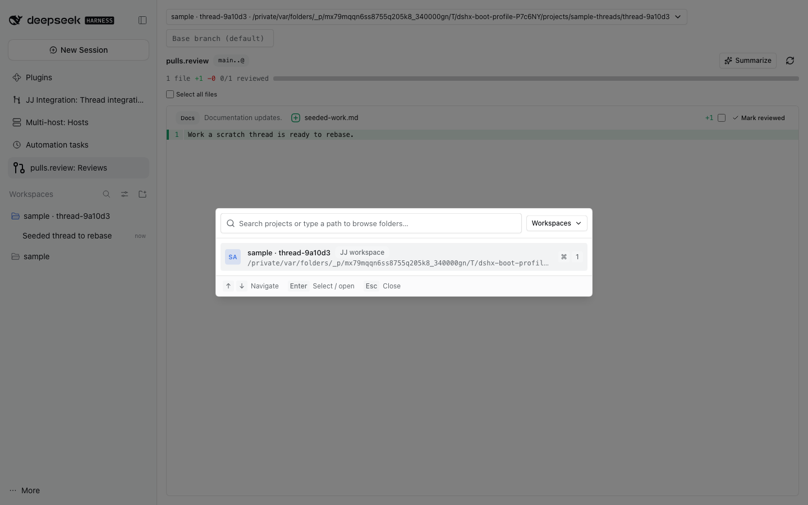

# pulls.review

Review a project's or workspace's changes the way [pulls.review](https://pulls.review) does:
all changed-file diffs in one vertically scrollable view, grouped by scope and
with per-file review progress — inside DSH.


The searchable project picker keeps existing thread workspaces in their own scope:



Open the reusable **pulls.review: Reviews** view from navigation or the Workbench chooser.

## What it does

Choose any registered project or existing JJ thread workspace from the
searchable project picker. Workspaces have their own scope instead of crowding
projects. You can also browse to a folder. If a selected workspace has
disappeared, choose another project or workspace without leaving the review.
Optionally enter a base bookmark (the Host otherwise chooses `main`, `master` or
`trunk`). Live workspaces are read as `jj diff --from <base> --to @`. Landed
threads also retain exact ranges of persistent JJ change IDs. When the panel's
current thread workspace has been removed, it automatically reads that thread's
saved integration history and shows the latest landed range from the owning
repository. Agents can use `jj_thread_review_history` to get the saved base/head
IDs and call `pulls_review` with `path` set to the repository root plus
`fromChangeId` and `toChangeId`. The Host reads that patch and groups it with
[`@pulls.review/core`](https://github.com/antfu/pulls.review)'s deterministic
rule-based adapter (MIT): no model call, no GitHub token, and the same rules the
site uses, so a scope reads `Code` / `Tests` / `Docs` / `Config` /
`Dependencies` / `Generated` / `Other` here exactly as it does there.

The panel shows the range and totals, then every changed-file diff in one
scrollable view. Each diff header carries its scope and summary, and a per-file
action marks that file reviewed. The review-wide selector can batch-mark files
across scopes. Review marks are kept on the Host through dshx plugin storage
(`hostStorage(api).store`), so every browser of that DSH shows the same marks; marks
an earlier version kept in this browser's localStorage move there once. They are keyed by
workspace, base and working-copy revision, so a new revision — or a base that
moved under the same `@` — starts fresh; the record keeps the 20 most recently
touched scopes.

**Summarize** replaces the deterministic scope text with one model call over the
whole diff, using the provider the thread last requested with and the first model
that provider offers. The route is resolved from the thread's session log, so no
key is typed twice, and the call borrows that session id because providers keyed
per session (OpenCode Go) reject a call without it. The model answers with one
`scope: sentence` line per scope; anything unusable leaves the deterministic
summaries in place and says why.

## In a thread

`/pulls` prints the same grouping as text, without opening the panel:

```
pulls.review · main..@ · 3 files · +42 −7
Code (2) · +40 −7 · Source changes.
  - plugins/app/src/host.ts (+38 −6)
  - plugins/app/src/api.ts (+2 −1)
Docs (1) · +2 −0 · Documentation updates.
  - README.md (+2 −0)
```

Agents get the same through the `pulls_review` tool (`path`, optional `base`),
so an agent can inspect a workspace's change shape before reading it. For a removed workspace, first read its exact landed range with `jj_thread_review_history`, then pass `path`, `fromChangeId` and `toChangeId` to `pulls_review`. Older records without a saved base cannot be reconstructed safely.

## Why the rules rather than the site

The site is a GitHub-PR product, and the `pulls.review` CLI needs a git
checkout. A DSH thread workspace is a jj workspace with no `.git`, and the
CLI's dev server gates its browser behind a one-time pairing code, so embedding
it would depend on another project's dev-server internals. Reusing the core
package gets the real grouping without that coupling. See
[the plan](../../../plans/pulls-review/README.md) for the measured evidence.

## Host API

`pullsReviewApi.review({ path, base?, fromChangeId?, toChangeId? })` returns one of:

- `{ status: 'ok', path, base, head, range, patch, truncated, fileCount, additions, deletions, files, scopes }`
  — `base` defaults to the first of `main`, `master`, `trunk` that resolves. Exact reviews require both persistent change IDs and use the owning repository root as `path`; the Host verifies both revisions resolve before reading their diff.
  `truncated` says the patch hit the 1.2 M-character cap **or** that the file
  lists were clipped to 4000 entries; totals stay exact either way.
- `{ status: 'failed', path, reason, message }` with `reason` one of
  `workspace-missing`, `not-a-repository`, `no-base`, `jj-missing`, `jj-failed`.

`pullsReviewApi.summarize({ path, base?, sessionId?, provider?, model? })` reads
the workspace again and returns `{ status: 'ok', route, summaries }` — one entry
per scope key, an answer missing a scope is still a success — or
`{ status: 'failed', reason, message }` with `reason` one of `no-route`,
`llm-unavailable`, `llm-failed`, `unparsed`, `review-failed` (the read failed)
or `no-changes`.

`jj` runs with explicit argv, a bounded output, a timeout and the caller's
signal; its stderr is read only to classify a failure and never leaves the Host.
The model call goes through the Host's `llm` service with `purpose: 'compaction'`,
the thread's session id and the caller's signal, so it is cancellable and never a
second key path.
