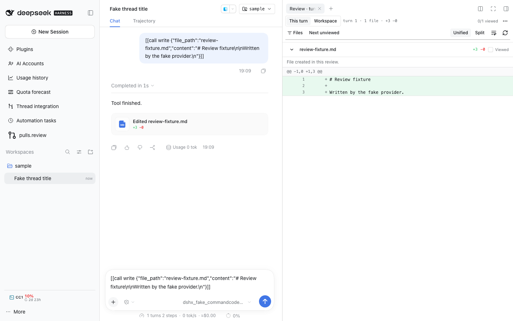

# pulls.review



Review changes the way [pulls.review](https://pulls.review) and GitHub do: every
changed file in one scroll, grouped into scopes, with lazy comparisons, a
searchable file rail, viewed progress and line comments — inside DSH, for a
turn's snapshot and for the thread's own jj workspace.

## Two sources, one surface

- **This turn** — the snapshot the changed-files card lists
  (`/api/changes.summary` + `/api/changes.diff`). This is what the card's
  "Preview in sidebar" opens.
- **Workspace** — the thread's live `jj diff --from <base> --to @`, grouped by
  [`@pulls.review/core`](https://github.com/antfu/pulls.review)'s deterministic
  rules (MIT): no model call, no GitHub token, the same `Code` / `Tests` / `Docs`
  / `Config` / `Dependencies` / `Generated` / `Other` scopes the site uses.

A turn review is immutable: its identity is the Session and the announcing
sequence, so a later turn starts a new review. A workspace review is keyed by
workspace path, base bookmark and head revision, so a new revision starts fresh.

## The review tab

The plugin writes the `changes-review` tab kind itself, at the sidebar-right
registry's `extension` band, so a changed-files card row or a prose file link
opens this all-files review instead of the native one-file tab. The native tab is
one setting away (`classicReviewTab`), and the builtin resumes the moment the
setting changes because the extension registration goes away.

The surface shows:

- **A stacked review**: each file mounts its comparison only when it comes near
  the viewport, so a large change set stays scrollable. A comparison the Host
  refuses (binary, oversized, missing) renders one line instead of an empty diff.
- **A file rail** with search, scope groups, per-file `+/-` stats, comment counts
  and a viewed checkbox. Below 42 rem of pane width it becomes a `Files` toggle
  with an overlay, because the right Sidebar is often narrower than the rail.
- **Viewed progress**: a file's header and rail row mark it viewed; the header
  menu marks every file, clears them, or jumps to the next unviewed file. Turn
  progress is the Host's durable `diff-viewed` record, so the native tab and this
  surface always agree. Auto-mark on scroll is on by default and configurable: a
  file is marked once its header leaves the review viewport, and scrolling back
  never unviews it.
- **Unified/split and wrap** choices, kept per browser.
- **Scope summaries**: `Summarize scopes` replaces the deterministic scope text
  with one model call over the whole diff, using the provider the thread last
  requested with and the first model that provider offers. The route is resolved
  from the thread's session log, so no key is typed twice; the call borrows that
  session id because providers keyed per session (OpenCode Go) reject a call
  without it. Anything unusable leaves the deterministic summaries in place.
- **Inline comments**: hover a changed line, anchor a thread, reply, resolve or
  reopen it, and delete it behind a confirmation. Threads live in Host storage
  keyed by the review identity, so the Agent reads and writes the same threads
  through its tools.

The same surface is the plugin's main-area page (`pulls.review` in the sidebar
rail); the tab's menu opens it on the same review with `Open full page`.

## Settings (`dshfiles-pulls-review`)

| Key                | Default | Meaning                                                                                       |
| ------------------ | ------- | --------------------------------------------------------------------------------------------- |
| `autoMarkViewed`   | `true`  | Mark a changed file viewed once its header scrolls past the review viewport. Never unmarks.   |
| `classicReviewTab` | `false` | Open the native one-file review tab instead of this all-files review. Off restores this view. |

## In a thread

`/pulls` prints the same grouping as text, without opening the surface:

```
pulls.review · main..@ · 3 files · +42 −7
Code (2) · +40 −7 · Source changes.
  - plugins/app/src/host.ts (+38 −6)
  - plugins/app/src/api.ts (+2 −1)
Docs (1) · +2 −0 · Documentation updates.
  - README.md (+2 −0)
```

Agents get the same through the `pulls_review` tool (`path`, optional `base`), so
an agent can inspect a workspace's change shape before reading it.

## Why the rules rather than the site

The site is a GitHub-PR product, and the `pulls.review` CLI needs a git
checkout. A DSH thread workspace is a jj workspace with no `.git`, and the
CLI's dev server gates its browser behind a one-time pairing code, so embedding
it would depend on another project's dev-server internals. Reusing the core
package gets the real grouping without that coupling. See
[the plan](../../../plans/pulls-review/README.md) for the measured evidence and
[the changes-review plan](../../../plans/changes-review/README.md) for this
surface.

## Host API

`pullsReviewApi.review({ path, base? })` returns one of:

- `{ status: 'ok', path, base, head, range, patch, truncated, fileCount, additions, deletions, files, scopes }`
  — `base` defaults to the first of `main`, `master`, `trunk` that resolves.
  `truncated` says the patch hit the 1.2 M-character cap **or** that the file
  lists were clipped to 4000 entries; totals stay exact either way.
- `{ status: 'failed', path, reason, message }` with `reason` one of
  `workspace-missing`, `not-a-repository`, `no-base`, `jj-missing`, `jj-failed`.

`pullsReviewApi.summarize({ path, base?, sessionId?, provider?, model? })` reads
the workspace again and returns `{ status: 'ok', route, summaries }` — one entry
per scope key, an answer missing a scope is still a success — or
`{ status: 'failed', reason, message }` with `reason` one of `no-route`,
`llm-unavailable`, `llm-failed`, `unparsed`, `review-failed` (the read failed)
or `no-changes`.

`reviewCommentsApi` owns the comment threads in the `changes_review` storage
domain:

- `list({ source })` — the threads anchored to one review, oldest first.
- `create({ source, path, anchor, body })`, `reply({ id, body })`,
  `setResolved({ id, resolved })`, `delete({ id, confirm: true })`.
- `source` is `{ kind: 'turn', sessionId, seq }` or
  `{ kind: 'workspace', path, base, head }`; `anchor` is
  `{ side: 'old' | 'new', line }`. A thread written from a tool is attributed to
  that Agent, one written from the browser to the user.

Every method is also an agent tool: `review_comments` (read), and
`review_comment_create`, `review_comment_reply`, `review_comment_resolve`,
`review_comment_delete` (write; they run only when the user asked, and delete
needs `confirm: true`).

`jj` runs with explicit argv, a bounded output, a timeout and the caller's
signal; its stderr is read only to classify a failure and never leaves the Host.
The model call goes through the Host's `llm` service with `purpose: 'compaction'`,
the thread's session id and the caller's signal, so it is cancellable and never a
second key path.

## Viewed marks

The turn's viewed marks are owned by
[`@dshfiles/diff-viewed`](../diff-viewed/README.md): the review surface imports
its `@dshfiles/diff-viewed/marks-api` contract and calls `mark` (idempotent, so a
scroll handler can repeat it) instead of flipping a checkbox. A workspace review
keeps its marks in the plugin's local record, keyed by workspace, base and head.
