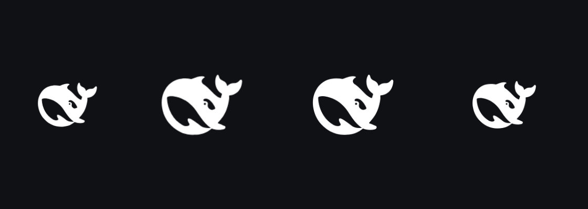

# PWA install metadata



Install the harness on a phone and it opens as an app: its own icon, no URL bar, a
status bar that matches the dark UI, and a black splash instead of a white flash.
Every tag comes from the Host's own Web server, so the Tailscale tunnel, the LAN
listener and the desktop URL serve the same thing.

## What it adds

1. `GET /manifest.webmanifest` — the manifest the shell already links, with PNG
   icons (`/pwa/icon-192.png`, `/pwa/icon-512.png`, `/pwa/icon-maskable-512.png`)
   and `background_color` for the splash.
2. `GET /pwa/apple-touch-icon-180.png` — the icon iOS puts on the Home Screen.
3. Five head tags on the served index: `apple-touch-icon`, `mobile-web-app-capable`,
   `apple-mobile-web-app-capable`, `apple-mobile-web-app-title` and
   `apple-mobile-web-app-status-bar-style=black`.

The artwork is rasterized from `assets/mark.svg` (the shell's own dark favicon)
into `src/icons.generated.ts` by `scripts/generate-icons.mjs`, so the Host bundle
carries its icons and reads nothing at run time.

## What it deliberately does not do

1. No service worker, so no offline cache. Chrome dropped the
   service-worker-with-a-fetch-handler requirement for installation in 108; a cache
   in front of a live agent client would only risk serving stale code after a rebuild.
2. No `theme_color` in the manifest or a `meta[name="theme-color"]` of its own:
   `frame-layout` already owns one metadata node and rewrites it from the resolved
   theme, so a static value here would fight the live one.
3. No viewport or safe-area change. With the `black` status-bar style iOS keeps the
   content below the bar, so no `viewport-fit=cover` or inset padding is needed, and
   the page layout and every component's styling stay exactly as they are.

## Measured

`node scripts/pwa-probe.mjs` (Chromium over CDP: `Page.getInstallabilityErrors`,
`Page.getAppManifest`, the served head, and every manifest icon's decoded size).
"Before" is the shipped shell, "after" the same app with this bundle loaded.

| Signal                         | Before                                 | After                                  |
| ------------------------------ | -------------------------------------- | -------------------------------------- |
| Chromium installability        | 0 errors (already installable)         | 0 errors (no regression)               |
| Manifest icons                 | 1 SVG, `sizes: any`                    | 3 PNGs, decoded 192, 512, 512 maskable |
| `background_color`             | absent                                 | `#0f1115` (no white splash flash)      |
| `id`                           | absent                                 | `/`                                    |
| `apple-touch-icon`             | absent — iOS uses a page screenshot    | 180×180 PNG                            |
| `apple-mobile-web-app-capable` | absent — iOS launches with the URL bar | `yes` — standalone                     |
| Status-bar style / label       | absent / `<title>`                     | `black` / `DSH`                        |
| 390 px screenshot              | renders                                | renders unchanged                      |

So the win is iOS app mode, the Home Screen icon and the splash: Chrome on Android
could already install the shell (it accepts the SVG icon), it just had no raster
icon or splash colour.

## Configuration

```yaml
- id: dshfiles-pwa
  config:
    title: DeepSeek Harness # manifest name
    shortName: DSH # Home Screen label
    backgroundColor: '#0f1115' # splash behind the icon
```

## Verify

```sh
pnpm --dir plugins/@dshfiles/pwa typecheck && pnpm --dir plugins/@dshfiles/pwa test
dshx dev up --plugin @dshfiles/pwa --skip-build --name pwa
node scripts/pwa-probe.mjs --name pwa --label after   # installability, head, icon sizes
dshx dev doctor --name pwa && dshx dev down --name pwa
```

Unverified: the iOS side (icon, standalone launch, status bar) needs a real iPhone
Home Screen install; the tags are what Apple documents, not something this
repository can drive headlessly.

## Provenance

`assets/mark.svg` is the dark favicon shipped by `@deepseek-ai/dsh-web-frontend`
(MIT), copied here so icon generation does not depend on the installed core.
