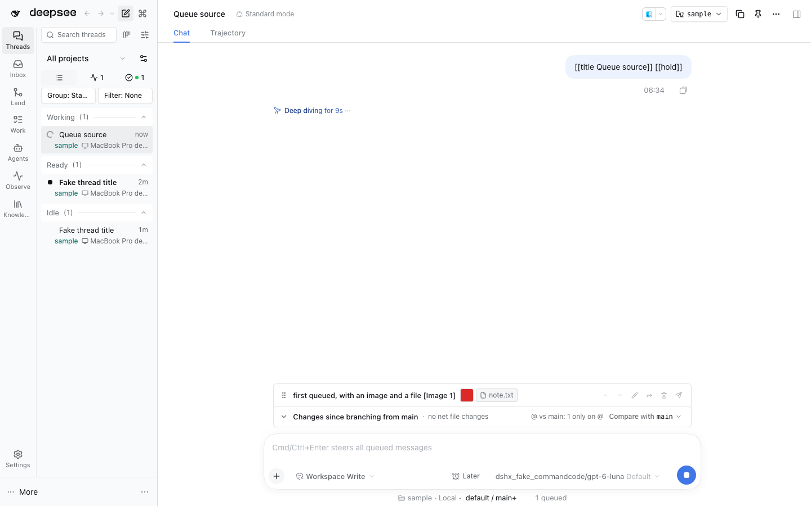
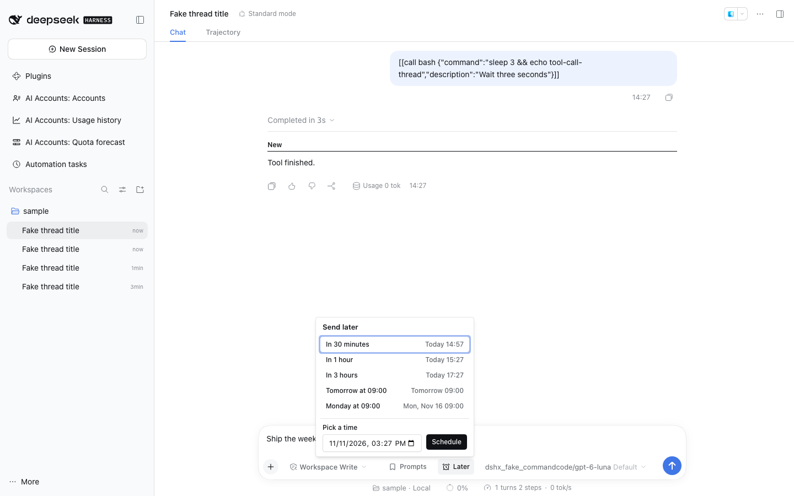

# @dshfiles/queue-reorder

Adds drag-to-reorder for queued DSH messages using the Host's move API. This preserves the queued item; it does not remove and resend it.

The separate queued-message editor is a client workflow: it removes the item, hydrates its contents into the composer, then resubmits on save. Cancel reconstructs the original message and restores its prior queue position. Editing rebuilds the reference chips the message was sent with (`[Image 1]`, `b:<ref>`, `@{handle}`, a file or thread mention) by asking each trigger source's restore grammar, so the composer shows the chips again instead of their serialized text. Escape cancels, and a finishing turn cannot run the message while it is out for editing. File attachments are read back through this bundle's Host `readFile` method, so a DSH started before that method existed edits text and image messages only until it is restarted. It is not an atomic Host edit, and does not promise to preserve message identity or attachment metadata across save. The proposed Host-level attachment-preserving edit remains a [Host gap](../../../plans/dsh-host-gaps.md).

**Move to thread…** sends one queued message, with its images and files, to another thread picked from a thread list. A busy target gets it at the end of its queue; an idle target gets it in its composer, appended to any draft there, and that thread opens, so nothing runs that the person did not send. The message leaves this queue before it is delivered, so a finishing turn cannot run it here mid-move; if delivery fails it goes back to the end of this queue, and if even that fails the dock shows its text. Like editing, it re-uploads the attachments into the target thread rather than moving them by reference.

Each queued row previews its attachments: a small thumbnail per image, read from the session that holds it, and a chip with the name per other file. The `attachmentPreviews` setting (default on) turns them off.

## Send later

**Send later** (the alarm-clock button beside Send) schedules the composer's message: **In 30 minutes**, **In 1 hour**, **In 3 hours**, **Tomorrow at 09:00**, **Monday at 09:00**, or **Pick a time**. The composer empties and the message waits in **Scheduled messages** above it with its time. Each row can be edited (text, time, and the model and effort the thread switches to just before sending), sent now, or cancelled; Cancel puts the text back in the composer. Attachments cannot be scheduled.

The Host owns scheduled messages in this plugin's storage, so they survive a restart and go out from the Host whether or not a browser is open. Delivery goes through the session controller's `sessions.prompt` with a request id fixed when the message was scheduled: the claim (`sending`) is committed first, and a Host that stops mid-send delivers again under the same id, which the thread ignores when it already holds that message. A model switch uses the guarded thread-model selection; while the thread still has queued input it waits and retries every 30 seconds. A thread that cannot be reached is retried five times, then the row shows **Not sent** with the reason until it is edited or cancelled. A scheduled message runs as if the user sent it at that time: a running thread queues it.

The agent has the same verbs: `scheduled_send_list` (read-only), `scheduled_send_create`, `scheduled_send_update`, `scheduled_send_cancel` and `scheduled_send_now`, each write only when the user asked. `sendLater` (default on) hides the button and the dock; scheduled messages still go out while it is off. The Host half needs a DSH restart after an update.

This is an owned DSH bundle. Run `pnpm build`, `pnpm test`, and `pnpm typecheck` from this package.
