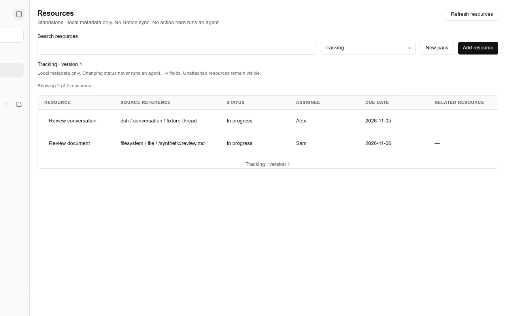

# @dshfiles/resource-packs



Optional **Resources** page: attach reusable, typed property packs to conversations, files or other resource references. A resource is not required to be a task. The existing Backlog and native stores are unchanged.

The reusable page is **Resource Packs: Resources** in navigation and the Workbench chooser.

## First local milestone

- Register a reference with `provider`, `kind`, opaque native `id` and a display label. Repeating the same reference returns the existing local record without resetting it.
- Use the built-in **Tracking** pack or create a pack in the GUI. Property and choice IDs are stable; labels are not identities. The GUI builder allows up to 12 fields and 20 options per choice field.
- Select a pack to choose the table's columns, then attach it to any resource. Resources without the selected pack remain visible so they can be attached.
- Edit text, number, checkbox, date-only, date/time, select, multiselect and single/multiple resource-reference properties. An empty value is stored as `null`.
- Save explicitly. The Host validates values and checks the resource revision; an outdated editor fails visibly rather than overwriting someone else's changes.
- Confirm **Detach** to hide a pack. Reattaching restores the retained values. There is no hard-delete operation in this milestone.

**Local only:** these properties are not synchronized with Notion. Changing a property never starts an agent, performs a check, merges code, or changes native file/conversation content.

## What a reference means

The triple `(provider, kind, id)` identifies a resource within this DSH home's metadata store. IDs preserve case and punctuation. For example:

```json
{ "provider": "filesystem", "kind": "file", "id": "/project/README.md" }
```

A file reference denotes a current path. It does not follow renames, resolve symlinks, grant filesystem access, or identify an immutable Git version. Version-pinned reviews and cross-runtime references require later adapters. Registering a reference never opens or reads the path.

Conversation reference values are clickable in the table, including readonly values. Navigation uses a known, available local Session through native DSH navigation, not a tokenized URL. Missing or archived resources remain readable references; they are not created or restored implicitly. References to other kinds use a plain readable fallback.

## Extension contract

The public modules are `@dshfiles/resource-packs/api` and `@dshfiles/resource-packs/model`. They are declared in `dshx.config.ts` and built as JavaScript entries; consumers never import runtime TypeScript source.

An installed Host contributor can register a declarative pack using the same validated API:

```ts
import { createHostApiClient } from '@dshfiles/dshx/host'
import { resourcePacksApi } from '@dshfiles/resource-packs/api'

const resources = createHostApiClient(ctx, resourcePacksApi, '@example/review')
await resources.registerPack({
  definition: {
    id: 'example.review',
    version: 1,
    label: 'Review',
    description: 'Review metadata, not a command to execute.',
    properties: [
      {
        id: 'reviewer',
        label: 'Reviewer',
        type: 'text',
        description: '',
        readOnly: false,
      },
    ],
  },
})
```

The Host gets the caller's package identity from dshx, not from a request-supplied owner field. GUI and agent registrations belong to `user`; plugins may update only their own definitions. The built-in Tracking definition belongs to this plugin.

A `readOnly` property is a stored value writable only by its contributing owner plugin, not a callback that evaluates arbitrary JavaScript. All properties currently use built-in renderers/editors. Computed properties and custom renderer registration are not implemented.

Removing a contributor does not delete its definitions or values. Persisted definitions are decoded independently and rendered using the built-in types. An absent owner stops producing new values; there is no promise of continued computation.

### Schema evolution

Registering exactly the same version and definition is idempotent. A higher version may add nullable properties and select options, or change display labels/descriptions. Removing a field/option, changing a type or changing write ownership is refused with a migration-required error. No conversion silently picks one value from a multiselect.

This is a data/API convention for trusted installed plugins, not a security sandbox against a malicious Node plugin.

## Shared GUI / plugin / agent methods

| Tool                               | Behavior                                                     |
| ---------------------------------- | ------------------------------------------------------------ |
| `resource_packs_catalog`           | Read persisted pack definitions and owners                   |
| `resource_packs_list`              | Search/filter bounded local resource metadata                |
| `resource_packs_get`               | Read one resource and recent metadata audit events           |
| `resource_packs_register_pack`     | Register a user pack or compatible owned version             |
| `resource_packs_register_resource` | Register/idempotently retrieve a resource reference          |
| `resource_packs_attach`            | Attach/recover a retained pack attachment                    |
| `resource_packs_set_values`        | Validate and update only named properties                    |
| `resource_packs_detach`            | Confirmed, reversible detach; retained values are not purged |

Mutations require the user's request or the calling thread's explicitly authorized work. `attach`, `setValues` and `detach` require `expectedRevision`. Detach additionally requires `confirm: true` with no default.

## Persistence and trust boundaries

The Host stores local pack definitions, resource metadata and audit events in `$DSH_HOME/plugins/resource-packs/resources.db`, using prepared SQLite statements and transactional resource revision/audit writes. Closing/reopening the plugin retains the database. Native file contents and conversation history are not copied into it.

This milestone is a single-owner local metadata surface. A reference is **not** an access grant to the native object. It does not add per-resource sharing ACLs or publish data externally. Stored labels/properties can still be sensitive; protect the DSH home and exports accordingly. Data validation and disabled UI controls are not substitutes for Host authorization.

## Verification

Unit/Host tests cover value types, pack ownership, compatible schema evolution, stale-write refusal, retained detach/reattach values, SQLite reopen and a separate Host contributor using the public contract. Browser journeys are in `tooling/dshx/e2e/features/resource-packs.feature` and use synthetic references, no private files or model provider.

```sh
pnpm --dir plugins/@dshfiles/resource-packs test
pnpm --dir plugins/@dshfiles/resource-packs typecheck
pnpm --dir plugins/@dshfiles/resource-packs build
pnpm check:e2e resource-packs
```

Scratch runs must use the installed stock core through `DSHX_DSH_EXECUTABLE`, not a personal launcher that resets `DSH_HOME`. Build `@dshfiles/ui-styles` after class changes. Do not restart the live Host to verify this optional plugin.

Focused results, browser coverage and known baseline failures are recorded in [Verification](docs/verification.md).

## Next boundaries

Notion OAuth/schema discovery and explicit mappings; durable outbox/conflict handling; richer entity resolvers; immutable file references; saved views and advanced filters; and separately authorized automations are later milestones. They are not simulated in this UI.

Design references: Coda/Superhuman Packs (stable property identities and separate display/sync contracts), Teable (field option/value separation), and the installed TanStack v9 examples. No third-party product runtime or source was vendored for this milestone.
