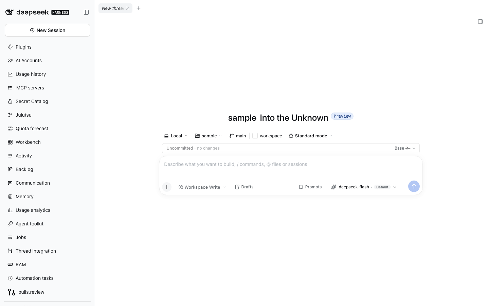

# @dshfiles/rich-composer




Owned fork of DSH's native Conversation client plugin. It preserves the full native shell, services, Slots and composer, while recognizing canonical session-reference wire text on paste and inserting it as a structured reference chip. Plain text is preferred; when only HTML is available, session-link anchors are converted to canonical mention text and other markup is reduced to safe text.

## Conversation header in Workbench

The original Header/SessionHeader and every contributed action render inside each fixed conversation's existing SessionProvider through the public Workbench conversation-header Factory contract. Rich Composer is its sole implementation and the sole declarer of the native header child. Native MainPanel calls the same Factory; Workbench no longer forces the Chat view, so the native per-session view store drives the existing body without replacing its editor. The Workbench-only host-corner clearance keeps tab-row recovery off the toolbar; native callers retain the original bare header. [Ownership and browser proof](../workbench/docs/conversation-header.md).

## Upstream and license

- Upstream: [`deepseek-ai/deepseek-harness`](https://github.com/deepseek-ai/deepseek-harness)
- Package: `@deepseek-ai/dsh-client-ui-conversation@0.2.1-rc.2` (MIT)
- Client source: `packages/client/ui-conversation/src/client`
- Shared settings source: `packages/client/ui-conversation/src/submission-settings.ts`
- Pinned revision: [`687f282e8625c6b8d11ff58211a90524be2e4317`](https://github.com/deepseek-ai/deepseek-harness/commit/687f282e8625c6b8d11ff58211a90524be2e4317), tag `dsh-v0.2.1-rc.2`
- Previous pin: `c1b47e41fcd54d20a0f061df28683bfc29ee24e5` (`0.2.0-rc.2`); the 0.2.1 update was a three-way merge (`git merge-file`, base `dsh-v0.2.0-rc.2`) of the upstream delta onto this fork
- The complete client source is vendored in [`src/native`](./src/native) (upstream `src/client`) plus [`src/submission-settings.ts`](./src/submission-settings.ts) (upstream `src/submission-settings.ts`), keeping the upstream relative layout.

### Local delta

Every other vendored file is byte-identical to the pinned revision, so an upstream update starts from a real `diff`. The whole delta is:

| File                                                  | Change                                                                                                                                                                                                                                                                                                                                                                        |
| ----------------------------------------------------- | ----------------------------------------------------------------------------------------------------------------------------------------------------------------------------------------------------------------------------------------------------------------------------------------------------------------------------------------------------------------------------- |
| `src/native/contract/slots.ts`                        | `ComposerBarInjected` gains `insertReference` and `promptHistory`; `ConversationSessionHeaderInjected` gains `rename`; native MainPanel uses the public header Factory instead of claiming a header child                                                                                                                                                                     |
| `src/native/apply.ts`                                 | injects those actions (`promptHistory` reads the Session event window); workspace switch hands the draft over through `transferComposerDraft` without ever blocking navigation; renames through `remote.session.rename`; registers Workbench view sources, the owned view-only wrapper and the sole reusable header Factory; the main entry no longer claims the header child |
| `src/native/locales.ts`                               | `workspace.draftTransferRefused` notice when a handoff keeps the draft in the previous thread; title-edit labels and failure copy; large-paste notice copy                                                                                                                                                                                                                    |
| `src/native/skeleton/InputBar.tsx`                    | paste converts canonical mentions into reference chips, falling back to text; a paste of 32 KiB or more attaches as a text file with a Paste as text notice; recalled prompts replace the draft                                                                                                                                                                               |
| `src/native/input/editor/keymap.ts`                   | reads `text/html` when the clipboard has no plain text; bare ArrowUp/ArrowDown ask for prompt recall and Escape ends it                                                                                                                                                                                                                                                       |
| `src/native/input/editor/view-binding.ts`             | routes the paste handler through the bar's live handler; owns the composer's prompt-recall position                                                                                                                                                                                                                                                                           |
| `src/native/input/editor/ComposerContentEditable.tsx` | DOM-root leases preserve the shell's editor/draft across legacy duplicate retirement; cleanup returns attachment and the editable gate to the last connected host, never detaching a newer owner.                                                                                                                                                                             |
| `src/native/input/editor/runtime.ts`                  | logs the Lexical error stack before rethrowing; reuses the content half of the projection while no commit dirtied the document (selection-only commits skip the walk)                                                                                                                                                                                                         |
| `src/native/input/editor/projection.ts`               | splits `$projectComposer` into a content half (`$composerProjectionContent`) and a selection half (`$composerSelection`) so the reusable half can be recomputed independently                                                                                                                                                                                                 |
| `src/native/user-text/session-reference-rule.ts`      | imports and augments `../index.ts` instead of the package's own `/client` self-reference                                                                                                                                                                                                                                                                                      |
| `src/native/conversation/location-index.ts`           | `import type` instead of inline `type` specifiers, so the bundle no longer requires the stock Session client module, which the browser does not serve once `@dshfiles/session-controller` replaces that row                                                                                                                                                                   |
| `src/native/input/hub.ts`                             | publishes semantic draft changes to `sessionDrafts` before first-edit warmup; only content creates a local New chat on the Host, using existing composer text persistence                                                                                                                                                                                                     |
| `src/session-draft-tracking.ts`                       | new: observes text/attachment changes, ignores caret-only updates, and forwards restored content to the draft identity owner                                                                                                                                                                                                                                                  |
| `src/native/skeleton/ConversationMainPanel.tsx`       | Calls the reusable owned header Factory; its original authorized header child is declared once by that Factory rather than by this main entry.                                                                                                                                                                                                                                |
| `src/native/skeleton/ConversationContent.tsx`         | reads the local draft's project before Host workspace attachment, so a blank new chat has an enabled composer and the correct project chip                                                                                                                                                                                                                                    |
| `src/native/skeleton/ConversationSession.tsx`         | the current Session title is a click-to-edit input; Enter or blur renames through the injected `rename`, Escape cancels                                                                                                                                                                                                                                                       |
| `src/native/skeleton/InputBar.module.css`             | the large-paste notice row and its Paste as text button                                                                                                                                                                                                                                                                                                                       |
| `src/native/skeleton/ConversationRoot.module.css`     | styles for that in-place title editor and its failure message                                                                                                                                                                                                                                                                                                                 |
| `src/composer-draft-handoff.ts`                       | new: rollback-safe, non-blocking draft handoff carrying the semantic `DraftSnapshot`                                                                                                                                                                                                                                                                                          |
| `src/prompt-recall.ts`                                | new: reads human prompts from the event window and keeps one composer's recall position                                                                                                                                                                                                                                                                                       |
| `src/large-paste.ts`                                  | new: the 32 KiB threshold and the `pasted-<time>.txt` file                                                                                                                                                                                                                                                                                                                    |
| `src/paste-references.ts`                             | new: canonical wire-text parser and reference builder                                                                                                                                                                                                                                                                                                                         |
| `src/clipboard-text.ts`                               | new: markup-free clipboard text and `dsh-session:` link conversion                                                                                                                                                                                                                                                                                                            |
| `src/composer-controls-settings.ts`, `src/host.ts`    | new: Host settings namespace `dshfiles-rich-composer` (`hidePermissionSelector`)                                                                                                                                                                                                                                                                                              |
| `src/agent-warmup.ts`, `src/agent-warmup-api.ts`      | new: `agent-warmup` Host API (`warm` resolves the Session's Agent through `sessionController`) and its first-edit client trigger                                                                                                                                                                                                                                              |
| `src/client-entry.tsx`                                | shadows `conversation.input.permission` with an empty occupant while `hidePermissionSelector` is on                                                                                                                                                                                                                                                                           |

`src/native` is excluded from Oxlint, Oxfmt and ast-grep (see [native plugin overrides](../../../docs/native-plugin-overrides.md)); the files above that live outside it are linted normally.

The native `conversation.composer.bar` slot requires package-private injection state (`ComposerBarInjected`) to provide its keyboard, uploads, notices, hooks and session input actions. That callback is created inside the native plugin and is not exposed as a reusable public service. A separate slot occupant cannot safely rebuild those props, so this fork replaces the whole `ui-conversation` Loader row while retaining its complete shell and service implementation. The stock row is disabled in this package's patch; other DSH core packages remain unchanged. Its composer Slot still registers at priority 0, so the higher-priority remote-composer takeover at -100 keeps its existing behavior.

## Workbench Conversation views

In Workbench mode, **Add panel** offers each registered non-chat view for known threads (for example, **Trajectory — thread title**). Each mounted panel retains its own explicit Session and releases it when closed. Renaming only changes the label, not the component identity. A failed acquisition shows an error rather than borrowing the active thread.

The root assembly declares only its own session-scoped child. That child calls the public `conversation.content` Factory with a fixed-view local component. The original `conversation.session` still renders `conversation.view` with its genuine store, hooks and owner props. An owned context wrapper renders just the Factory's Views in these panels, with no hidden composer or bootstrap conversation. Sources exist before any conversation mounts, so restored layouts do not depend on a previously captured renderer. The normal native Conversation Factory is unchanged outside this explicit wrapper context.

## Paste behavior

The upstream editor handles clipboard `text/plain` as editable text. This fork parses canonical `@[label](dsh-session:<base64url>)` values in that text and inserts each through the native session-scoped reference action, preserving surrounding text and selection. Unsupported or invalid wire values remain ordinary text. HTML clipboard data is never inserted into the DOM; when plain text is absent, it is reduced to text and valid `dsh-session:` anchors are converted to the same canonical wire format.

## Prompt recall

ArrowUp in an empty composer shows this thread's previous prompt; ArrowUp again goes older, ArrowDown goes newer and past the newest returns to the empty draft, and Escape brings that draft back at once. A multi-line prompt keeps ArrowUp/ArrowDown for its own lines until the caret reaches its first or last line. Editing the recalled text ends recall. The prompts come from the thread's loaded event window (`user/message` events from a person, newest first, each text once), so nothing new is stored and prompts outside the loaded history are not offered.

## Large paste

A paste of 32 KiB or more of text becomes a `pasted-<date>-<time>.txt` file attachment through the same upload path as a picked file, instead of filling the draft. A notice above the composer offers **Paste as text**, which removes that attachment and inserts the text as an ordinary paste. Continuable subagent composers, which accept only images, keep the text inline.

## Composer contract

The fork provides dshx's `Composer` contract (`src/composer-service.ts`) over its per-session input shells, so other plugins read and edit the draft, add chips, pick the model and move focus without a slot of their own. Quote, note and line-comment chips are reference chips of the `composer-snippet` input-trigger source (`src/composer-snippets.ts`): the chip carries its content in `ref`, so a restored draft still sends it, and the model reads a quote as a Markdown block quote, a note inside `<note>` tags and a comment inside `<comment path lines>`. File chips use the native `reference` source the composer's file drop already uses. `setModel` goes through the `modelDirectories` service, the same path as the model picker.

## Composer settings

`hidePermissionSelector` (Plugins page, off by default) hides the permission mode selector. The seat is a single Slot, so an empty occupant at priority -1 shadows the native selector while the setting is on and is disposed when it turns off; the change applies live.

## Updating from DSH

When the installed DSH package changes:

1. Compare the entire upstream package (`src/client` and `src/submission-settings.ts`) at the exact new release commit against the pinned revision above; the table lists the only files that should differ.
2. Re-apply the local delta on top of the new upstream files rather than porting your own edits forward.
3. Recheck the Loader row identity, native service dependencies, slot props/priorities and plugin peer ranges against the installed release.
4. Update package pins, source revision and this document together; run typecheck, tests, build, import check, boot check, and the paste browser journey. Never overwrite the fork from upstream without reviewing its diff.

## Verify

```sh
pnpm --dir plugins/@dshfiles/rich-composer typecheck
pnpm --dir plugins/@dshfiles/rich-composer test
pnpm --dir plugins/@dshfiles/rich-composer build
```

The web profile seed includes this package. Its patch replaces the loaded native plugin, so only the user's restart of the live `web` profile can activate the change. Do not restart it from plugin work.
