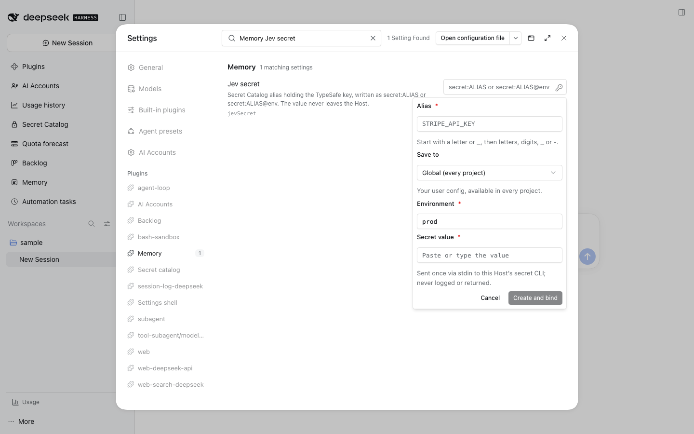
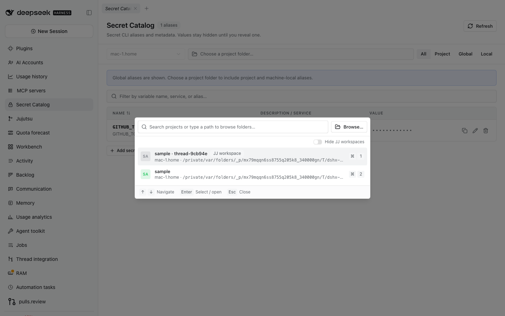
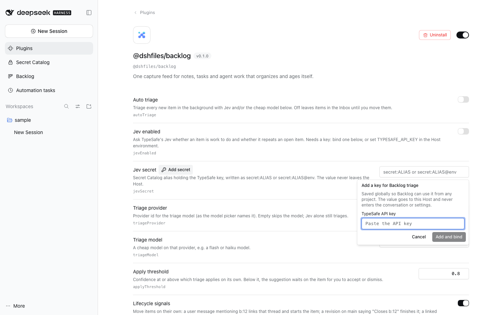
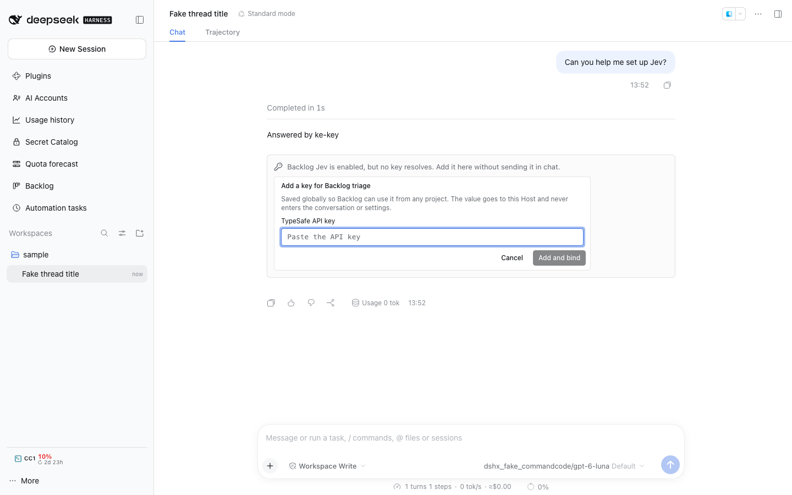

# Secret Catalog

Secret Catalog is a DSH 0.2 client/Host plugin backed by the installed
`secret` CLI contract. It uses `secret print --all --json` only when a project
folder is selected. Without one it calls `secret print global --json`, so the
Host process working directory cannot leak an unrelated project alias list.
The parser copies an explicit metadata allowlist (`alias`, `scope`, `env`,
`envKey`, `item`, and `field`, plus documented descriptive fields) and drops
unexpected properties such as `value` before data crosses to the Client.

The filter offers **All**, **Project**, **Global**, and **Local**. All includes
the three CLI scopes when a project folder is selected; without a folder the
Catalog shows global aliases and prompts for a folder to include project or
machine-local aliases. Selecting a folder retains its canonical path and,
when it is registered, its workspace id.

Open the reusable **Secret Catalog: Secrets** view from navigation or the Workbench chooser.

## Value actions and mutations

- Reveal calls the Host only when the exact row's masked value is clicked;
  hovering it says "Click to reveal". The revealed value is focused and stays in
  component state until the reveal timeout (15 seconds by default), Esc, a
  second click, focus leaving it or the window (when hide-on-blur is on),
  document hiding, a filter/scope/folder change, refresh, or unmount.
- Copy calls `secret get <alias> --copy` only after the exact row's Copy button
  is pressed, without revealing. The Host discards both output streams.
- **Add secret** under the list appends an editable row: an env-var style name
  (typed text is upper-cased, separators become `_`) and a masked value. The
  row menu offers Generate on this Host, Copy (the typed value) and Delete.
  Enter, or focus leaving the row, saves it to the viewed scope (the selected
  project under All, otherwise global) and the default environment. An empty
  draft asks for a value or Generate instead of saving: the Host refuses empty
  manual values and `secret set` documents no empty-value mode. The CLI has no
  bulk import command, so there is no Import entry.
- The arrow beside Add secret opens **Add with details…**: alias first, then
  where it lives (the selected project by default), environment (default
  `prod`), and where the value comes from. Generate asks the CLI to create the
  value on the Host; a typed value goes once to the Host and reaches the CLI on
  stdin. Item name, source, tags, type and field (`password`, or `notes` for a
  Secure Note) sit behind Advanced. Values never appear in arguments or
  captured output. Global uses the CLI's `--global`; project uses the selected
  working directory; local uses the selected folder's `.secret.local.json`
  through the CLI's `--config`. Both paths check metadata for an existing alias
  in the selected environment and refuse a duplicate before writing.
- The Backlog Jev setting's **Add secret** button opens a masked popover, creates
  or replaces the global `jev-api-key-optmem` alias, and binds only
  `secret:jev-api-key-optmem`. Backlog resolves this setting without a project
  folder, so a project-scoped alias will not work there. The value goes to the
  Host and secret CLI stdin, never the conversation or settings.
- When Jev is enabled, no key resolves, and Backlog has no configured reference,
  the newest completed chat turn offers Secret Catalog's compact masked setup
  flow inline. It suggests the global `TYPESAFE_API_KEY` alias; the value goes to
  the Secret Catalog Host and Backlog settings receive only the reference. A
  configured but unresolvable reference shows the reference repair card (below)
  instead of a duplicate-create form. The action does not enable Jev or
  auto-triage.

## Repairing a reference that does not resolve

`referenceStatus` (setup API; agent tool `secret_reference_status`, read-only)
checks one `secret:ALIAS[@env]` the way a consumer resolves it and returns a
typed state: `resolved`, `alias-missing` (with any project/local configs among
the registered workspaces that hold the alias, which a global-only setting
cannot read), `environment-missing` (with the environments that exist),
`ambiguous` (several scopes), `value-unreadable`, `value-empty`, `cli-missing`
(not on the Host's PATH), `cli-timeout` (usually a locked vault) or `cli-failed`.
It reads the value on the Host to prove resolution and never returns it. It also
reports when the global config is a symlink, because a global write then lands
in the linked file (for example a Nix-managed clone) and an atomic rewrite can
be moved aside by the tool that manages it.

The repair card renders that state wherever a reference is configured: in the
chat turn tail for Backlog's Jev key, and in the picker panel of every
`data-secret-input="reference"` field (Backlog and Memory Jev settings
included), which opens by itself once and marks its key button when the typed
reference does not resolve. It names the reference and the reason, and offers
only the fixes that reason allows: **Set value** (create the alias in the scope
the reference resolves from, or replace an empty/unreadable value, masked, on
the Host), **Pick another secret**, **Open in Secret Catalog** (filtered to the
alias) and **Re-check**. Any Catalog write refreshes it; once it resolves, the
card says so and disappears.

- If a manually entered alias already exists, setup offers to bind its unique
  existing record. Ambiguous duplicates still need to be resolved in the catalog.
- Edit supports item name, source, tags, and a two-step masked value
  replacement. Value replacement is passed through stdin with an explicit
  overwrite flag after user confirmation. The CLI's `edit --field` also
  requests a new field value, so field changes are not offered as a metadata
  only edit.
- Remove alias and delete Bitwarden item are separate choices, each followed
  by confirmation. The CLI's `unset` removes that alias across every
  environment in the owning config; the confirmation says so. The CLI's `rm`
  requires `--force` and may fall back to unsetting if the vault item is
  already missing.

Project value actions resolve through the selected folder's merged CLI view;
global and local reads and vault deletion pass their exact config files. If the
same alias and environment appears in more than one scope, value and mutation
actions are disabled because the CLI cannot target the merged row by scope
identity. Search and metadata display remain available.

No live aliases or values were read during implementation or tests. Fixtures
use synthetic metadata and a fake CLI runner only. The Catalog never logs CLI
stdout/stderr or mutation stdin. Reveal responses are held only in transient
component state.

The Host runs the fixed `secret` executable through DSH's managed subprocess
service. It passes only the optional `BW_SESSION` and `SECRET_SESSION_FILE`
inputs to the CLI wrapper, caps captured stdout at 1 MB, keeps stderr out of the
UI and logs, and terminates the managed process range when the 15-second
command deadline expires.

## Rename, agent tools, and settings

Edit can rename an alias inside its owning config with `secret mv`; it refuses
a name that already exists. The Host registers two agent tools bound to the
calling Session's workspace (`session.header.cwd`): `secret_list` returns
metadata only, and `secret_get` returns one plaintext value, so it should be
called only when the task needs it. Arrow keys, Home, and End move between
table rows; the table header stays visible while rows scroll.

The `secret-catalog` Settings namespace (DSH Settings page) sets the default
scope filter, the environment prefilled for new secrets, how long a revealed
value stays visible, whether blur/hidden pages hide it, and how long success
notices stay.

## AI Accounts credential import

When both plugins are active, AI Accounts can browse value-free Secret Catalog
metadata: global entries without a folder, and project/local entries only after
the user chooses a Host folder. The Host omits unknown scopes and ambiguous
alias/environment/scope rows. Import is an explicit action: it rechecks the
source metadata, verifies the target `*_API_KEY` reference is writable and
empty, reveals only on the Host, and writes directly to DSH credentials. No key
value crosses to the Client or enters the account JSON. Manual entry through
DSH's write-only credential controller remains available when Secret Catalog is
not installed.

## Machine and Host boundary

The machine control identifies the current DSH Host using its OS hostname and
is disabled. The secret CLI and installed DSH rc.2 contracts expose no remote
machine inventory or selector, so selecting another machine requires a Host
service that routes a CLI call to a chosen machine. Machine-local aliases can
be listed, edited, removed, and added for the current Host when a project
folder is selected.

## Reusable folder picker

The picker is the separate `@dshfiles/project-folder-picker` workspace
package. Secret Catalog supplies registered workspaces and adapts the DSH 0.2
Host ports: `ctx.remote.directoryPicker.pick(signal)`,
`list(path, signal)`, `createDirectory(path, name)`, and
`ctx.remote.workspace.create({ path })`. Selection keeps workspace identity
and the Host-canonical path explicit.

## Compatibility and composition

The peer ranges target `@deepseek-ai/dsh@0.2.0-rc.2`,
`@deepseek-ai/dsh-api-workspace-controller@0.2.0-rc.2`, and
`@deepseek-ai/dsh-subprocess@0.2.0-rc.2`; actual Host and Client imports use the
installed workspace-controller entry points. Host API registration injects
`connection`, `webServer`, and `subprocess`. The standard web base provides
`dsh-subprocess-local`; this bundle does not insert a second provider. This
package contributes its own sidebar and main slots; profile composition
remains a parent registration step.

## Secret references

Other plugins never hold a credential value. They hold a reference — `secret:ALIAS`
or `secret:ALIAS@ENV`, parsed by `@dshfiles/credential-port` — and resolve it on
the Host through the `secretCatalogValues` port this bundle provides. Resolution
looks up the one row matching alias and environment (a duplicate across scopes
is refused by name, never guessed) and reveals it through the same `secret get`
path the Copy action uses. The value reaches the requesting plugin only.

Browser-side, any text field carrying `data-secret-input="reference"` gets a key
button while focused: the `shell.overlay` picker lists the global aliases,
searches them, and writes the reference through the field's own value setter so a
controlled input's `onChange` sees it. `SecretInputBinding` in this package holds
the attribute names and the write helper for code that wants to name them. The
Settings form uses it for `Schema.string().role('secret-ref')` fields. The panel
opens below the field, flips above when that side has more room, and caps its
height to the room left, so it stays inside the viewport.

A focused reference field can also choose **Add a new secret**. That form masks
the value, sends it once to this Host and the `secret` CLI on stdin, and writes
only `secret:ALIAS` or `secret:ALIAS@env` through the field's normal input event.
Optional `data-secret-alias`, `data-secret-environment`, `data-secret-scope`,
and `data-secret-cwd` attributes provide suggestions; alias/environment/scope
still go through the Catalog's canonical validation and duplicate checks. If
storage succeeds but binding fails, the field keeps only the stored reference
for retry—never the value.

For a separate missing-credential offer (for example, in a chat turn tail),
import `SecretSetupOffer`, `SecretSetupRequirement`, and `SecretSetupBinding`
from `@dshfiles/secret-catalog/setup`. The consumer owns the Host-side missing
status and supplies labels and optional suggestions; `onBind` receives only the
requirement id and canonical reference. Render it inside a decorated client
slot with that plugin's `PluginQueryProvider`; the offer preflights non-secret
catalog metadata and stays hidden if the Catalog is unavailable. The offer is
opt-in and its form writes values through Secret Catalog without exposing them
to the consumer.
