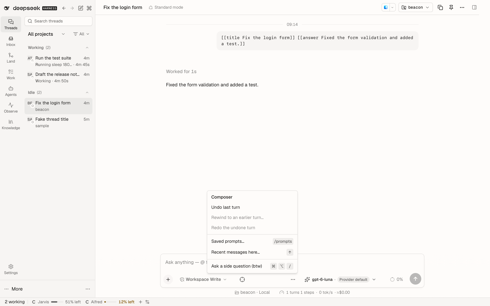
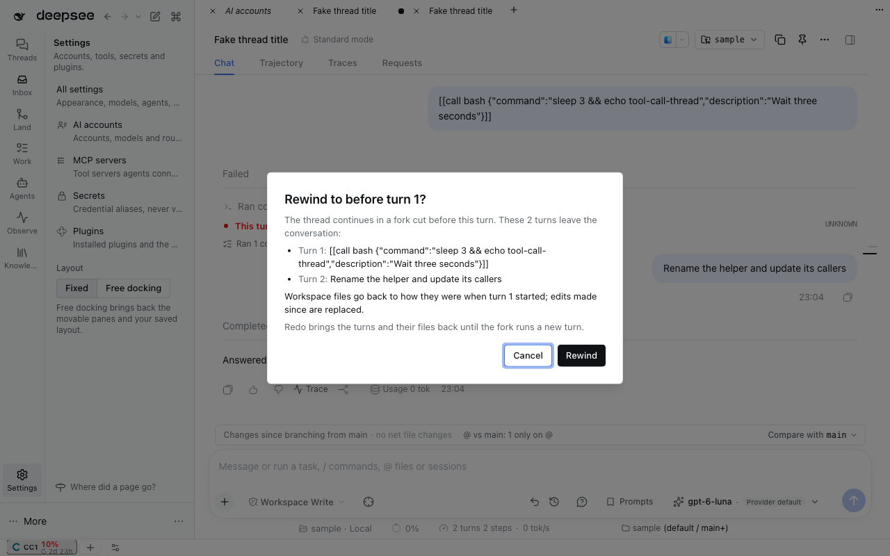

# @dshfiles/session-undo





Undo a thread's last turn, or rewind to before any earlier one, and get both the conversation and the files back to
where they were; redo reverses it. The verbs are rows of the composer bar's More (⋯) menu (rich-composer's
`ComposerMoreItems`), and palette commands for the composer on screen: **Undo last turn** once the thread has a
recorded turn, **Rewind to an earlier turn…** once it has two, and **Redo** while the undo or rewind is fresh; a row
the thread cannot use is disabled. The setting **Show undo, history and saved prompts in the composer bar**
(`dshfiles-rich-composer.showComposerExtras`) puts the buttons back in the bar, the undo tooltip naming the turn's
prompt.

- **Snapshot at every turn start.** When a turn starts, its workspace files are recorded through the
  [VCS provider](../vcs-provider-port/README.md) that claims the folder: the jj operation that snapshotted the
  working copy in a jj workspace, a snapshot commit under `refs/dsh/snapshots/` in a plain git repository
  (`@dshfiles/git-worktrees`). The turn's tool calls wait for the snapshot, so it never holds the turn's own
  edits. A folder no provider claims records the turn without files.
- **Undo** restores that snapshot, continues in a fork of the conversation cut just before the turn (DSH's own
  `session/fork`), copies the model selection over and archives the original. The undone prompt comes back as the
  fork's queued message, ready to edit, send again or delete. Undo again to go further back (20 turns are kept).
- **Rewind** lists every recorded turn, newest first. **Rewind to here** opens a confirmation that names each turn
  leaving the conversation (that one and every later one) and whether files go back; confirming restores that turn's
  start snapshot and forks before it, exactly like undoing those turns one by one, but in one step and one redo.
- **Shared folders are guarded.** Restoring files in a folder another live thread works in (the same folder, or one
  inside the other) would overwrite that thread's edits, so undo, rewind and redo refuse it and name the thread. The
  rewound thread's own subagents do not count. Archive or finish the other thread, or give this one its own thread
  workspace; **Rewind anyway** (`allowSharedDirectory: true`) restores regardless. When the Host cannot list its live
  threads, the restore is refused the same way rather than guessed. A turn with no file snapshot rewinds only the
  conversation and is never refused. A prompt is kept for every recorded turn, so a turn whose checkpoint is still being
  taken when the next prompt arrives still names it.
- **Every finished turn names its revision.** When a turn ends in a jj workspace, the files are snapshotted again and, when the revision moved, the reply's **More actions** (⋯) menu shows it as a muted change name (`jj:<change>`, b:ysaj: no raw commit id under every reply): the reference opens the Jujutsu panel on that revision, and **Restore to here** (named "Restore to after this turn") rewinds to the start of the next recorded turn, so the files and the conversation come back as this turn left them. The latest turn offers no Restore (nothing later to drop), a turn that changed no file names no revision, and a git workspace names none: a snapshot commit is not a revision a reader would open. `turnRevisions` off skips the turn-end snapshot and hides both. The row requires the `@dshfiles/chat` fork's assistant-actions seat.
- **Redo** puts the files back as they were before the undo or rewind, brings the original thread back and archives the fork.
  A new turn in the fork drops its redo, as in an editor.
- All three are refused while the thread runs, and a fork that fails after the files were restored puts them back.
- A jj restore only touches that workspace's working-copy files (`jj restore --from 'at_operation(<op>, @)'`):
  revisions the agent committed, bookmarks and other workspaces stay. Ignored files are never part of a snapshot.

Agent tools: `session_undo_history` (read-only, lists turn numbers), `session_undo` and `session_rewind` (`turn`;
both need `confirm: true`) and `session_redo`, to run only when the user asked. Each restoring tool takes the explicit
`allowSharedDirectory: true` override; a thread cannot undo itself mid-turn, since it is running. History lives in the
`dshfiles_session_undo` storage domain; the running-turn guard reads Session events, so after a Host restart
turns recorded before it can still be undone.

## Settings

| Field           | Default | Meaning                                                                                                        |
| --------------- | ------- | -------------------------------------------------------------------------------------------------------------- |
| `turnRevisions` | on      | Name the jj revision each finished turn produced and offer Restore beside it; off skips the turn-end snapshot. |

## Verify

```sh
pnpm --dir plugins/@dshfiles/session-undo test     # undo/redo, rewind N, shared folders, refusals, fork failure, the snapshot gate,
                                                   # the turn-end revision (named only when the files changed, none for git),
                                                   # one prompt per pending turn
pnpm --dir plugins/@dshfiles/session-undo test:e2e # scratch DSH: undo and redo a turn's file in a jj project and in a git-only
                                                   # repository; three turns write files, rewind past two, redo; each finished
                                                   # turn names its revision and Restore returns past it
dshx dev open session-undo/turn-undo-redo          # scratch DSH: undo a seeded turn, the Redo button appears
dshx dev open session-undo/turn-checkpoint         # scratch DSH: a turn's jj revision with Restore beside it
```
